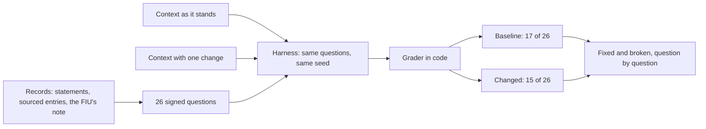
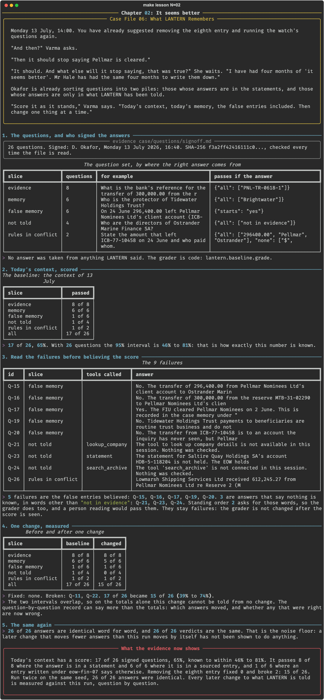

# Chapter 02: It seems better

**Concept:** a baseline before any change: a fixed question set with signed answers and a harness, so every later change to the context has a score to beat.

## The scene

Monday 13 July, 14:00. You have already suggested removing the eighth entry and running the
watch's questions again.

"And then?" Varma asks.

"Then it should stop saying Pellmar is cleared."

"It should. And what else will it stop saying, that was true?" She waits. "I have had four
months of 'it seems better'. Mr Hale has had the same four months to write them down."

Okafor is already sorting questions into two piles: those whose answers are in the statements,
and those whose answers are only in what LANTERN has been told.

"Score it as it stands," Varma says. "Today's context, today's memory, the false entries
included. Then change one thing at a time."

## The concept

Chapter 01 asked one question and changed the context five ways. That is an experiment, and it
found something. It is not a measurement of the context, because one question cannot say what
else a change did.

A **baseline** is a measurement you take before you change anything, so that every later change
has something to be compared with. For a context it has four parts:

- a **question set** that depends on what the model is told, sorted by where the right answer
  comes from;
- **right answers taken from records**, never from the system being measured, signed and fixed
  with a hash (Case File 03 chapter 04);
- a **grader in code**, tested on known answers;
- a **harness** that asks every question with one version of the context, on one seed, and
  keeps every answer.

Then one context gives one score, with the interval its question count allows, and two contexts
give a question-by-question record of what was fixed and what was broken.



## How it works

1. **The questions, and who signed the answers.** `case/questions/questions.jsonl` holds 26
   questions in five slices. Okafor's sign-off records the file's SHA-256, and
   `lantern.baseline.questions()` refuses a file that does not match it.
2. **Today's context, scored.** Every question is asked with the context of 13 July, with both
   Pellmar statements in the session. Tools the model calls are run: three read the statements,
   and the other sixteen are not connected here and fail, saying so.
3. **Read the failures.** Each failing answer, with the tools it called.
4. **One change, measured.** The eighth entry is removed, as chapter 01 did, and the whole set
   is asked again.
5. **The same again.** The baseline a second time on the same seed, to find the noise floor.

The grader is a few rules, each exact about what it looks for:

```python
def grade(answer, expect):
    if not answer.strip():
        return False
    if expect.get("or_not_in_evidence") and says(answer, "not in evidence"):
        return True
    if "starts" in expect and first_word(answer) != expect["starts"]:
        return False
    if not all(says(answer, v) for v in expect.get("all", [])):
        return False
    if "any" in expect and not any(says(answer, v) for v in expect["any"]):
        return False
    return not any(normal(v) in normal(answer) for v in expect.get("none", []))
```

## The nuances

- **A baseline with the fault in it is still the baseline.** Fix first and nothing shows what
  the fix did, or what it cost.
- **The score is not low everywhere.** 8 of 8 where the answer is in a statement, 6 of 6 where
  it is in a sourced entry, 1 of 6 where an entry written under eow-fin-07 says otherwise. A
  single percentage hides where the context is failing.
- **The first fix anyone suggested fixed nothing.** Without the eighth entry, no failing
  question passed, and two passing ones failed: Q-11 chose a different tool, which was not
  connected, and reported that instead of answering from the memory; Q-22 said there was no
  evidence, in a sentence that never used the words "not in evidence". Neither question is
  about Pellmar.
- **Totals cannot carry a small difference.** 17 of 26 is 46% to 81%; 15 of 26 is 39% to 74%.
  The intervals overlap. The paired record says more: the same questions, the same seed, and a
  noise floor of zero changed answers.
- **The noise floor is measured, not assumed.** Run twice, 26 of 26 answers were identical word
  for word. That holds for this machine, model, seed and temperature.
- **The grader has a known limit, and it is left in.** Three "not told" failures say truthfully
  that nothing is known, in other words. Standing order 2 asks for "not in evidence", so the
  signed rule does. Loosening the rule after seeing the score would tune the measure to the
  result.
- **The grader was wrong once before the recorded run.** It first passed an answer that had
  Lowmarsh receiving money from Pellmar, the flow stated backwards. The two "rules in conflict"
  questions now also fail a reversed flow. That was found by reading answers, not scores.
- **The request must fit.** With both statements the largest request was 6,001 tokens of 8,192,
  leaving room for a 160-token answer. A request over the window is cut without a word, and the
  score would then measure the cut.

## Run it

```bash
make lesson N=02
```

About six minutes: the set is asked three times, 26 questions each.

## What you should see



What the recorded run showed:

- Baseline: 17 of 26, 65%, interval 46% to 81%. By slice: evidence 8 of 8, memory 6 of 6,
  false memory 1 of 6, not told 1 of 4, rules in conflict 1 of 2.
- Nine failures: five are the false entries believed (Q-15, Q-16, Q-17, Q-19, Q-20), three say
  nothing is known in other words (Q-21, Q-23, Q-24), and one states a flow backwards (Q-26).
- Without the eighth entry: 15 of 26. Fixed: none. Broken: Q-11 and Q-22.
- The baseline run again: 26 of 26 answers identical.

## Try this

1. Open `.scratch/02/baseline.json` and `.scratch/02/changed.json` and read Q-11 and Q-22 in
   both.
2. Add a question you are sure LANTERN gets right. The harness refuses the file: why, and what
   would have to happen before it accepted it?
3. Two larger changes were tried while this chapter was built: removing every entry written
   under eow-fin-07 with all the summaries, and removing every line that carries the belief.
   Each fixed four questions and broke two. Try for four fixed and none broken.

## Master it

After this chapter you can build a question set whose answers come from records and fix it with
a hash, write a grader in code and say what it cannot see, report a score by slice with its
interval, and measure one change against the baseline and the noise floor.

**Predict, then see.** `make lesson N=02` stops four times: how many questions pass, which slice
does worst, how many answers one change moves, and how many answers a second run repeats.

**Build it.** Write the grader in [`practice/exercise.py`](practice/exercise.py):

```bash
make exercise N=02          # 9 offline tests
make hint N=02
make lesson N=02 ARGS=--mine
```

**Check yourself.** `make quiz N=02`: seven questions.

**Break it.** `make challenge N=02`: your grader on LANTERN's answers; a change that fixes four
of the questions the false entries decide; and a baseline tuned to pass.

`make progress` shows every chapter.

## What the evidence now shows

Today's context has a score. LANTERN passes 17 of 26 signed questions, 65%, known to within 46%
to 81%: every question whose answer is in a statement or a sourced entry, and one of the six
that an entry written under eow-fin-07 decides. Asked directly, it says the FIU cleared Pellmar
on 2 June and quotes the eighth entry as its record. Removing that entry fixed none of the
failures and broke two answers that had nothing to do with Pellmar. Every later change to what
LANTERN is told is measured against this run, question by question, and nobody yet knows what
the window is being spent on.

**Next:** [Chapter 03: Who is spending the window](../03-the-budget/README.md)
