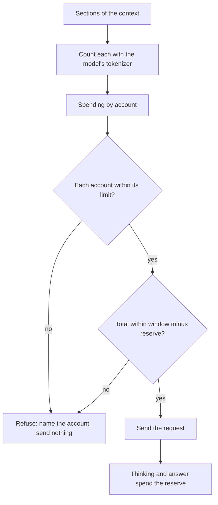
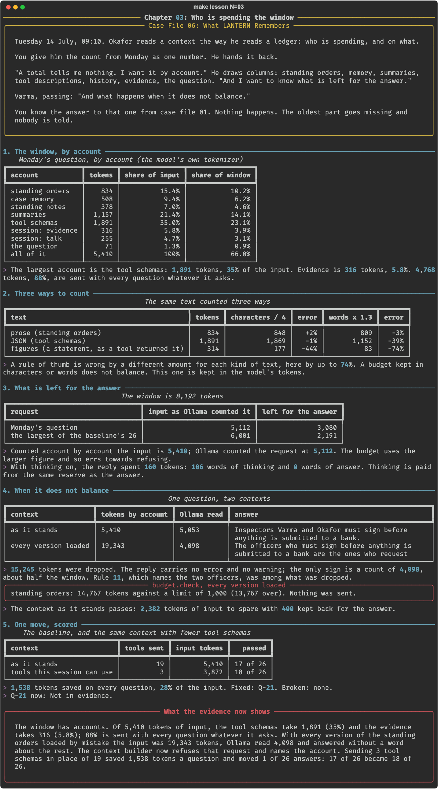

# Chapter 03: Who is spending the window

**Concept:** the token budget: the window is a fixed sum, every section of the context spends from it, and the spending is measured, not guessed.

## The scene

Tuesday 14 July, 09:10. Okafor reads a context the way he reads a ledger: who is spending, and
on what.

You give him the count from Monday as one number. He hands it back.

"A total tells me nothing. I want it by account." He draws columns: standing orders, memory,
summaries, tool descriptions, history, evidence, the question. "And I want to know what is left
for the answer."

Varma, passing: "And what happens when it does not balance."

You know the answer to that one from case file 01. Nothing happens. The oldest part goes
missing and nobody is told.

## The concept

A model's **context window** is a fixed number of tokens. Everything sent and everything the
model writes back comes out of that one sum: the rules, the memory, the tool descriptions, the
session, the question, the model's thinking and its answer.

A **token budget** treats the window as Okafor treats an account. It has three parts:

- **Spending by account.** The context is counted section by section with the model's own
  tokenizer, so you can say who is spending and how much of it is evidence.
- **A reserve.** Part of the window is kept back for what the model writes. Input may not
  spend it.
- **A refusal.** A context that is over is not sent. The code that builds the request refuses
  it and names the account that broke the budget.

The third part matters because of what happens without it. A local server does not reject a
prompt that is too long. It cuts it to fit and answers from what is left.



## How it works

1. **The window, by account.** `lantern.budget.spend()` groups the sections of Monday's context
   into accounts. The session is split in two: what a tool returned is evidence, the rest is
   talk.
2. **Three ways to count.** The same three texts counted with the tokenizer, by characters
   divided by four, and by words times 1.3.
3. **What is left for the answer.** The request as Ollama counted it against the window, and
   one reply with thinking switched on.
4. **When it does not balance.** The loader is pointed at the folder of all 31 versions of the
   standing orders. The over-full request is sent once to see what comes back, then refused by
   `budget.check()`.
5. **One move, scored.** Only the three tools this session can use are sent, and all 26 signed
   questions are asked again.

The refusal is a few lines:

```python
def check(spent, budget):
    for account, tokens in spent.items():
        limit = budget.limits.get(account)
        if limit is not None and tokens > limit:
            raise OverBudget(account, tokens, limit)
    total = sum(spent.values())
    if total > budget.for_input:
        raise OverBudget("the whole input", total, budget.for_input)
    return budget.for_input - total
```

## The nuances

- **Tool schemas are paid on every request.** They were 1,891 tokens, 35% of the input, for a
  question that called no tool. Nineteen were added in four months and none was removed.
- **Evidence is among the smallest accounts.** 316 tokens, 5.8%. 4,768 tokens, 88% of the
  input, are sent with every question whatever it asks.
- **A rule of thumb fails by kind of text.** Characters divided by four was within 2% on prose
  and 44% under on a statement. Words times 1.3 was 74% under on the same statement.
- **Thinking spends the reserve first.** With thinking on and 160 tokens allowed, the reply was
  106 words of thinking and no answer at all.
- **An over-full request is not an error.** 19,343 tokens went in, Ollama read 4,098 and
  answered. The answer no longer named Varma and Okafor, because rule 11 was in the part that
  was dropped.
- **The budget counts before sending, and counts high.** Section by section the input is 5,410
  tokens; the request as sent was counted at 5,112. A check that runs before the request cannot
  use a number only the request returns.
- **A saving is a change.** Sending 3 tool schemas in place of 19 fixed Q-21 and broke nothing
  in this run. Chapter 02's far smaller change broke two answers. The budget does not tell you
  which you will get; the baseline does.
- **This is one machine and one model.** How a server treats an over-long prompt differs by
  server and version. Measure yours.

## Run it

```bash
make lesson N=03
```

About three minutes: a handful of calls, then the 26 questions once.

## What you should see



What the recorded run showed:

- Input 5,410 tokens, 66% of the 8,192-token window. Tool schemas 1,891 (35%), summaries 1,157
  (21%), standing orders 834 (15%), case memory 508, standing notes 378, evidence 316, the
  rest of the session 255, the question 71.
- The largest of the baseline's 26 requests was 6,001 tokens, leaving 2,191.
- Every version of the standing orders loaded: 19,343 tokens by account, 4,098 read, 15,245
  dropped with no error.
- `budget.check` refused it: standing orders 14,767 against a limit of 1,000.
- Three tool schemas in place of 19: 1,538 tokens saved a question, 28% of the input. 17 of 26
  became 18 of 26. Fixed: Q-21, which now says "Not in evidence." Broken: none.

What did not happen: the planned beat said the evidence takes least. The question takes
least, at 71 tokens; the evidence is the smallest of everything else but the session's talk.

## Try this

1. Open `.scratch/03/fewer-tools.json` and compare Q-21 with `.scratch/02/baseline.json`. Which
   tool did the baseline call, and what did that tool say?
2. Set a limit of 1,000 tokens on the summaries. What does `check` say, and which summary
   would you drop first?
3. Count a page of your own notes three ways. How far out is each rule of thumb?

## Master it

After this chapter you can count a context by account with the model's own tokenizer, keep a
reserve for everything the model writes, refuse an over-full request in code with the account
named, and score a budget move against the baseline before keeping it.

**Predict, then see.** `make lesson N=03` stops five times: the largest account, the share that
is evidence, what arrives with thinking on, what an over-full request returns, and how many
answers a smaller context moves.

**Build it.** Write `check` in [`practice/exercise.py`](practice/exercise.py):

```bash
make exercise N=03          # 7 offline tests
make hint N=03
make lesson N=03 ARGS=--mine
```

**Check yourself.** `make quiz N=03`: seven questions.

**Break it.** `make challenge N=03`: your check on LANTERN's context; a reserve large enough to
think in; and a saving that goes too far.

`make progress` shows every chapter.

## What the evidence now shows

The window has accounts. Of 5,410 tokens sent with Monday's question, tool descriptions took
1,891 and the evidence 316; 88% is sent with every question whatever it asks. With every
version of the standing orders loaded by mistake, 19,343 tokens went in, the server read 4,098
and answered, and the answer no longer named the two officers who sign. The context builder
now refuses such a request before it is sent and names the account. Sending only the three
tools the session can use saved 1,538 tokens a question and moved one answer of 26, Q-21, from
wrong to right: 18 of 26. The largest account that people wrote, the standing orders, has not
been read by anyone in four months.

**Next:** [Chapter 04: Four months of standing orders](../04-rewriting-the-system-prompt/README.md)
