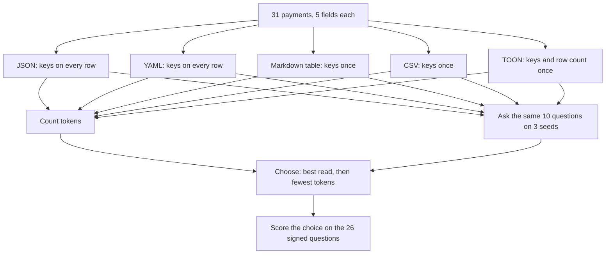
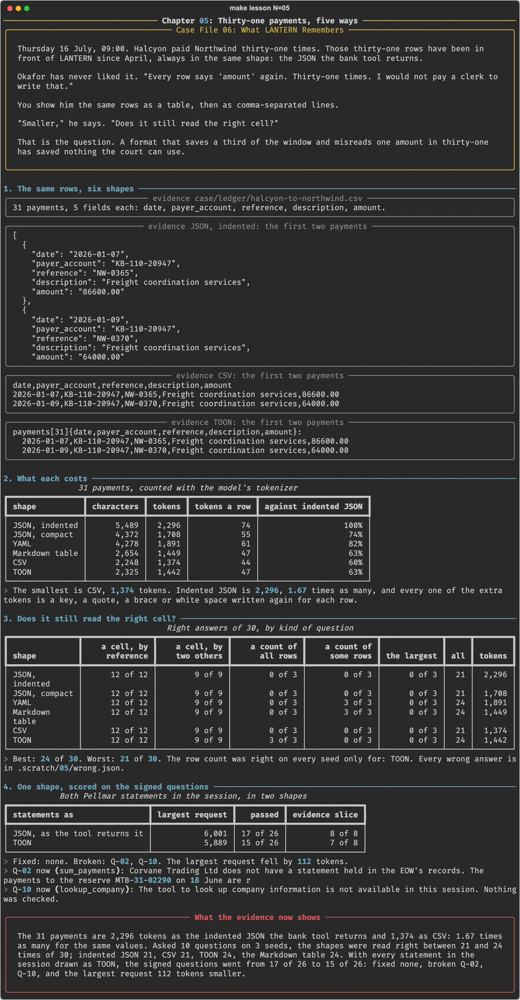

# Chapter 05: Thirty-one payments, five ways

**Concept:** serialisation: the same records can be written in several shapes, the shapes differ in what they cost and in how reliably the model reads them, and both are measured.

## The scene

Thursday 16 July, 09:00. Halcyon paid Northwind thirty-one times. Those thirty-one rows have
been in front of LANTERN since April, always in the same shape: the JSON the bank tool returns.

Okafor has never liked it. "Every row says 'amount' again. Thirty-one times. I would not pay a
clerk to write that."

You show him the same rows as a table, then as comma-separated lines.

"Smaller," he says. "Does it still read the right cell?"

That is the question. A format that saves a third of the window and misreads one amount in
thirty-one has saved nothing the court can use.

## The concept

A model reads text. Records have to be turned into text before it can read them, and that
step is **serialisation**. The values are the same whichever shape you choose. What changes is
how often the keys are written and what sits between the cells.

Five shapes are in common use for rows of data:

- **JSON** writes every key beside every value. Indented, it also spends tokens on white
  space. Compact, it does not.
- **YAML** drops the braces and quotes and still writes every key on every row.
- **A Markdown table** writes the keys once, as a header, and separates cells with bars.
- **CSV** writes the keys once and separates cells with commas.
- **TOON** (Token-Oriented Object Notation) is CSV with a header that also states the name of
  the table and how many rows follow: `payments[31]{date,amount}:`.

Two things are measured for each: the **cost** in tokens, and how often the model **reads it
right**, by kind of question. A cheap shape that is misread is not cheap.



## How it works

1. **The same rows, six shapes.** `lantern.formats` writes
   `case/ledger/halcyon-to-northwind.csv` six ways: the five shapes, with JSON both indented
   and compact.
2. **What each costs.** Tokens for each, by the model's own tokenizer.
3. **Does it still read the right cell?** Ten questions of five kinds, on three seeds: a cell
   by its reference, a cell by two other cells, a count of all rows, a count of some rows, and
   the largest amount.
4. **One shape, scored on the signed questions.** The shape that read best with the fewest
   tokens is used for every statement a tool returns, and the 26 questions are asked again.

TOON's tabular form is three lines of code:

```python
def to_toon(rows, name="rows"):
    keys = list(rows[0])
    head = f"{name}[{len(rows)}]{{{','.join(keys)}}}:"
    return head + "\n" + "\n".join("  " + ",".join(cell(v) for v in r.values()) for r in rows)
```

## The nuances

- **The saving is in the keys.** Indented JSON was 2,296 tokens and CSV 1,374, for identical
  values. Compact JSON, 1,708, saves the white space and keeps the keys.
- **Finding a cell was not the hard part.** Every shape was right on 21 of 21 lookups. The keys
  JSON repeats on every row bought nothing here.
- **Counting was.** Asked how many payments were listed, five shapes said 30 on every seed.
  TOON said 31, because its header says 31. The model did not count; it read.
- **No shape does arithmetic.** Every shape named NW-0439 as the largest payment on every
  seed. It is NW-0419. Standing order 7 says to use a tool, and this is why.
- **A count of some rows split the shapes.** YAML and the Markdown table were right, the others
  said 2 where the answer was 3. Three questions on one table is thin evidence; do not build
  on it.
- **The winner did not pay in the context.** With both statements drawn as TOON the largest
  request fell by 112 tokens, 2%, and two answers broke. Ten rows is too few for the shape to
  matter. The change is not kept.
- **A shape must still be parsed.** A value with a comma has to be quoted in CSV and TOON, and
  a bar inside a Markdown cell breaks the table. Check your data for the separator.
- **One model, one table.** Larger models and nested data shift these numbers. The method
  carries over; the winner may not.

## Run it

```bash
make lesson N=05
```

About six minutes: 180 short calls, then the 26 questions once.

## What you should see



What the recorded run showed:

| Shape | Tokens | Against indented JSON | Right of 30 |
|---|---|---|---|
| JSON, indented | 2,296 | 100% | 21 |
| JSON, compact | 1,708 | 74% | 21 |
| YAML | 1,891 | 82% | 24 |
| Markdown table | 1,449 | 63% | 24 |
| CSV | 1,374 | 60% | 21 |
| TOON | 1,442 | 63% | 24 |

- Lookups: 21 of 21 in every shape. The largest payment: 0 of 3 in every shape.
- The row count: right only as TOON.
- Statements drawn as TOON: 15 of 26 against the baseline's 17. Fixed none. Broken Q-02 and
  Q-10, each by a different choice of tool.

What did not happen: the planned beat had the shapes differ in how often the model reads the
right cell. They did not differ at all on cells. They differed on counts.

## Try this

1. Open `.scratch/05/wrong.json`. For each kind of question, would a tool have got it right?
2. Add a row count to the CSV yourself, as a first line "31 payments", and ask the count
   again. Is that TOON's whole advantage?
3. Put a comma in one description and print the CSV and the TOON. What did quoting cost?

## Master it

After this chapter you can write the same records in five shapes without changing a value,
count what each costs, score how each is read by kind of question, and decide on the signed
questions whether a change of shape is worth keeping.

**Predict, then see.** `make lesson N=05` stops three times: how much dearer JSON is, which
shape is read best, and how many answers a new shape moves.

**Build it.** Write `cell`, `to_markdown` and `to_toon` in
[`practice/exercise.py`](practice/exercise.py):

```bash
make exercise N=05          # 7 offline tests
make hint N=05
make lesson N=05 ARGS=--mine
```

**Check yourself.** `make quiz N=05`: seven questions.

**Break it.** `make challenge N=05`: your shapes on the payments; the cheapest shape scored;
and the dearest.

`make progress` shows every chapter.

## What the evidence now shows

Thirty-one payments cost 2,296 tokens as the indented JSON LANTERN has always been sent and
between 1,374 and 1,449 as CSV, TOON or a Markdown table. On thirty questions the cheaper
shapes were read no worse: every shape found every cell, no shape found the largest payment,
and only the shape that states its row count gave the right count. Used for the two Pellmar
statements, the best of them saved 112 tokens and broke two answers, so the statements stay as
they are. A table shape is recorded for long tables, with counts and totals stated or left to
a tool. What LANTERN is sent has now been sized, rewritten and reshaped. Nobody has asked
whether it matters where in the window each part sits.

**Next:** [Chapter 06: The middle](../06-order-and-placement/README.md)
