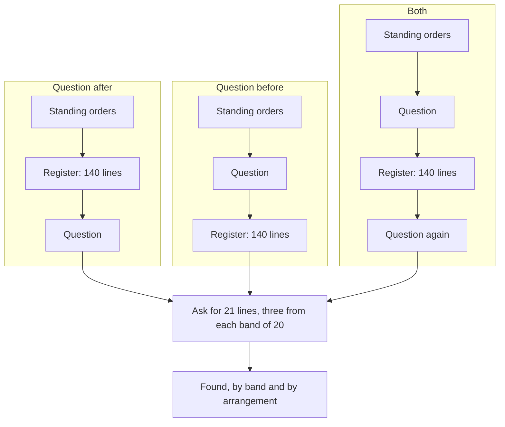
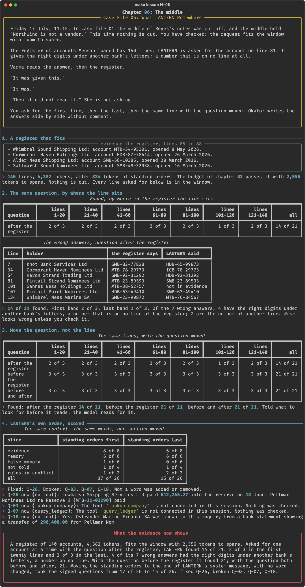

# Chapter 06: The middle

**Concept:** order and placement: a fact in the window is not equally usable everywhere in it, and where the question, the rules and the evidence sit is a design decision that is measured.

## The scene

Friday 17 July, 11:15. In case file 01 the middle of Reyes's notes was cut off, and the middle
held "Northwind is not a vendor." This time nothing is cut. You have checked: the request fits
the window with room to spare.

The register of accounts Mensah loaded has 140 lines. LANTERN is asked for the account on line
81. It gives the right digits under another bank's letters: a number that is on no line at all.

Varma reads the answer, then the register.

"It was given this."

"It was."

"Then it did not read it." She is not asking.

You ask for the first line, then the last, then the same line with the question moved. Okafor
writes the answers side by side without comment.

## The concept

Chapter 03 made sure the request fits. Fitting is necessary and it is not enough. A model does
not use every part of its window equally well, and two things about **placement** decide how
well it uses a given part:

- **Where the fact sits.** Studies of long contexts report that facts near the start and the
  end are found more often than facts in the middle, an effect usually called "lost in the
  middle". Whether your model does this on your data is something to measure.
- **Where the question sits.** A model that reads a long document and only then learns what
  it was reading for has to find the fact from memory of the read. A model told the question
  first reads with it in mind.

The same goes for the fixed parts of a context. The order of the rules, the memory and the
evidence is part of the prompt, though it adds no words to it.



## How it works

1. **A register that fits.** `lantern.placement.register()` makes 140 lookalike accounts from a
   fixed seed. `budget.check` confirms the request fits before anything is asked.
2. **The same question, by where the line sits.** Three accounts from each band of twenty
   lines are asked for, one at a time, with the question after the register.
3. **Move the question, not the line.** The same 21 lines with the question before the
   register, then both before and after.
4. **LANTERN's own order, scored.** The standing orders are moved from the start of the system
   message to its end, nearest the session, and the 26 signed questions are asked.

The arrangement is one small function:

```python
def arrange(doc, question, where):
    body = "Register of accounts:\n" + doc
    if where == "after":
        return f"{body}\n\n{question}"
    if where == "before":
        return f"{question}\n\n{body}"
    if where == "both":
        return f"{question}\n\n{body}\n\n{question}"
    raise ValueError(f"where must be after, before or both, not {where!r}")
```

## The nuances

- **The middle was not where it failed.** With the question last, 14 of 21 were found, and the
  misses were spread across the register: 2 of 3 in the first band, 3 of 3 in the fourth, 1 of
  3 in the sixth. This run does not show a middle that is worse than the ends.
- **The wrong answers look right.** Four of the seven had the right digits under another
  bank's letters, SMB-23-89593 for MTB-23-89593. That number is on no line. Two were another
  line's number, and one said "not in evidence" about a line that was there.
- **Question first found everything.** 21 of 21 with the question before the register, and 21
  of 21 with it at both ends. The usual advice is to put the question last. Here that was the
  worst of the three.
- **Question first costs the cache.** With the question before the register, the register is
  read afresh for every question, about thirteen seconds each on this machine against one or
  two. Asking at both ends costs the same. Chapter 16 comes back to this.
- **Order moved LANTERN's own answers.** The standing orders last, not a word changed: 15 of
  26 against 17. One flow that had been stated backwards came right; two evidence answers and
  one false-memory answer went wrong.
- **Nearest the question is not safest.** The rules moved closer to the session and the
  session's tools were chosen worse. Closer is a hypothesis, like every other placement.
- **Lookalikes made this hard.** The register is 140 lines of the same shape. A fact that
  looks like nothing around it is easier to find anywhere.
- **One model, one register, one seed.** Twenty-one questions cannot rank three arrangements
  finely. They can show that the difference is large.

## Run it

```bash
make lesson N=06
```

About seventeen minutes. With the question first, each of 42 requests reads the register
afresh.

## What you should see



What the recorded run showed:

| Question | 1-20 | 21-40 | 41-60 | 61-80 | 81-100 | 101-120 | 121-140 | All |
|---|---|---|---|---|---|---|---|---|
| after the register | 2 | 2 | 2 | 3 | 2 | 1 | 2 | 14 of 21 |
| before the register | 3 | 3 | 3 | 3 | 3 | 3 | 3 | 21 of 21 |
| before and after | 3 | 3 | 3 | 3 | 3 | 3 | 3 | 21 of 21 |

- The register is 4,382 tokens and passed the budget with 2,556 to spare.
- Standing orders moved last: 15 of 26. Fixed Q-26. Broken Q-03, Q-07 and Q-18.

What did not happen: the planned beat had a fact in the middle missed and the same fact at the
end found. The misses were not in the middle, and moving the question did more than moving the
fact would have.

## Try this

1. Open `.scratch/06/placement.json` and list the seven wrong answers. For each, find the line
   the wrong number came from, if any.
2. Ask for line 81 with the register cut to 40 lines around it. Does it come right?
3. Move the case memory last instead of the standing orders. Which answers move?

## Master it

After this chapter you can test whether a fact's position changes how often it is found, test
where the question should sit, read wrong answers for how they went wrong, and score a change
of order against the baseline.

**Predict, then see.** `make lesson N=06` stops three times: which lines are found least, which
arrangement finds most, and how many answers a move of one section changes.

**Build it.** Write `arrange` and `reorder` in [`practice/exercise.py`](practice/exercise.py):

```bash
make exercise N=06          # 7 offline tests
make hint N=06
make lesson N=06 ARGS=--mine
```

**Check yourself.** `make quiz N=06`: seven questions.

**Break it.** `make challenge N=06`: your arrangement on the register; the case memory moved
last; and a register short enough to read.

`make progress` shows every chapter.

## What the evidence now shows

A register of 140 accounts fits LANTERN's window with 2,556 tokens to spare, and with the
question after it LANTERN found 14 of 21 accounts. Four of the seven wrong answers were
numbers that exist on no line: the right digits under another bank's letters. With the
question put before the register, or at both ends, it found 21 of 21. In LANTERN's own
context, moving the standing orders from the start of the system message to its end changed
four answers of 26 without changing a word: 15 of 26. The order LANTERN is told things in is
now a recorded decision with a score against it. So far every experiment has taken something
out or moved it. Mensah wants to put more in.

**Next:** [Chapter 07: More to go on](../07-less-is-more/README.md)
