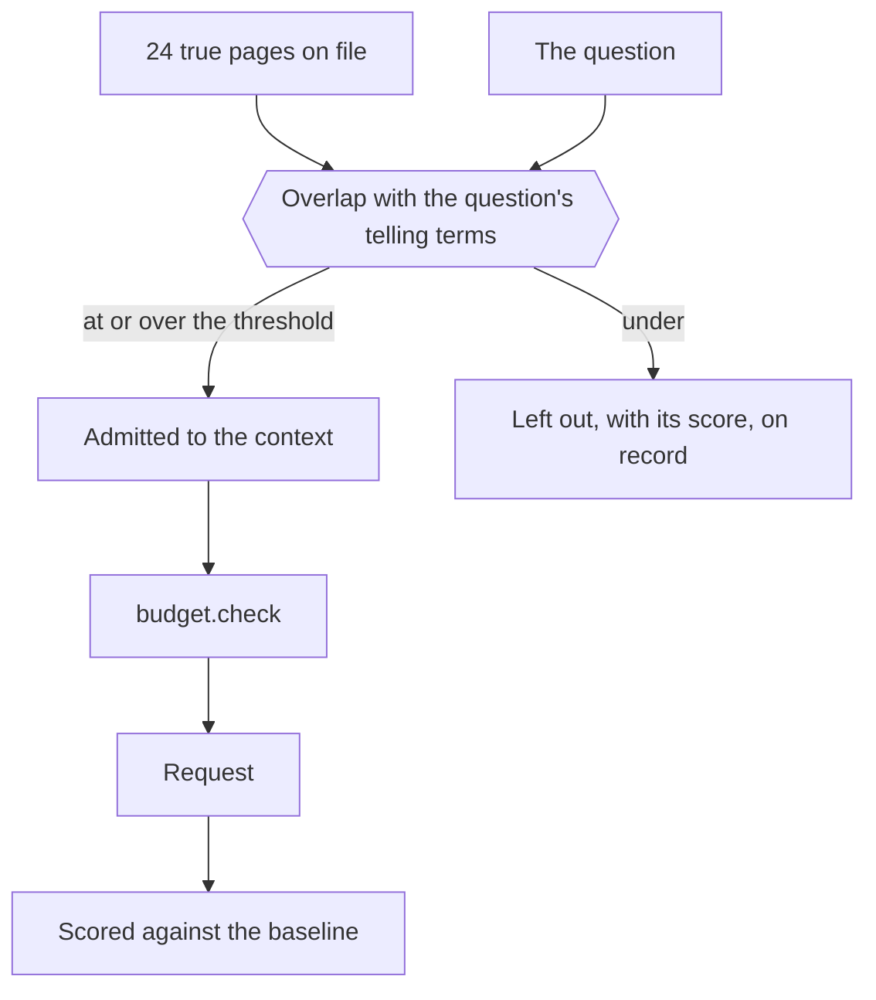
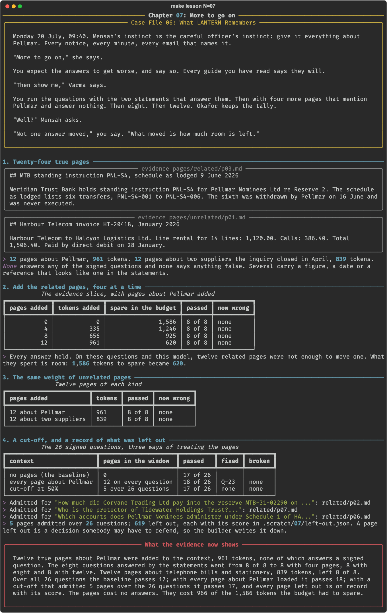

# Chapter 07: More to go on

**Concept:** distraction: whether material that is true and related but unneeded makes answers worse is measured, and what it always costs is room in the window.

## The scene

Monday 20 July, 09:40. Mensah's instinct is the careful officer's instinct: give it everything
about Pellmar. Every notice, every minute, every email that names it.

"More to go on," she says.

You expect the answers to get worse, and say so. Every guide you have read says they will.

"Then show me," Varma says.

You run the questions with the two statements that answer them. Then with four more pages
that mention Pellmar and answer nothing. Then eight. Then twelve. Okafor keeps the tally.

"Well?" Mensah asks.

"Not one answer moved," you say. "What moved is how much room is left."

## The concept

**Distraction** is the name for a context that holds the answer and still gets a worse one,
because it also holds material that looks like the answer and is not. The usual advice
follows from it: load less, and load only what the question needs.

That advice is a claim about a model and a task, and this chapter tests it on LANTERN in the
way the claim describes: true pages, about the right subject, carrying figures and references
that resemble the ones asked for, added until an answer changes.

Whatever the test shows, two costs of an unneeded page are certain:

- **It spends the window.** Every page is paid for on every question, whether it helps or
  not, and the budget of chapter 03 has a limit.
- **Somebody chose to load it, or chose not to.** A context builder that leaves a page out has
  made a decision that may have to be defended. It should record the decision.

A **cut-off** is the builder's rule for that decision: a page is admitted only if it is
relevant enough to the question in hand, by a score that can be read afterwards.



## How it works

1. **Twenty-four true pages.** `case/pages/related/` holds twelve pages about Pellmar and its
   two accounts. `case/pages/unrelated/` holds twelve about two suppliers the inquiry closed in
   April. None answers a signed question.
2. **Add the related pages, four at a time.** The eight questions the statements answer, with
   0, 4, 8 and 12 pages added. Every request goes through `budget.check` first.
3. **The same weight of unrelated pages.** Twelve pages of telephone bills and stationery.
4. **A cut-off, and a record of what was left out.** All 24 pages offered; the builder admits
   a page for a question only if it holds half the question's telling terms. All 26 questions.

The cut-off returns two lists, and the second matters as much as the first:

```python
def select(pages, question, threshold):
    kept, left_out = [], []
    for p in pages:
        score = overlap(question, p)
        if score >= threshold:
            kept.append(p)
        else:
            left_out.append((p.path, round(score, 2)))
    return kept, left_out
```

## The nuances

- **The pages did not distract.** 8 of 8 with no pages, with 4, with 8 and with 12. One page
  says six transfers were lodged under PNL-S4 where five were made; another gives a release
  date a day after the transfer. Neither moved an answer.
- **Related and unrelated did the same.** 8 of 8 each. The claim that related material
  distracts more than unrelated had nothing to show itself on here.
- **It was tried harder, outside the lesson.** The same twelve pages delivered as a tool
  result in the session, beside the statements: 8 of 8, at 7,730 tokens. All 24 pages with
  only three tool schemas loaded: no answer worse.
- **One answer got better.** With every related page loaded, Q-23 said "not in evidence" in
  those words. No page mentions Saltire Quay. More text in the window changed the wording of
  an unrelated answer, as chapter 02 found less text can.
- **Why it held, as far as the run shows.** The statements are exact and in front of the
  model, and the questions name an amount, a date or a reference. A vaguer question, a
  weaker source or a longer window may behave differently. This is one model on 26 questions.
- **The cost was the window.** Twelve pages took the room to spare from 1,586 tokens to 620.
  Loaded through a tool into the session they reached 7,730 of 8,192. A thirteenth set would
  have been refused by the budget, or cut by the server without one.
- **The cut-off admitted 5 pages in 26 questions** and scored exactly as the baseline did. It
  is justified here by the room it keeps, not by answers it saved.
- **Word overlap is a crude score.** It admitted a fee note for a question about a transfer
  because both name Corvane. Chapter 14 replaces it with something better.

## Run it

```bash
make lesson N=07
```

About nine minutes: the evidence slice four times, then all 26 questions twice.

## What you should see



What the recorded run showed:

| Pages added | Tokens added | Spare in the budget | Evidence slice |
|---|---|---|---|
| 0 | 0 | 1,586 | 8 of 8 |
| 4 about Pellmar | 335 | 1,246 | 8 of 8 |
| 8 about Pellmar | 656 | 925 | 8 of 8 |
| 12 about Pellmar | 961 | 620 | 8 of 8 |
| 12 about two suppliers | 839 | | 8 of 8 |

- All 26 questions: 17 with no pages, 18 with every page about Pellmar (fixed Q-23, broken
  none), 17 with the cut-off.
- The cut-off admitted 5 pages over 26 questions and recorded 619 left out.

What did not happen: the planned beat had the answer change as pages were added. It never
did. The chapter's title and scene were rewritten to what the run showed.

## Try this

1. Open `.scratch/07/left-out.json`. Find a page that scored just under the threshold. Should
   it have been admitted?
2. Write a thirteenth related page that you think will mislead LANTERN on one evidence
   question, add it under `case/pages/related/` in a scratch copy, and run the slice.
3. Lower the threshold to 0.25 and count what gets in. How much room does it cost?

## Master it

After this chapter you can test a claim about distraction on your own model in place of
repeating it, say what unneeded material certainly costs, and build a cut-off that records
every page it leaves out.

**Predict, then see.** `make lesson N=07` stops three times: when the first answer goes wrong,
how unrelated pages compare, and how many pages the cut-off admits.

**Build it.** Write `overlap` and `select` in [`practice/exercise.py`](practice/exercise.py):

```bash
make exercise N=07          # 7 offline tests
make hint N=07
make lesson N=07 ARGS=--mine
```

**Check yourself.** `make quiz N=07`: seven questions.

**Break it.** `make challenge N=07`: your cut-off on the pages; a looser threshold; and a
threshold nothing passes.

`make progress` shows every chapter.

## What the evidence now shows

Twelve true pages about Pellmar, 961 tokens, were loaded beside the statements, each with a
figure or a reference that resembles one in evidence. LANTERN answered all eight evidence
questions correctly with none of them, with four, with eight and with twelve, and did the
same with twelve pages about telephone bills. Over the 26 signed questions it passed 17
without the pages and 18 with them. Mensah's instinct cost no answers. It cost 966 of the
1,586 tokens the budget had to spare. The context builder now admits a page only when the
question calls for it, 5 pages in 26 questions, and writes down every page it leaves out. All
of this assumes the material is loaded before the question. The nightly service does that
with nine bank statements every morning.

**Next:** [Chapter 08: A list, not the files](../08-just-in-time/README.md)
