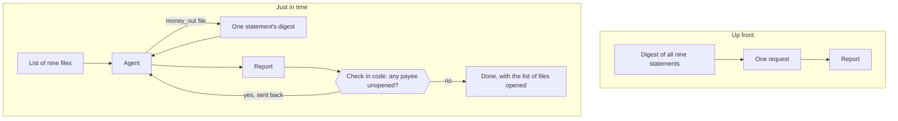
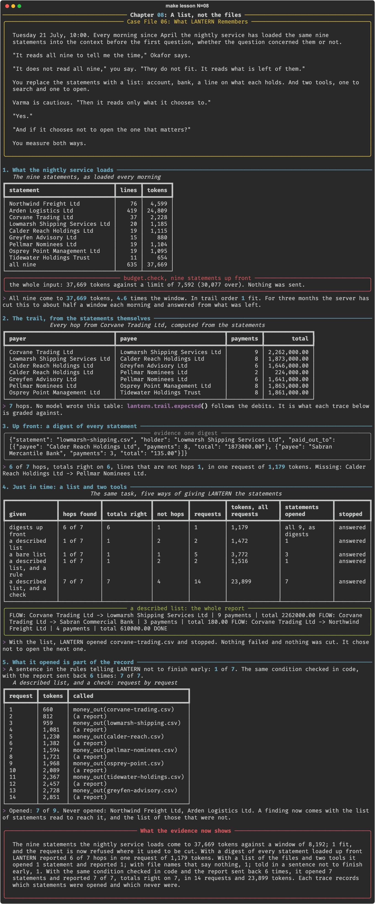

# Chapter 08: A list, not the files

**Concept:** just-in-time context: handing the agent references it can open in place of the material itself, and measuring what the agent then chooses to read.

## The scene

Tuesday 21 July, 10:00. Every morning since April the nightly service has loaded the same nine
statements into the context before the first question, whether the question concerned them or
not.

"It reads all nine to tell me the time," Okafor says.

"It does not read all nine," you say. "They do not fit. It reads what is left of them."

You replace the statements with a list: account, bank, a line on what each holds. And two
tools, one to search and one to open.

Varma is cautious. "Then it reads only what it chooses to."

"Yes."

"And if it chooses not to open the one that matters?"

You measure both ways.

## The concept

There are two ways to get material in front of a model.

- **Up front.** You decide what the model will need and put it in the context before the
  question. The model has everything at once and chooses nothing. The cost is paid on every
  question, and it has to fit.
- **Just in time.** You put a **reference** in the context: a file name and a line on what
  the file holds. The model is given a tool and opens what it decides it needs. A reference
  costs a few tokens. What is opened arrives when it is wanted.

Just in time is how large things are made to fit. It also moves a decision. Up front, a person
chose what was read. Just in time, the agent chooses, and it can choose to stop.

Two things follow. The list has to say enough for the agent to choose well. And whether the
agent has finished is checked by code that knows what "finished" means, not left to the agent.



## How it works

1. **What the nightly service loads.** The nine statements under `case/bank/`, in tokens,
   against the window, through `budget.check`.
2. **The trail, from the statements themselves.** `lantern.trail.expected()` follows the debits
   from Corvane Trading Ltd. Seven hops. Every trace is graded against it.
3. **Up front: a digest of every statement.** Each statement reduced to who it paid, how often
   and how much. All nine loaded, no tools, one request.
4. **Just in time: a list and two tools.** Four arms: a described list; a list of bare file
   names; a described list with a sentence telling LANTERN not to finish early; and a
   described list with that condition checked in code.
5. **What it opened is part of the record.** The checked trace, request by request, and the
   statements it never opened.

The check that sends a report back:

```python
def not_done(opened):
    def check(report):
        left = unopened_payees(report, opened)
        if not left:
            return None
        return ("Not done. You reported payments to " + ", ".join(left) + ", which has a "
                "statement on file that you have not opened. ...")
    return check
```

## The nuances

- **"Everything up front" was never what happened.** The nine statements are 37,669 tokens,
  4.6 times the window. One fits. For three months the server cut the rest.
- **A digest is a decision made in advance.** Somebody chose that "who was paid, how often,
  how much" is what a statement is for. A question about dates would find nothing in it.
- **The agent stopped after one hop.** With the list and the tools it opened Corvane's
  statement, reported one hop and two lines that are not hops, and wrote DONE. Nothing failed.
- **A better list did not help, and a worse one cost more.** The bare list took five requests
  to do no better: LANTERN had to search to find which file was Corvane's.
- **A sentence did not help either.** "Do not write DONE while a payee's statement is
  unopened" changed nothing: 1 of 7, as chapter 04 found for another rule.
- **A check in code did.** The same condition, computed from the report and the list of files
  opened, sent the report back six times. 7 of 7, with every total right.
- **It cost twenty times the tokens.** 23,899 tokens over 14 requests against 1,179 in one.
  Every request carries every earlier result. Chapter 09 is about that.
- **The checked report still had four lines that are not hops:** bank charges and the payments
  back to Northwind that the task said to ignore. The check proves the statements were
  opened. It does not prove the report is clean.
- **Its choices are now evidence.** The trace records that Northwind's and Arden's statements
  were never opened. For this task that is correct, and it is on record that it was so.

## Run it

```bash
make lesson N=08
```

About twelve minutes. Five traces, the last of fourteen requests.

## What you should see



What the recorded run showed:

| Given | Hops found | Totals right | Requests | Tokens, all requests | Statements opened |
|---|---|---|---|---|---|
| digests up front | 6 of 7 | 6 | 1 | 1,179 | all 9, as digests |
| a described list | 1 of 7 | 1 | 2 | 1,472 | 1 |
| a bare list | 1 of 7 | 1 | 5 | 3,772 | 3 |
| a described list, and a rule | 1 of 7 | 1 | 2 | 1,516 | 1 |
| a described list, and a check | 7 of 7 | 7 | 14 | 23,899 | 7 |

- Up front missed one hop, Calder Reach to Pellmar: the smaller of two payees on one line of
  the digest.
- The largest single request of the checked trace was 2,851 tokens.

What did not happen: the plan expected a list and two tools to trace the trail "at a measured
cost and with a measured loss". Left to itself the agent lost six hops of seven.

## Try this

1. Open `.scratch/08/traces.json` and read the six reports the check refused. What did each
   add?
2. Change the task to "On what date did Corvane first pay Lowmarsh?" and run it against the
   digests. What does a digest cost you?
3. Describe each file in the list by what it paid out, in a few words. Does the agent go
   further without the check?

## Master it

After this chapter you can say what loading up front and loading just in time each cost, write
a file list an agent can choose from, check in code that an agent followed its references,
and read a trace for what was never opened.

**Predict, then see.** `make lesson N=08` stops three times: how many statements fit, how many
hops a digest gives, and how many a list and two tools give.

**Build it.** Write `listing` and `unopened` in [`practice/exercise.py`](practice/exercise.py):

```bash
make exercise N=08          # 7 offline tests
make hint N=08
make lesson N=08 ARGS=--mine
```

**Check yourself.** `make quiz N=08`: seven questions.

**Break it.** `make challenge N=08`: your list in the trace; a better sentence than the
lesson's; and a trace cut short by its turn limit.

`make progress` shows every chapter.

## What the evidence now shows

The nine statements loaded every morning are 37,669 tokens and one of them fits the window.
The request is now refused. From a digest of all nine, loaded up front, LANTERN traced 6 of
the 7 hops from Corvane in one request of 1,179 tokens. From a list of the files and two
tools it opened one statement and stopped, three times out of three, whether the list
described the files or not and whether or not it was told to go on. With the stopping
condition checked in code and its report sent back six times, it traced all 7 with every
total right, at 23,899 tokens. Each trace now names the statements it opened and the ones it
did not. By its fourteenth request the agent was carrying the result of every earlier call.

**Next:** [Chapter 09: What stays behind](../09-tool-results/README.md)
