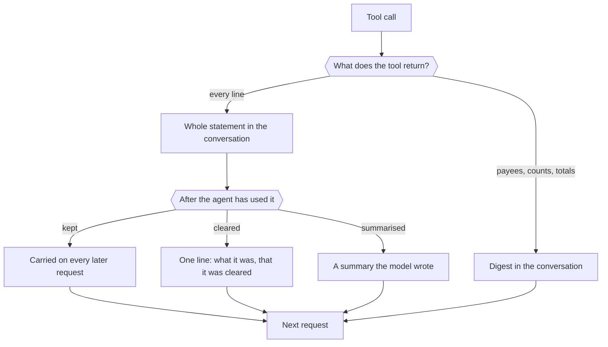
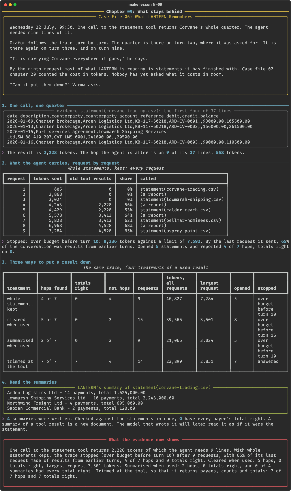

# Chapter 09: What stays behind

**Concept:** tool results in the context: a result is asked for once and carried on every later request, and it can be cleared, summarised or made smaller at the tool, each with a measured cost.

## The scene

Wednesday 22 July, 09:30. One call to the statement tool returns Corvane's whole quarter. The
agent needed nine lines of it.

Okafor follows the trace turn by turn. The quarter is there on turn two, where it was asked
for. It is there again on turn three, and on turn nine.

"It is carrying Corvane everywhere it goes," he says.

By the ninth request most of what LANTERN is reading is statements it has finished with. Case
file 02 chapter 20 counted the cost in tokens. Nobody has yet asked what it costs in room.

"Can it put them down?" Varma asks.

## The concept

In an agent's loop every request carries the whole conversation so far. A **tool result**
enters the conversation on the turn that asked for it and stays for every turn after. The
agent reads it once. It pays for it until the run ends.

There are three things you can do with a result the agent has finished with:

- **Clear it.** Replace it with one line that says what it was and that it was cleared. The
  line matters: without it the model acts as if it never looked.
- **Summarise it.** Replace it with a shorter text. Somebody has to write that text, and if
  it is the model, the summary is a new document that can be wrong.
- **Trim it at the tool.** Change the tool so it returns less in the first place: the lines or
  the totals the task needs. What was never returned never has to be put down.

The first two manage what is already in the window. The third decides what enters it.



## How it works

1. **One call, one quarter.** What `statement(corvane-trading.csv)` returns, and how much of
   it the hop needs.
2. **What the agent carries, request by request.** The checked trace of chapter 08 with a tool
   that returns whole statements. `results.old_share()` measures, before each request, how
   much of the conversation is results from earlier turns.
3. **Three ways to put a result down.** The same trace with old results cleared, with old
   results summarised by the model, and with the tool trimmed to return a digest.
4. **Read the summaries.** Each summary the model wrote, checked in code against the
   statement it summarises.

Clearing is a rewrite of the conversation before each request:

```python
def clear_old(messages):
    out = list(messages)
    for i, call in _old_results(messages):      # every tool result but the newest
        if untouched(out[i]["content"]):
            out[i] = {**out[i], "content": stub(call)}
    return out
```

## The nuances

- **Old results were two thirds of the conversation.** By the ninth request, 4,528 of about
  7,000 tokens were statements the agent had already reported from.
- **Kept, the run did not finish.** The tenth request would have been 8,336 tokens against a
  limit of 7,592. The loop stopped and said so. A server would have cut the oldest turns:
  the task itself.
- **Clearing bought room, not accuracy.** The largest request fell from 7,284 tokens to 3,501
  and the agent opened eight statements in place of five. It then opened Arden's, 24,809
  tokens in one result, and no clearing can help a single result larger than the window.
- **No arm that returned whole statements got one total right.** The model does not add
  thirty-seven lines. It never has, in any chapter.
- **The summaries were wrong.** Zero of four had every total right. The first lists Arden
  Logistics as someone Corvane paid, with a total. Arden paid Corvane. The model then read its
  own summary as the statement, and that arm found 2 hops.
- **Trimming at the tool was the only arm that worked:** 7 of 7 with every total right,
  because the tool did the sums and returned nothing else.
- **A cleared result needs its note.** The stub names the call, so the agent can make it
  again. Clearing silently looks, to the model, like never having looked.
- **Rewriting history breaks the cache.** Each request after a clearing starts from a
  different prefix, so the server reads more of it afresh. Chapter 16 measures that.

## Run it

```bash
make lesson N=09
```

About twenty-five minutes: four long traces, three of them carrying whole statements.

## What you should see



What the recorded run showed:

| Treatment | Hops found | Totals right | Requests | Largest request | Opened | Stopped |
|---|---|---|---|---|---|---|
| whole statements, kept | 4 of 7 | 0 | 9 | 7,284 | 5 | over budget |
| cleared when used | 5 of 7 | 0 | 15 | 3,501 | 8 | over budget |
| summarised when used | 2 of 7 | 0 | 9 | 3,024 | 5 | over budget |
| trimmed at the tool | 7 of 7 | 7 | 14 | 2,851 | 7 | answered |

- `statement(corvane-trading.csv)` is 2,228 tokens; the hop is on 9 of its 37 lines.
- Four summaries were written and none had every payee's total right.

What did not happen: the plan had each treatment "scored on tokens and on flows found" as if
all three were workable. Two of the three failed, and the one that worked is not a treatment
of the result at all.

## Try this

1. Open `.scratch/09/summaries.json` and check each summary against
   `lantern.trail.digest(file)`. Which errors would a reader catch?
2. In the clearing arm, find the request where Arden's statement arrives. What should the
   tool have refused to do?
3. Change the stub so it does not say the result was cleared. Does the agent open the same
   statement again?

## Master it

After this chapter you can measure how much of an agent's context is used tool results,
clear a used result and leave a note that it was cleared, say why a model's summary of a
result is a new document, and decide at the tool what a result should hold.

**Predict, then see.** `make lesson N=09` stops twice: the share of the last request that is
old results, and which treatment gets totals right.

**Build it.** Write `clear_old` in [`practice/exercise.py`](practice/exercise.py):

```bash
make exercise N=09          # 7 offline tests
make hint N=09
make lesson N=09 ARGS=--mine
```

**Check yourself.** `make quiz N=09`: seven questions.

**Break it.** `make challenge N=09`: your clearing in the trace; the trimmed tool alone; and a
trace that keeps everything.

`make progress` shows every chapter.

## What the evidence now shows

A statement tool that returns every line puts 2,228 tokens into the conversation for a hop
that is on nine lines, and they stay. By the ninth request two thirds of what LANTERN was
sent was statements it had finished with, and the trace stopped, over budget, with 4 of 7
hops and no total right. Clearing used results halved the largest request and still got no
total right. Summaries written by LANTERN were wrong in four cases of four, and one named a
payer as a payee. Only a tool that returns payees, counts and totals traced all seven hops
with every total right. The agent no longer carries whole statements. It does still carry
every digest and every report, and at some length that too will have to be made smaller.

**Next:** [Chapter 10: Who paid whom](../10-compaction-with-a-schema/README.md)
