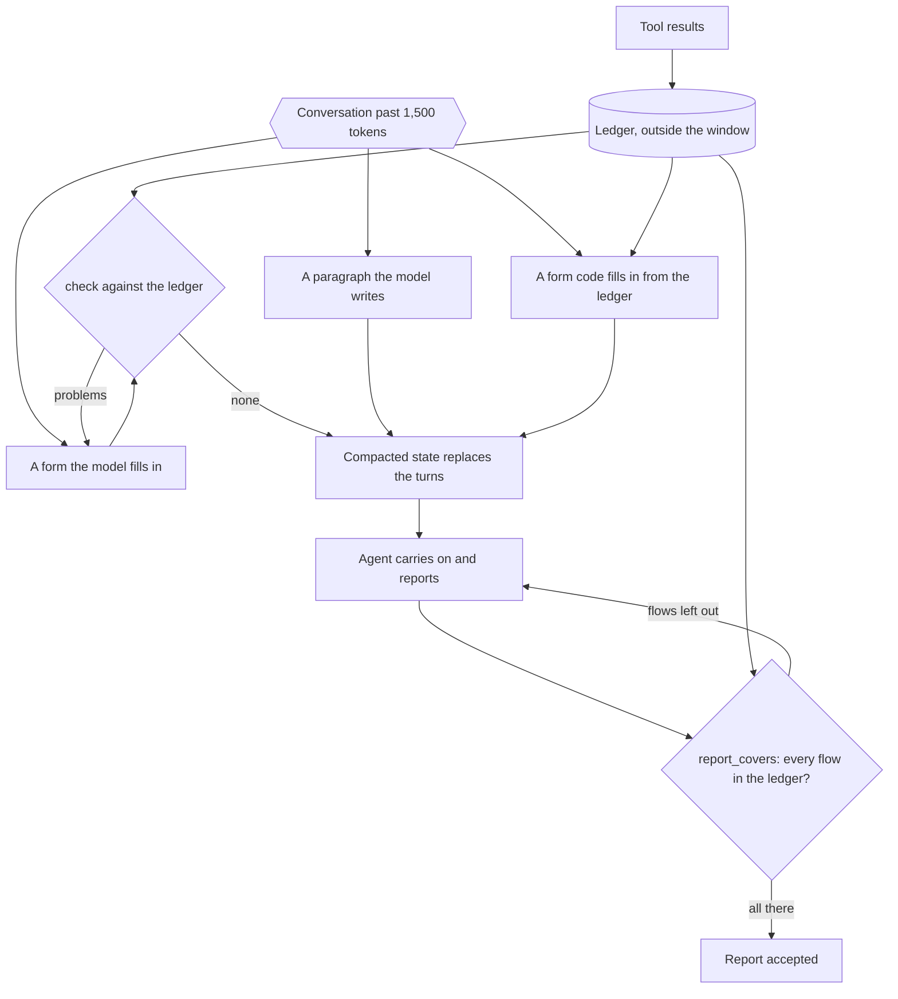
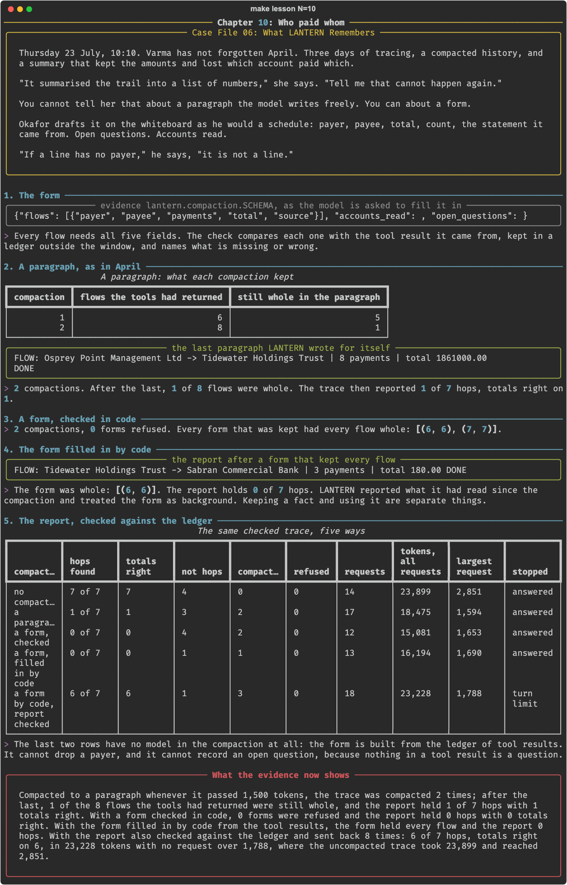

# Chapter 10: Who paid whom

**Concept:** compaction with a schema: a summary of the history has named fields that must survive, and code checks them after every compaction.

## The scene

Thursday 23 July, 10:10. Varma has not forgotten April. Three days of tracing, a compacted
history, and a summary that kept the amounts and lost which account paid which.

"It summarised the trail into a list of numbers," she says. "Tell me that cannot happen again."

You cannot tell her that about a paragraph the model writes freely. You can about a form.

Okafor drafts it on the whiteboard as he would a schedule: payer, payee, total, count, the
statement it came from. Open questions. Accounts read.

"If a line has no payer," he says, "it is not a line."

## The concept

**Compaction** replaces the turns of a long conversation with something shorter, so the agent
can carry on inside its window. Everything after the task is thrown away and one message takes
its place. Whatever that message leaves out, the agent no longer knows.

Case file 02 compacted to a paragraph. A paragraph has no place where a payer must go, and the
model that writes it is the model that will have nothing else to read afterwards. A **schema**
gives the compacted state named fields:

- **flows**, each with a payer, a payee, a number of payments, a total and the statement it
  came from;
- **accounts read**, every file opened;
- **open questions**.

A schema on its own only says what should be there. The other half is a **check in code** after
every compaction. Code keeps a **ledger** of every tool result outside the window, compares the
form with it, and refuses a form that drops a flow, changes a figure, invents a flow or leaves a
file out. A refused form goes back to the model with the list of what was wrong.

The form can also be filled in by code, straight from the ledger. Then no model writes it at
all. That keeps every fact. It does not make the agent use them, and this chapter measures the
difference.



## How it works

1. **The form.** `lantern.compaction.SCHEMA`: flows with five required fields, the files read,
   the open questions. The model is asked for it with structured output.
2. **A paragraph, as in April.** The checked trace of chapter 09, with the digest tool, is
   compacted whenever the conversation passes 1,500 tokens, by asking the model for one
   paragraph. After each compaction, `compaction.survived()` counts the flows from the ledger
   that are still whole in it: payer, payee and total, the total as a whole figure.
3. **A form, checked in code.** The model fills in the form; `compaction.check()` compares it
   with the ledger. A refused form is asked for again with its problems; after three refused
   attempts the form is filled in from the ledger.
4. **The form filled in by code.** `compaction.from_source()`: the form built from the ledger
   at every compaction, no model involved.
5. **The report, checked against the ledger.** The same, and the final report is also checked
   by `compaction.report_covers()`, which sends it back while it leaves out a flow the ledger
   holds (Northwind Freight, which the task says to ignore, excepted).

The check, in outline:

```python
def check(state, ledger):
    want = {(f["payer"], f["payee"]): f for f in seen_flows(ledger)}   # no bank charges
    returned = all_pairs(ledger)                                       # banks included
    ...
    for key, f in want.items():                  # dropped, wrong total, wrong count
        ...
    for key in got:                              # invented, whoever the payee
        if key not in returned:
            problems.append(f"not in any tool result: {key[0]} paid {key[1]}")
    unread = sorted(set(ledger) - set(state.get("accounts_read", [])))
    ...
```

## The nuances

- **The summary of a summary lost the trail.** The first paragraph kept 5 of the 6 flows the
  tools had returned; the one it dropped was the payment to Northwind, which the task says to
  ignore. The second was written from the first and the turns since, and kept 1 of 8: one line,
  Osprey Point to Tidewater, and DONE. The report then held 1 of 7 hops and named Sabran
  Commercial Bank as a payer of Osprey Point.
- **The paragraph was not a paragraph.** Asked for one paragraph, LANTERN wrote FLOW lines both
  times. The format of a free summary is the model's choice, and so is what it keeps.
- **The check never had to refuse.** Asked for the form with structured output, LANTERN filled
  it in correctly both times: 6 of 6 flows whole, then 7 of 7, and every file listed. 0 forms
  were refused.
- **A whole form and an empty report.** The same arm reported 0 of 7 hops. Its report was four
  bank charges, all four copied from its own last form, which listed them after the hops. The
  task says to ignore bank charges. The check proves the facts survived the compaction; it does
  not prove the agent reports from them.
- **Filled in by code, the same.** With the form built from the ledger, every flow was in it
  and the report held 0 of 7 hops: one line, Tidewater's bank charge, read after the
  compaction. LANTERN treated the form as background.
- **A second check made the report carry the facts.** With the report also compared with the
  ledger, it was sent back 8 times and reached 6 of 7 hops, all six totals right, before the
  turn limit of 18 requests. The hop it left out, Greyfen to Pellmar, was in the last form.
- **The check proves what is present, not that nothing else was lost.** The form has no place
  for why an account was opened. The model's first form held one open question, "Is there any
  further flow from Osprey Point Management Ltd?"; its second held none, and nothing checked
  that. A form filled in by code never has one, because nothing in a tool result is a question.
- **Compaction kept the requests small.** The uncompacted trace reached 2,851 tokens in one
  request; the compacted arms stayed between 1,594 and 1,788. The checked arm spent about as
  many tokens in all (23,228 against 23,899), because being sent back costs requests.

## Run it

```bash
make lesson N=10
```

Five traces, the last two sent back several times. In the recorded run the 78 model calls took
646.2 seconds of model time on the shared machine.

## What you should see



What the recorded run showed (qwen3:8b, local Ollama, the 16 GB Apple silicon Mac, 23 November
2026; 78 calls, 101,705 prompt tokens and 5,902 output tokens in all):

| Compaction | Hops found | Totals right | Not hops | Compactions | Refused | Requests | Tokens, all requests | Largest request | Stopped |
|---|---|---|---|---|---|---|---|---|---|
| none | 7 of 7 | 7 | 4 | 0 | 0 | 14 | 23,899 | 2,851 | answered |
| a paragraph | 1 of 7 | 1 | 3 | 2 | 0 | 17 | 18,475 | 1,594 | answered |
| a form, checked | 0 of 7 | 0 | 4 | 2 | 0 | 12 | 15,081 | 1,653 | answered |
| a form, filled in by code | 0 of 7 | 0 | 1 | 1 | 0 | 13 | 16,194 | 1,690 | answered |
| a form by code, report checked | 6 of 7 | 6 | 1 | 3 | 0 | 18 | 23,228 | 1,788 | turn limit |

- Flows still whole after each compaction: the paragraph 5 of 6, then 1 of 8; the model's form
  6 of 6, then 7 of 7; the form by code 6 of 6; with the report checked 6 of 6, 7 of 7, 8 of 8.
- The report in the last arm was sent back 8 times.
- Every report, form and paragraph is in `.scratch/10/traces.json`.

What did not happen: the plan expected the check to do the work, refusing forms that dropped
who paid whom until the model got them right. On this run it refused none, because the model's
forms were right. The failure was one step later: a compacted state that held every flow, and a
report that did not use it. Only a second check, on the report, got the hops back.

## On a hosted model

```bash
make lesson N=10 TIER=hosted
```

Runs the chapter on Claude Sonnet 5.5 (`config.yaml`, `hosted:`). The form is asked for with
native structured outputs (`output_config.format`, the schema closed by
`lantern.hosted.strict`), and the statement tools are native tools. The provider's own
server-side compaction (`compact_20260112`) is not used: it triggers at 50,000 tokens or more,
and this chapter compacts at 1,500. The check and the report check are code on either tier.

Not run: no hosted key was available when this chapter was built; there are no hosted numbers
beside the local ones yet.

Expectations, not measurements: a larger model will likely report from a compacted form without
being sent back, and leave bank charges out as the task says; the gap between a whole form and
an empty report is probably in large part a small-model effect. The paragraph losing more at
each summary of a summary should hold in some measure on any model, because the model decides
again each time what matters. A form filled in by code cannot drop a payer on any model.

## Try this

1. Open `.scratch/10/traces.json` and compare the two paragraphs in "a paragraph". What did
   the second have to work from that the first did not?
2. In "a form, checked", put the last form beside the report. Which lines of the report come
   from the form, and where in the form are they?
3. Remove `source` from the form and from `check`. Which problems can the check no longer name?

## Master it

After this chapter you can compact a conversation into a form with named fields, check a
compacted state in code against a ledger of tool results kept outside the window, refuse a
form and say why, and explain why a state that keeps every fact still needs a check on what the
agent reports from it.

**Predict, then see.** `make lesson N=10` stops three times: how many flows survive the last
paragraph, how often a form is refused, and how many hops the report holds once it is checked.

**Build it.** Write `number` and `check` in [`practice/exercise.py`](practice/exercise.py):

```bash
make exercise N=10          # 9 offline tests
make hint N=10
make lesson N=10 ARGS=--mine
```

**Check yourself.** `make quiz N=10`: seven questions.

**Break it.** `make challenge N=10`: your check on every form; compacting more often; and the
last arm without its report check.

`make progress` shows every chapter.

## What the evidence now shows

Compacted to a paragraph whenever it passed 1,500 tokens, the trace was compacted twice; the
second paragraph, written from the first, kept 1 of the 8 flows the tools had returned, and the
report held 1 of 7 hops. Asked for a form and checked in code, LANTERN filled it in correctly
both times and no form was refused; its report held 0 of 7 hops and four bank charges. With the
form filled in by code it was the same: every flow kept, no hop reported. Only when the report
was also checked against the ledger, and sent back 8 times, did it reach 6 of 7 hops with every
total right, in 23,228 tokens with no request over 1,788. A compaction can now be made to keep
who paid whom. What LANTERN does with what was kept is a separate question, and the form has no
room for anything that is not a figure.

**Next:** [Chapter 11: Its own notes](../11-notes-and-scratchpads/README.md)
