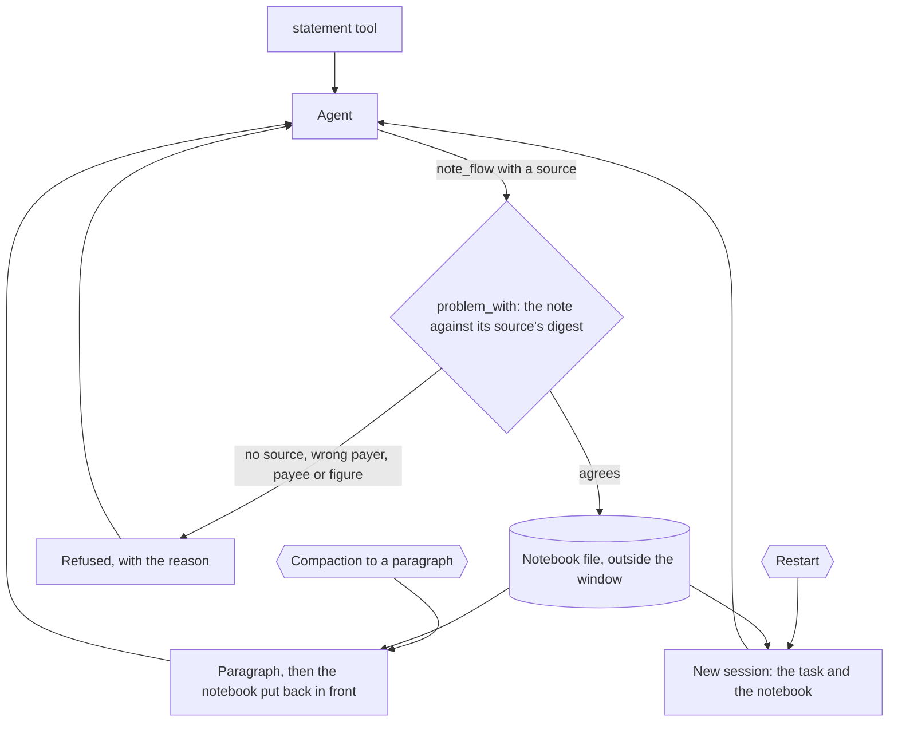
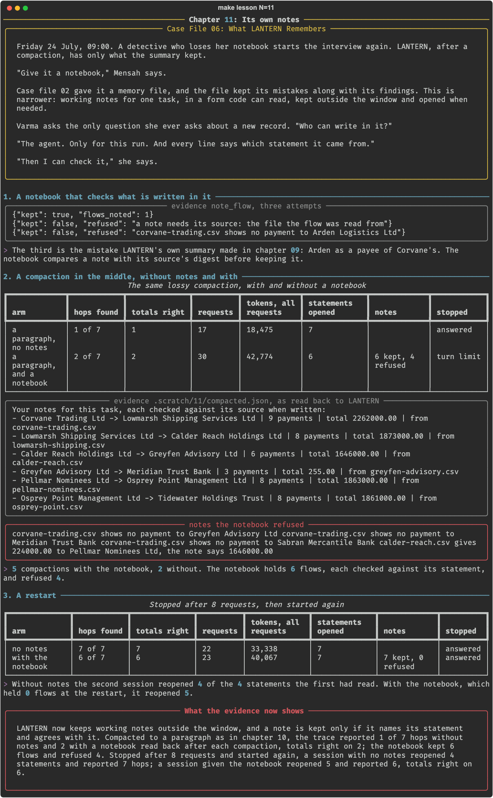

# Chapter 11: Its own notes

**Concept:** structured notes outside the window: the agent writes down flows found and questions open, and reads them back after a compaction or a restart.

## The scene

Friday 24 July, 09:00. A detective who loses her notebook starts the interview again. LANTERN,
after a compaction, has only what the summary kept.

"Give it a notebook," Mensah says.

Case file 02 gave it a memory file, and the file kept its mistakes along with its findings. This
is narrower: working notes for one task, in a form code can read, kept outside the window and
opened when needed.

Varma asks the only question she ever asks about a new record. "Who can write in it?"

"The agent. Only for this run. And every line says which statement it came from."

"Then I can check it," she says.

## The concept

A **notebook** is context the agent writes for itself. It is kept in a file, outside the
window, so a compaction cannot shorten it and a restart cannot lose it. The agent writes to it
with tools:

- `note_flow(payer, payee, payments, total, source)`: one flow read from a statement;
- `note_question(question)` and `close_question(id, answer)`: what it cannot answer yet.

Two rules make the notes checkable. Every flow must name its **source**, the statement it was
read from. And before a note is kept, code compares it with that statement's digest: the payer
must hold the statement, the payee must be in it, and the count and the total must be the
statement's. A note that fails is **refused**, and the agent is told why.

The notebook is read back in two places: in front of the agent straight after a compaction, and
at the start of a new session after a restart.

Chapter 10 checked a compacted state against a ledger code kept of every tool result. A notebook
is different: the agent decides what goes into it. The check can refuse a wrong note. It cannot
see a note that was never written.



## How it works

1. **A notebook that checks what is written in it.** Three notes, no model: one that agrees
   with `corvane-trading.csv`, the same with no source, and one that has Arden Logistics as a
   payee of Corvane's, the mistake LANTERN's own summary made in chapter 09.
2. **A compaction in the middle, without notes and with.** The trace is compacted to a
   paragraph whenever it passes 1,500 tokens, chapter 10's lossy arm, for up to 30 requests.
   The second arm adds the notebook tools, a rule asking for a note after every statement, and
   the notebook put back after each compaction.
3. **A restart.** Each arm is stopped after 8 requests, as if the workstation had restarted,
   and a second session begins: one with the task alone, one with the task, the notebook read
   from its file, and the statements its notes came from counted as opened.

After a compaction the notebook is put back in code, not left to the agent to ask for:

```python
def before(messages):
    was = len(messages)
    messages = paragraph(messages) if compact else messages
    if book and len(messages) < was:  # just compacted: put the notebook back in front
        messages = [*messages, {"role": "user", "content": book.text()}]
    return messages
```

## The nuances

- **The check caught four wrong notes.** Three named Corvane as paying Greyfen Advisory,
  Meridian Trust Bank and Sabran Mercantile Bank; Corvane's statement shows none of them. The
  fourth gave Calder Reach's payment to Pellmar the total of its payment to Greyfen: 1646000.00
  where the statement says 224000.00. Each was refused, and the agent was told why.
- **The notebook held more than the report used.** After 30 requests and 5 compactions, the
  notebook held 6 flows: five of the seven hops and one bank charge, which the rule says not to
  note. The report held 2 hops, and
  only one of them was in the notebook. The other four hops in the notebook were not reported.
  As in chapter 10, keeping a fact and using it are separate things.
- **The report was not clean.** It ran into the turn limit with tool calls written out as text,
  three stray `</think>` tags, and a payment from Greyfen to Meridian Trust Bank of 15 payments
  and 1275000.00, where the checked note in the notebook says 3 payments and 255.00. The report
  contradicted a note the model had written and the check had kept.
- **The notebook cost room.** Note calls and their results are turns too. With the notebook the
  trace was compacted 5 times in place of 2 and used 42,774 tokens in place of 18,475.
- **At the restart the notebook was empty.** In 8 requests the first session with the notebook
  kept no note and had none refused, though the rule asks for one after every statement. The
  second session had nothing to carry on from and reopened 5 statements; the session without
  notes reopened 4. A notebook carries only what the agent writes in it, and nothing here makes
  it write.
- **Starting again from nothing worked.** The second session without notes did the trace again
  and reported 7 of 7 hops with every total right, in 33,338 tokens over both sessions. With the
  notebook: 6 of 7, in 40,067.
- **A note is believed more readily than a document.** The agent reads it back as its own
  earlier finding, after the statement it came from has left the window. That is why the check
  runs when the note is written, not when it is read.
- **Notes are for one task.** The file is per run. What deserves to outlive the task is a memory,
  and who may write one, with what proof, is chapter 13's decision.

## Run it

```bash
make lesson N=11
```

Six sessions, the longest 30 requests. In the recorded run the 99 model calls took 633.5
seconds of model time on the shared machine.

## What you should see



What the recorded run showed (qwen3:8b, local Ollama, the 16 GB Apple silicon Mac, 23 November
2026; 99 calls, 142,777 prompt tokens and 8,060 output tokens in all):

| Arm | Hops found | Totals right | Requests | Tokens, all requests | Statements opened | Notes | Stopped |
|---|---|---|---|---|---|---|---|
| a paragraph, no notes | 1 of 7 | 1 | 17 | 18,475 | 7 | | answered |
| a paragraph, and a notebook | 2 of 7 | 2 | 30 | 42,774 | 6 | 6 kept, 4 refused | turn limit |
| restart, no notes | 7 of 7 | 7 | 22 | 33,338 | 7 | | answered |
| restart, with the notebook | 6 of 7 | 6 | 23 | 40,067 | 7 | 7 kept, 0 refused | answered |

- The demonstration kept 1 note and refused 2: "a note needs its source" and
  "corvane-trading.csv shows no payment to Arden Logistics Ltd".
- Compactions: 2 without the notebook, 5 with it.
- At the restart the notebook held 0 flows. The second session reopened 4 of the 4 statements
  the first had read without notes, and 5 with the notebook.
- The notebooks and reports are in `.scratch/11/`.

What did not happen: the plan had the agent read its notes back after a compaction and carry
on. It was given them after every compaction and reported 2 of 7 hops, with five of the seven
in its notebook. The plan also had the run carry on from the notes after a restart; at the
restart there were no notes, and the session with the notebook reopened more statements than
the one without.

## On a hosted model

```bash
make lesson N=11 TIER=hosted
```

Runs the chapter on Claude Sonnet 5.5 (`config.yaml`, `hosted:`). The statement tool and the
three notebook tools are sent as native tools (`lantern.hosted.tool_def`), so note calls
arrive as structured tool use. The notebook is the lab's own file,
not the provider's memory tool (`memory_20250818`), which chapter 21 compares. Server-side
compaction is not used: it triggers at 50,000 tokens or more, and this chapter compacts at
1,500. The check on a note is code on either tier.

Not run: no hosted key was available when this chapter was built; there are no hosted numbers
beside the local ones yet.

Expectations, not measurements: a larger model will likely follow the rule and write a note
after each statement, so the notebook would hold flows at the restart; it will likely report
from its notes after a compaction, and not write tool calls into its report. Those failures
are probably small-model effects. That the check refuses a note its source does not support is
code and holds on any model, and so does its limit: a notebook holds only what the agent chose
to write, and no check on a note can see a flow that was never noted.

## Try this

1. Open `.scratch/11/compacted.json` and put it beside the report in `.scratch/11/traces.json`
   ("paragraph and notebook"). Which noted hops did the report leave out?
2. Take one flow from `.scratch/11/restarted.json`, change its total, and pass it to
   `lantern.notes.problem_with` with `digest=trail.digest` and `holder_of=notes.holder`. What
   does the check say?
3. Let the agent write free-text notes with no source and no check. Which of the four refused
   notes would then have been read back after the next compaction?

## Master it

After this chapter you can give an agent a notebook it writes with tools and that is kept
outside the window, refuse a note that has no source or that disagrees with it, put the notes
back after a compaction or a restart, and say what a notebook cannot do that a ledger kept in
code can.

**Predict, then see.** `make lesson N=11` stops twice: how many hops the report holds with the
notebook read back after every compaction, and which second session reopens more statements
after a restart.

**Build it.** Write `problem_with` in [`practice/exercise.py`](practice/exercise.py):

```bash
make exercise N=11          # 8 offline tests
make hint N=11
make lesson N=11 ARGS=--mine
```

**Check yourself.** `make quiz N=11`: six questions.

**Break it.** `make challenge N=11`: your check on every note; a restart late enough for the
notebook to hold something; and a notebook that keeps every note unchecked.

`make progress` shows every chapter.

## What the evidence now shows

LANTERN now keeps working notes outside the window, and a note is kept only if it names its
statement and agrees with it. In the recorded run the check refused 4 wrong notes, three of
them payments Corvane never made. Compacted to a paragraph as in chapter 10, the trace reported
1 of 7 hops without notes and 2 with a notebook put back after each compaction, though the
notebook held five of the seven. Stopped after 8 requests, the session with a notebook had
written nothing in it, and the restart from it reopened 5 statements where the restart with no
notes reopened 4; the restart with no notes then found all 7 hops, the one with the notebook 6.
The notes LANTERN does write can be trusted. What it writes, and whether it reads what it wrote,
is still up to the model.

**Next:** [Chapter 12: A fact with no episode](../12-kinds-of-memory/README.md)
