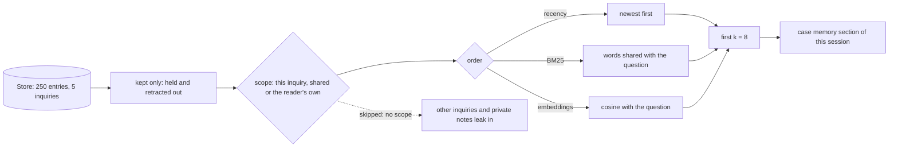
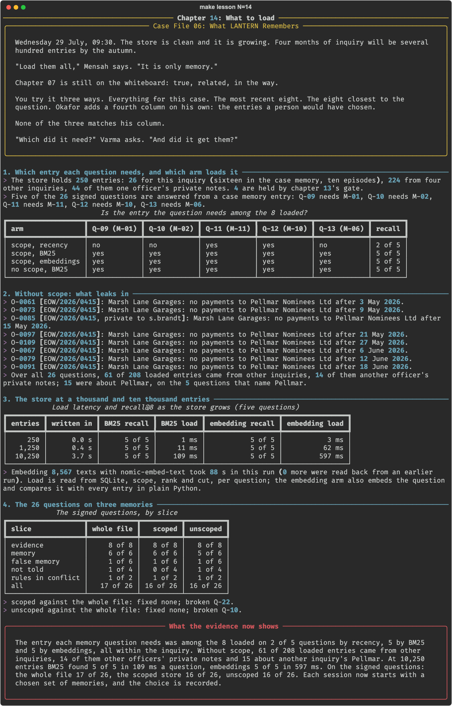

# Chapter 14: What to load

**Concept:** reading from memory: which entries are loaded at the start of a session, by scope, by recency and by relevance, and what changes when the store grows to thousands of entries.

## The scene

Wednesday 29 July, 09:30. The store is clean and it is growing. Four months of inquiry will be
several hundred entries by the autumn.

"Load them all," Mensah says. "It is only memory."

Chapter 07 is still on the whiteboard: true, related, in the way.

You try it three ways. Everything for this case. The most recent eight. The eight closest to
the question. Okafor adds a fourth column on his own: the entries a person would have chosen.

None of the three matches his column.

"Which did it need?" Varma asks. "And did it get them?"

## The concept

Today LANTERN's case memory is one file, loaded whole into every session. A store that grows
cannot be loaded whole, so a session starts with a **chosen** set of entries, and the choice is
three decisions, made in this order:

- **Scope**: which entries this session may read at all. Only this inquiry's, and of those only
  the shared ones and the reading officer's own private notes. Entries the write gate held, or
  that were retracted, are never candidates.
- **Order**: which of those come first. By **recency**, newest first; by **relevance** to the
  question, with BM25 over the words; or by **embeddings**, the cosine between the question's
  vector and each entry's.
- **How many**: the first `k`. Here k is 8.

Scope comes first because ranking cannot do its work. BM25 and embeddings find entries about
the same thing; another inquiry's entries about Pellmar are about the same thing. A rule that
ranks first and filters later, or never, loads them.

The measure of a choice is **recall@k**: is the entry the question needs among the k loaded?
An entry that is not loaded does not exist for that session, however true it is.



## How it works

1. **Which entry each question needs, and which arm loads it.** The store is LANTERN's case
   memory written through chapter 13's gate, its ten episodes, and 224 memories of four other
   inquiries. Five of the 26 signed questions name a case memory entry as their source. Each
   arm (scope and recency, scope and BM25, scope and embeddings, BM25 with no scope) loads 8
   entries for each of the five, and the run counts whether the needed one is among them. The
   embeddings are `nomic-embed-text` through Ollama's `/api/embed`, in batches of 64. No chat
   model.
2. **Without scope: what leaks in.** The 26 questions loaded with no scope, counting entries
   from other inquiries, other officers' private notes, and other inquiries' entries about
   Pellmar. No model.
3. **The store at a thousand and ten thousand entries.** Synthetic entries for this inquiry
   (statements filed, invoices checked, calls logged, payments, about the same twelve
   companies, seed 14) are written into fresh stores of 1,250 and 10,250 entries. For the five
   questions, the run times each load (read from SQLite, scope, rank, cut) and checks recall.
4. **The 26 questions on three memories.** Today's whole file (chapter 02's recorded baseline,
   read, not asked again), the scoped store with the 8 entries closest by BM25 rendered into
   the case memory section per question, and the same unscoped. Two arms of 26 questions.

The retriever, reduced to its spine (`lantern.memory.retrieve`):

```python
pool = [e for e in entries if e.status == "kept"]
if inquiry is not None:
    pool = [e for e in pool if e.inquiry == inquiry and (e.user is None or e.user == user)]
pool.sort(key=lambda e: (e.written_at, e.id))
if by == "recency":
    pool = sorted(pool, key=lambda e: e.written_at, reverse=True)
elif by == "relevance":
    scores = bm25([e.text for e in pool], query)
    pool = [pool[i] for i in sorted((i for i in range(len(pool)) if scores[i] > 0),
                                    key=lambda i: (-scores[i], pool[i].written_at))]
return pool if k is None else pool[:k]
```

## The nuances

- **Recency loads what was written last, and that is not what is asked about.** By scope and
  recency the needed entry was among the 8 on 2 of 5 questions (Q-11 and Q-12). The entries
  Q-09, Q-10 and Q-13 need are older than the eight newest entries this inquiry may read.
- **Relevance found every one.** Scope and BM25, and scope and embeddings, both loaded the
  needed entry on 5 of 5. Within one inquiry's kept entries and episodes there is little to
  compete with.
- **Recall says nothing about what else came in.** BM25 with no scope also found 5 of 5. Over
  all 26 questions it loaded 61 of 208 entries from other inquiries, 14 of them another
  officer's private notes. For "Has the FIU cleared Pellmar Nominees?" all 8 entries it loaded
  were inquiry EOW/2026/0415's notes on Marsh Lane Garages and Pellmar, one of them private to
  s.brandt. On the five questions that name Pellmar, 15 loaded entries were another inquiry's
  entries about Pellmar. Scope is applied before ranking, or the ranking fills the session
  with someone else's case.
- **Ten thousand entries did not crowd the answers out, here.** At 10,250 entries BM25 still
  found 5 of 5 and embeddings 5 of 5. The synthetic entries name the same companies, but none
  is about a protector, a beneficial owner or a signature rule, so none competes with the
  entries the five questions need. A store that grows with entries on the same subjects would
  test this harder; the second challenge does that.
- **Load time grows with the store, and the embedding arm grows faster.** BM25 took 1 ms a
  question at 250 entries, 11 ms at 1,250 and 109 ms at 10,250. Embeddings took 3, 62 and
  597 ms. Both read every entry from SQLite and score all of them; the embedding arm compares
  the question's vector with every entry's in plain Python.
- **The embedding load time leaves out the model.** The document vectors were built once and
  not timed, as the run says. The question vectors were also already there: step 1 embedded
  the same five questions, and the cache kept them, so the timed loads in step 3 made no call
  to `nomic-embed-text` at all. The run's note, that the embedding arm "also embeds the
  question", is not what the timing measured. The 597 ms is reading and comparing; a session
  that has to embed a new question adds one `/api/embed` call on top.
- **Embedding the store is the expensive part.** Embedding 8,567 texts with nomic-embed-text
  took 88 s in this run, and 0 were read back from an earlier run. Writing 10,000 entries took
  3.7 s.
- **A smaller memory is not a better score by itself.** On the 26 signed questions the whole
  file passed 17, the scoped store 16 and the unscoped store 16. Scoped broke Q-22: given 8
  entries none of which mentions the call, LANTERN said the question "refers to a private note
  made by Simon Clarke", which nothing it loaded says. Unscoped broke Q-10: it loaded M-02 and
  three entries from inquiry EOW/2026/0421, then called `lookup_company`, which is not
  connected, and answered that nothing was checked. The false-memory slice was 1 of 6 on all
  three: the four entries the gate held were never loaded in the scoped arm (0 sessions), so
  what still misleads is elsewhere in the context, as chapter 18 finds.

## Run it

```bash
make lesson N=14
```

Steps 1 to 3 need only the embedding model; step 4 is the 26 questions twice. In the recorded
run the 62 chat calls took 1,504.64 seconds of model time on the shared machine.

## What you should see



What the recorded run showed (qwen3:8b and nomic-embed-text, local Ollama, the 16 GB Apple
silicon Mac, 23 November 2026, 12:51 to 13:18; 62 chat calls, 363,054 prompt tokens and 3,178
output tokens in all):

| Arm | Q-09 (M-01) | Q-10 (M-02) | Q-11 (M-11) | Q-12 (M-10) | Q-13 (M-06) | Recall@8 |
|---|---|---|---|---|---|---|
| scope, recency | no | no | yes | yes | no | 2 of 5 |
| scope, BM25 | yes | yes | yes | yes | yes | 5 of 5 |
| scope, embeddings | yes | yes | yes | yes | yes | 5 of 5 |
| no scope, BM25 | yes | yes | yes | yes | yes | 5 of 5 |

| Without scope, over 26 questions | Result |
|---|---|
| Loaded entries from other inquiries | 61 of 208 |
| Of them, another officer's private notes | 14 |
| Other inquiries' Pellmar entries, on the 5 Pellmar questions | 15 |
| "Has the FIU cleared Pellmar Nominees?": entries from other inquiries | 8 of 8 |

| Entries | Written in | BM25 recall | BM25 load | Embedding recall | Embedding load |
|---|---|---|---|---|---|
| 250 | 0.0 s | 5 of 5 | 1 ms | 5 of 5 | 3 ms |
| 1,250 | 0.4 s | 5 of 5 | 11 ms | 5 of 5 | 62 ms |
| 10,250 | 3.7 s | 5 of 5 | 109 ms | 5 of 5 | 597 ms |

| Slice | Whole file | Scoped | Unscoped |
|---|---|---|---|
| evidence | 8 of 8 | 8 of 8 | 8 of 8 |
| memory | 6 of 6 | 6 of 6 | 5 of 6 |
| false memory | 1 of 6 | 1 of 6 | 1 of 6 |
| not told | 1 of 4 | 0 of 4 | 1 of 4 |
| rules in conflict | 1 of 2 | 1 of 2 | 1 of 2 |
| all | 17 of 26 | 16 of 26 | 16 of 26 |

- The store: 250 entries, 26 for this inquiry, 224 from four other inquiries, 44 of them one
  officer's private notes; 4 held by chapter 13's gate.
- Scoped against the whole file: fixed none, broken Q-22. Unscoped: fixed none, broken Q-10.
- Every answer and every session's loaded ids are in `.scratch/14/runs.json`.

What did not happen: the scene's planned result, that no arm matches the entries a person
would choose, is true only of recency; BM25 and embeddings found every needed entry. The plan
expected recall to fall as the store grew; with these synthetic entries it did not. The plan
had the run load the whole store and count the cost of too many; the run loads eight and
measures the cost of the wrong eight, and of the store's size in milliseconds.

## On a hosted model

```bash
make lesson N=14 TIER=hosted
```

Only step 4 changes. The 26 questions go to Claude Sonnet 5.5 (`config.yaml`, `hosted:`) with
`cache: auto`: breakpoints on the last tool and the last system block, and automatic caching
for the rest. Each question now carries its own case memory section, second in the context, so
less of each request is the same from one question to the next, and less can be read from the
cache than with one fixed file.
Scope, ranking and the scale step are code, and the embeddings stay `nomic-embed-text` on the
local Ollama on either tier.

Not run: no hosted key was available when this chapter was built; there are no hosted numbers
beside the local ones yet.

Expectations, not measurements: recall@8, the 61 leaked entries, the 14 private notes and the
load times are properties of the store and the retriever, and will be the same on any model. A
larger model will probably not invent a private note for Q-22 or reach for a tool that is not
connected on Q-10; those are likely small-model effects. Whether 8 entries chosen by BM25 score
as well as the whole file on a larger model has to be measured again.

## Try this

1. Set `K = 20` and see what recency recalls, and how many of the 20 are episodes.
2. Add a synthetic template that names a protector and a trust, and run the scale step again.
3. Score a scoped session as `l.mensah`, with `user="l.mensah"`, and see whether her private
   notes change any answer.

## Master it

After this chapter you can scope a memory before ranking it, measure recall@k for the entry a
question needs, count what leaks in without scope, and measure what loading costs as a store
grows.

**Predict, then see.** `make lesson N=14` stops four times: how many needed entries recency
loads, how many of the FIU question's entries come from another inquiry without scope, whether
BM25 still finds all five at ten thousand entries, and which memory scores higher.

**Build it.** Write `retrieve` in [`practice/exercise.py`](practice/exercise.py):

```bash
make exercise N=14          # 9 offline tests
make hint N=14
make lesson N=14 ARGS=--mine
```

**Check yourself.** `make quiz N=14`: seven questions.

**Break it.** `make challenge N=14`: your retriever on every session; a store grown with entries
on the questions' own subjects; and a retriever that forgets the write gate.

`make progress` shows every chapter.

## What the evidence now shows

LANTERN no longer has to load its whole memory file. Scoped to the inquiry, BM25 and embeddings
put the needed entry among 8 on 5 of 5 questions; recency on 2. Without scope, 61 of 208 loaded
entries came from other inquiries, 14 of them other officers' private notes, and the FIU
question was answered from 8 entries of inquiry EOW/2026/0415. At 10,250 entries BM25 still
found 5 of 5 in 109 ms a question and embeddings in 597 ms, not counting the question's
embedding. On the signed questions the scoped store passed 16 of 26 against the whole file's
17. Each session now starts with a chosen set of memories, and the choice is recorded.

**Next:** [Chapter 15: Forty-two pages, five lines](../15-isolating-context/README.md)
