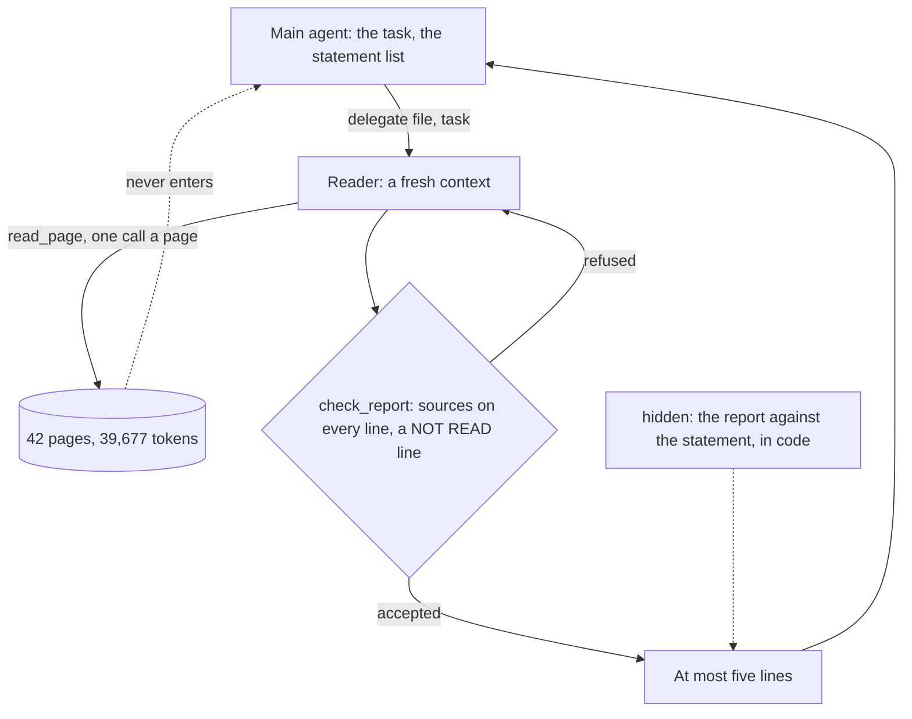
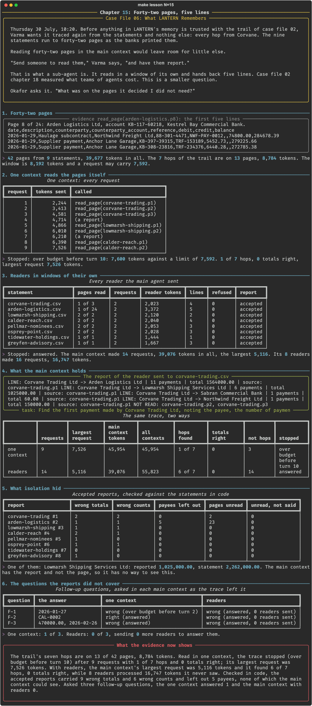

# Chapter 15: Forty-two pages, five lines

**Concept:** isolating context: a sub-agent reads at length in a context of its own and returns a few lines, so the main context never holds what it read.

## The scene

Thursday 30 July, 10:20. Before anything in LANTERN's memory is trusted with the trail of case
file 02, Varma wants it traced again from the statements and nothing else: every hop from
Corvane. The nine statements run to forty-two pages as the banks printed them.

Reading forty-two pages in the main context would leave room for little else.

"Send someone to read them," Varma says, "and have them report."

That is what a sub-agent is. It reads in a window of its own and hands back five lines. Case
file 02 chapter 18 measured what teams of agents cost. This is a smaller question.

Okafor asks it. "What was on the pages it decided I did not need?"

## The concept

A **sub-agent** is a second model session with a context of its own. The main agent gives it a
task in words; it starts with nothing else, does the reading, and returns a short report. Only
the report enters the main context. This is **isolation**: the pages are processed, but not in
the window that has to hold the whole trace.

Here the sub-agent is a **reader**. The main agent calls `delegate(file, task)`; the reader
opens the pages of one statement with `read_page` and must answer in a fixed form:

```text
LINE: <payer> -> <payee> | <n> payments | total <amount> | source: <page ids>
NOT READ: <the page ids it did not read, or none>
```

At most five lines, each naming the pages it rests on, and a list of what it did not read. A
check in code (`check_report`) refuses a report without those, and the reader is asked again.

The check reads the form of a report. It cannot read its truth: the main agent never held the
pages, so it has nothing to compare the report with. A report from a reader is testimony.



## How it works

1. **Forty-two pages.** `lantern.isolation.pages()` cuts the nine statements of the trail into
   pages of 18 rows, as a bank prints them. No model.
2. **One context reads the pages itself.** One tool, `read_page`, and every page it reads stays
   in its context, under chapter 08's budget: a request may carry 7,592 tokens of the 8,192
   window.
3. **Readers in windows of their own.** The same task, but the main agent cannot open a page.
   It sends readers with `delegate`, and only their reports come back.
4. **What the main context holds.** The two traces side by side, graded against the trail.
5. **What isolation hid.** Each accepted report checked in code against its statement: wrong
   totals, wrong counts, payees left out, pages not read and not said.
6. **The questions the reports did not cover.** Three follow-ups whose answers are on the pages
   and in no five-line report, asked in each main context as its trace left it, tools still
   there.

The reader is an ordinary agent run with its own messages; isolation is nothing more than not
sharing them:

```python
run = agent.run([{"role": "system", "content": READER + listing},
                 {"role": "user", "content": task}], chat=chat, schemas=[page_schema()],
                handlers={"read_page": read_page}, max_turns=max_turns, max_tokens=reserve,
                limit=limit, seed=seed, before_request=before, until=until)
```

`until` runs the check on every report the reader gives; a report the check refuses goes back
to the reader with the reasons.

## The nuances

- **One context ran out of room.** It read seven pages, twice stopped to report and was sent
  back to carry on, and stopped over budget before its tenth request: 7,600 tokens against a
  limit of 7,592. It had 1 of 7 hops, and 0 totals right. The seven hops are on 13 pages, 8,784 tokens: more than one
  request may carry.
- **The readers kept the main window small.** With readers the largest request in the main
  context was 5,116 tokens, and it reported 6 of 7 hops. The 8 readers processed 16,747 tokens
  the main context never saw.
- **Isolation moved the reading; it did not remove it.** Counting every context, the readers'
  trace processed 55,823 tokens, 1.43 times the main context's own 39,076.
- **Every report passed the check, and most were wrong.** All 8 were accepted at the first
  attempt. Checked in code against the statements they carried 9 wrong totals and 6 wrong
  counts and left out 5 payees. Corvane's payments to Lowmarsh were reported as 1,025,000.00;
  the statement shows 2,262,000.00. The main context had no way to see any of it.
- **The reader repeated an old mistake with a source on it.** The reader sent to Corvane
  reported a payment from Corvane to Arden Logistics, the error LANTERN's own summary made in
  chapter 09, and cited `corvane-trading.p1` for it. A source on a line says where to look. It
  does not say the line is right.
- **The readers were honest about what they skipped.** The reader sent to Arden read 1 of 24
  pages and listed the other 23 as not read; the one sent to Corvane read 1 of 3 and said so.
  No report left an unread page unsaid. A NOT READ line is the one claim the main agent can
  act on without the pages: it says where to send a reader next. The main agent did not.
- **The task is all a reader knows.** Every task the main agent wrote was a variation of "Find
  the first payment made by" a company, narrower than the trace it was doing. The readers had
  nothing else to go on.
- **Follow-ups need what was left behind.** Asked for a date, a reference and a single payment,
  the context that had read pages itself answered 1 of 3, the reference, from a page still in
  its window. The context with readers answered 0 of 3 and sent no reader to look: it gave a
  date, a reference and a payment, and none of them is the statements' answer.

## Run it

```bash
make lesson N=15
```

Two traces of up to 16 requests, the readers in between, then six follow-ups. In the recorded
run the 45 model calls took 722.78 seconds of model time on the shared machine.

## What you should see



What the recorded run showed (qwen3:8b, local Ollama, the 16 GB Apple silicon Mac, 23 November
2026; 45 calls, 141,690 prompt tokens and 5,577 output tokens in all):

| Arm | Requests | Largest request | Main context tokens | All contexts | Hops found | Totals right | Flows not in the trail | Stopped |
|---|---|---|---|---|---|---|---|---|
| one context | 9 | 7,526 | 45,954 | 45,954 | 1 of 7 | 0 | 3 | over budget before turn 10 |
| readers | 14 | 5,116 | 39,076 | 55,823 | 6 of 7 | 0 | 14 | answered |

- Pages: 42 from 9 statements, 39,677 tokens; the trail's hops are on 13 of them, 8,784 tokens.
- Readers: 8 sent, to 8 of the 9 statements (none to Northwind Freight), 8 accepted, none
  refused; pages read 1 of 3 (Corvane), 1 of 24 (Arden), and every page of the other six.
- Hidden in the accepted reports: 9 wrong totals, 6 wrong counts, 5 payees left out (all five
  from the Arden report), 0 unread pages not said.
- Follow-ups: F-1 (a date, 2026-01-27), F-2 (a reference, CAL-0002), F-3 (a payment and its
  date, 470000.00 on 2026-02-26). One context right on F-2 only; readers on none, with 0 more
  readers sent.
- The traces, every reader's task and report, and the follow-up answers are in
  `.scratch/15/traces.json`.

What did not happen: the plan had forty daily statements; the trail's nine statements make 42
pages. The plan also expected the main agent to send a reader again for a question its reports
did not cover. It sent none, and answered all three from what it had.

## On a hosted model

```bash
make lesson N=15 TIER=hosted
```

Runs the chapter on Claude Sonnet 5.5 (`config.yaml`, `hosted:`). `read_page` and `delegate`
are sent as native tools (`lantern.hosted.tool_def`), and each reader is its own request
sequence with its own messages, as on Ollama: the isolation is the lab's code, not a provider
feature. The budget a request may carry comes from `generation.num_ctx` in `config.yaml` on
either tier, so the one-context arm stops at the same 7,592 tokens unless that is raised.

Not run: no hosted key was available when this chapter was built; there are no hosted numbers
beside the local ones yet.

Expectations, not measurements: a larger model will likely write a reader's task in full, read
every page it is given, and report closer to the statements, so fewer wrong totals would be
hidden; it may send a reader again for a follow-up. Those failures are probably small-model
effects. With a window far larger than 8,192 tokens, all 39,677 tokens of pages would fit in
one context, and the case for isolation becomes cost and attention, not room. What holds on any
model is structural: the check reads the form and not the truth, the main context cannot see
what a reader got wrong, and detail left in a reader's window is gone unless a reader is sent
again.

## Try this

1. Open `.scratch/15/traces.json` and read the tasks the main agent wrote. Rewrite one in full
   and send a reader with it through `lantern.isolation.read`. Does the report change?
2. Take the Arden report and its NOT READ line. Which payees on the 23 unread pages would the
   main agent have needed?
3. Ask the main context with readers a fourth question about a page no reader opened, and
   watch whether it sends one.

## Master it

After this chapter you can give an agent a sub-agent that reads in a context of its own, hold
its report to a form with sources and a list of what it did not read, measure what that saves
the main window and what it costs in all, and say what the main agent cannot see.

**Predict, then see.** `make lesson N=15` stops four times: how the one-context trace ends,
how many tokens are processed in all with readers, whether an accepted report was wrong, and
which context answers more follow-ups.

**Build it.** Write `check_report` in [`practice/exercise.py`](practice/exercise.py):

```bash
make exercise N=15          # 7 offline tests
make hint N=15
make lesson N=15 ARGS=--mine
```

**Check yourself.** `make quiz N=15`: six questions.

**Break it.** `make challenge N=15`: your check on every reader; a main agent that sends a
reader for a follow-up; and readers allowed to skip the NOT READ line.

`make progress` shows every chapter.

## What the evidence now shows

The trail's seven hops are on 13 of 42 pages, 8,784 tokens. Read in one context, the trace ran
out of room after 9 requests with 1 of 7 hops. With readers in windows of their own, the main
context's largest request was 5,116 tokens and it found 6 of 7 hops, while 8 readers processed
16,747 tokens it never saw. Every report passed the check on its form, and between them they
carried 9 wrong totals and 6 wrong counts and left out 5 payees, Corvane's supposed payment to
Arden among them, none of it visible to the main context. Asked what the reports did not cover,
the main context with readers answered nothing right and sent no one to look. Isolation saved
the window and hid the mistakes. Before the memory is trusted with the trail, the trail itself
has to be read where it can be checked.

**Next:** [Chapter 16: The same beginning](../16-layout-for-the-cache/README.md)
