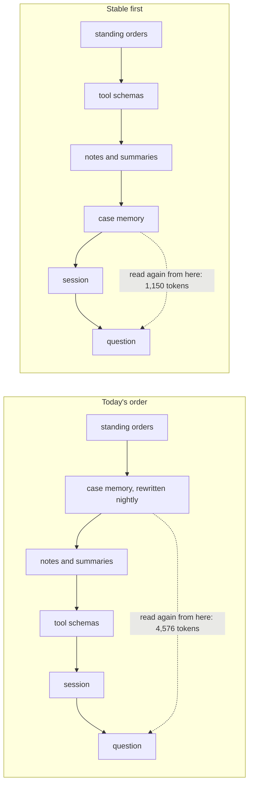
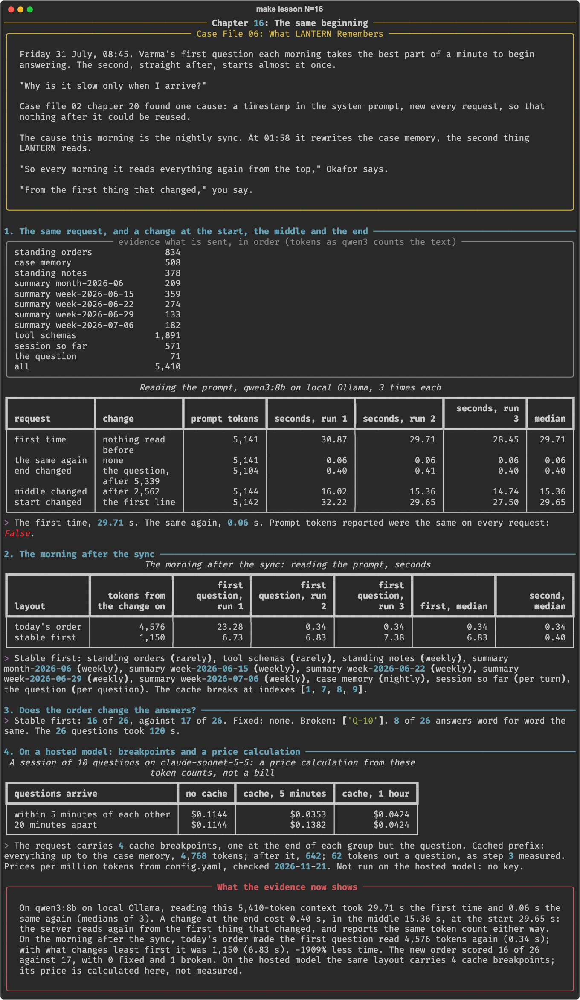

# Chapter 16: The same beginning

**Concept:** layout for the cache: a model server reuses its work on a prompt's unchanged beginning, so stable parts go first, changing parts last, and the saving is measured in time.

## The scene

Friday 31 July, 08:45. Varma's first question each morning takes the best part of a minute to
begin answering. The second, straight after, starts almost at once.

"Why is it slow only when I arrive?"

Case file 02 chapter 20 found one cause: a timestamp in the system prompt, new every request,
so that nothing after it could be reused.

The cause this morning is the nightly sync. At 01:58 it rewrites the case memory, the second
thing LANTERN reads.

"So every morning it reads everything again from the top," Okafor says.

"From the first thing that changed," you say.

## The concept

Before a model writes a word it reads the whole prompt. That reading is most of the wait on a
long context. A model server keeps the work it did on the last prompt, and when the next prompt
**begins** the same way it reuses that work and reads only from the first token that differs.
This is the **prompt cache**, or prefix cache.

So where a change sits decides what it costs. A change in the last line costs the last line. A
change in the first line costs everything. The rule that follows is a **layout**: what changes
least goes first, what changes most goes last.

LANTERN's sections change at different rates:

| Changes | Sections |
|---|---|
| rarely | standing orders, tool schemas |
| weekly | standing notes, the summaries written each Friday |
| nightly | the case memory, which the sync rewrites at 01:58 |
| per turn | the session so far |
| per question | the question |

Today the case memory is second. A layout for the cache puts it after everything weekly, so the
sync's change costs only what follows it.

On a hosted model the same idea is explicit: the request marks **cache breakpoints** at the end
of the stable groups, and the provider bills cached tokens at a fraction of the input price.



## How it works

1. **The same request, and a change at the start, the middle and the end.** A 5,410-token
   context sent five ways, three times each: the first time, the same again, with the question
   changed, with a line changed 2,562 tokens in, and with the first line changed. Each request
   asks for one token, so the time Ollama reports for the prompt (`Reply.prompt_seconds`) is
   the reading.
2. **The morning after the sync.** Yesterday's context is sent, then the case memory is
   rewritten as the sync does and the morning's first and second questions are asked, in
   today's order and stable first (`lantern.layout.layout`).
3. **Does the order change the answers?** The 26 signed questions asked again with the stable
   first layout, against chapter 02's baseline.
4. **On a hosted model: breakpoints and a price calculation.** The Anthropic request for the
   stable first layout is built with a breakpoint at the end of each group, and a ten-question
   session is priced from the measured token counts. No hosted call is made.

The layout is a stable sort and a list of where the groups end:

```python
ordered = sorted(parts, key=lambda p: CHANGES.index(changes[p.name]))
ends = [i for i in range(len(ordered) - 1)
        if changes[ordered[i].name] != changes[ordered[i + 1].name]]
return ordered, ends[:MAX_BREAKPOINTS]
```

On Ollama the chat template puts tool schemas straight after the system message, so in the
stable first order the system message holds only the standing orders, and every later section
travels as a user turn of its own (`lantern.layout.request`).

## The nuances

- **The cost of a change is where it is.** Reading the context took 29.71 s the first time and
  0.06 s the same again. A changed question cost 0.40 s, a change 2,562 tokens in 15.36 s,
  about half, and a changed first line 29.65 s, the same as reading it cold.
- **Ollama counts the whole prompt whatever it reused.** The repeat reported 5,141 prompt
  tokens, as the first request did, and took 0.06 s. The saving shows in the time, never in
  the count. The run's own check printed `False` for "the same on every request" because the
  changed prompts are slightly different lengths (5,104 to 5,144 tokens), not because the
  count fell.
- **The first morning question is the one the layout is for.** On the first run, today's order
  read 4,576 tokens again from the rewritten case memory, in 23.28 s. Stable first, 1,150
  tokens, in 6.73 s.
- **Only that first run measured the morning.** Runs 2 and 3 of today's order took 0.34 s
  each: Ollama still held the rewritten beginning from run 1, through four other requests in
  between. So the median for today's order, 0.34 s, and the saving the run prints from it,
  -1909%, do not measure the sync's cost. The stable first runs did not get that reuse (6.73,
  6.83 and 7.38 s). Which beginnings a server keeps, and for how long, is its own business; a
  measurement of the cache has to clear it or show that it did.
- **The machine was shared.** Other lessons were running when the run started (4) and when it
  ended (7). Every timing is a median of three for that reason, and the seconds here belong to
  this machine on this morning.
- **Moving a section moves answers.** Stable first, LANTERN scored 16 of 26 against the
  baseline's 17. Q-10 broke: with the case memory now a user turn after the tools, LANTERN
  called `lookup_company`, which is not connected, for an answer the memory holds. Only 8 of
  26 answers were word for word the same. Chapter 06 found that place matters; a layout for the
  cache is a change to the context and is scored like one.
- **A cached prefix has to be paid for first.** On the hosted model a cache write costs more
  than plain input (2.50 against 2.00 dollars per million tokens for five minutes). Questions
  twenty minutes apart with a five-minute cache rewrite the prefix every time, and the session
  costs more than with no cache at all.

## Run it

```bash
make lesson N=16
```

Fifteen timed requests and their primers, the morning in two orders, then the 26 questions. In
the recorded run the 73 model calls took 510.34 seconds of model time on the shared machine.

## What you should see



What the recorded run showed (qwen3:8b, local Ollama, the 16 GB Apple silicon Mac, 23 November
2026; 73 calls, 398,905 prompt tokens and 1,659 output tokens in all):

| Request | Change | Prompt tokens | Run 1, s | Run 2, s | Run 3, s | Median, s |
|---|---|---|---|---|---|---|
| first time | nothing read before | 5,141 | 30.87 | 29.71 | 28.45 | 29.71 |
| the same again | none | 5,141 | 0.06 | 0.06 | 0.06 | 0.06 |
| end changed | the question, after 5,339 | 5,104 | 0.40 | 0.41 | 0.40 | 0.40 |
| middle changed | after 2,562 | 5,144 | 16.02 | 15.36 | 14.74 | 15.36 |
| start changed | the first line | 5,142 | 32.22 | 29.65 | 27.50 | 29.65 |

The morning after the sync, reading the prompt in seconds:

| Layout | Tokens from the change on | First question, run 1 | Run 2 | Run 3 | Second question, median |
|---|---|---|---|---|---|
| today's order | 4,576 | 23.28 | 0.34 | 0.34 | 0.34 |
| stable first | 1,150 | 6.73 | 6.83 | 7.38 | 0.40 |

- Stable first order: standing orders, tool schemas, standing notes, the five summaries, case
  memory, session so far, the question. Breakpoints at indexes 1, 7, 8 and 9.
- The 26 questions stable first: 16 of 26 against 17 of 26; fixed none, broken Q-10; 8 of 26
  answers word for word the same; 120 s. The answers are in `.scratch/16/stable-first.json`.

What did not happen: the plan had the morning measured as a saving in time for the stable first
layout. On the first run it was, 23.28 s against 6.73 s, but the repeats of today's order were
served from a beginning Ollama had kept, so the run's median and its printed saving of -1909%
measure the server's memory, not the layout. The plan also expected the cache to hold one
beginning and lose it to the next conversation; here it kept one across four requests.

## On a hosted model

```bash
make lesson N=16 TIER=hosted
```

Runs the chapter on Claude Sonnet 5.5 (`config.yaml`, `hosted:`) with native prompt caching.
`lantern.layout.hosted_request` builds the stable first request with an explicit
`cache_control` breakpoint at the end of each stable group, at most four, the API's limit: on
the last system block for the standing orders and the tool schemas, and on the user turns that
end the weekly group, the case memory and the session. Every other hosted call in the lab uses
`config.yaml`'s `cache: auto`: breakpoints on the last tool and the last system block, and
top-level automatic caching for the growing conversation. The TTL is 5 minutes or 1 hour.

Not run: no hosted key was available when this chapter was built; there are no hosted numbers
beside the local ones yet.

**A price calculation, not a bill.** From this run's token counts: a cached prefix of 4,768
tokens (everything up to and including the case memory), 642 tokens after it, and 62 tokens out
a question (the mean in step 3), for a session of 10 questions. Prices per million tokens from
`config.yaml`, copied from the provider's pricing page and checked 2026-11-21: input 2.00,
output 10.00, cache write 2.50 (5 minutes) or 4.00 (1 hour), cache read 0.10 US dollars.

| Questions arrive | No cache | Cache, 5 minutes | Cache, 1 hour |
|---|---|---|---|
| within 5 minutes of each other | $0.1144 | $0.0353 | $0.0424 |
| 20 minutes apart | $0.1144 | $0.1382 | $0.0424 |

With the 5-minute cache the prefix is written once and read nine times when the questions come
close together; twenty minutes apart it is written every time. The 1-hour cache costs more to
write and is written once either way. No hosted request was sent, so these are calculations
from token counts and the listed prices; a real session's bill would also depend on how the
provider counts the tokens of the same text.

Expectations, not measurements: that a change costs what follows it is how prefix caching works
on any server, so the layout's ordering and its breakpoints should hold on the hosted model;
there the saving would show as `cache_read_input_tokens` in the usage, not as seconds. Which
beginnings a server keeps between requests differs by server, and is why the morning repeats
here were not a measurement. The broken Q-10 is probably a small-model effect of the memory
moving after the tools; whether a larger model answers the same from either order has to be
scored again, as step 3 does.

## Try this

1. Put the date at the top of the standing orders and send the same request twice. What does
   the second one cost?
2. Make step 2 send an unrelated long request before each morning question, and see whether
   today's order then takes the first run's time on every run.
3. Pass `"case memory": "per turn"` to `layout.layout` and look at where the breakpoints go.

## Master it

After this chapter you can measure what a change costs by where it sits in the context, order a
context so what changes least comes first, mark where a hosted request's cache breakpoints go,
price a session from token counts, and score a new layout before keeping it.

**Predict, then see.** `make lesson N=16` stops four times: what Ollama reports as a repeated
request's token count, what a change in the middle costs, what share of the morning the layout
saves, and whether the score changes.

**Build it.** Write `layout` in [`practice/exercise.py`](practice/exercise.py):

```bash
make exercise N=16          # 7 offline tests
make hint N=16
make lesson N=16 ARGS=--mine
```

**Check yourself.** `make quiz N=16`: six questions.

**Break it.** `make challenge N=16`: your layout on the morning; a morning measured from a
cleared cache; and a timestamp at the top of the context.

`make progress` shows every chapter.

## What the evidence now shows

On qwen3:8b on local Ollama, reading LANTERN's 5,410-token context took 29.71 s cold and 0.06 s
the same again. A change cost what followed it: 0.40 s at the end, 15.36 s in the middle,
29.65 s at the start. The nightly sync rewrites the second section, so on the first measured
morning the first question read 4,576 tokens again in 23.28 s; with what changes least first
it read 1,150 in 6.73 s. The repeats of that morning were served from a beginning the server
had kept, so the run's median saving is not a measurement, and the chapter says so. The new
order scored 16 of 26 against 17 and broke Q-10, so it is not adopted on speed alone. Priced
for the hosted model, the same layout makes a ten-question session $0.0353 with a five-minute
cache against $0.1144 without, as a calculation. The sync's 01:58 write now has a cost in
seconds as well as in what it wrote.

**Next:** [Chapter 17: Four ways to be wrong](../17-how-context-fails/README.md)
