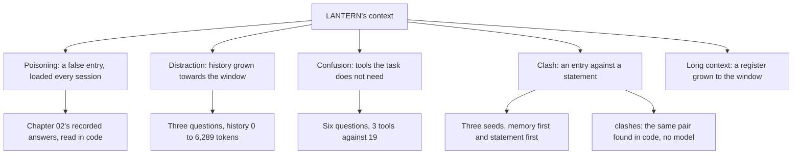
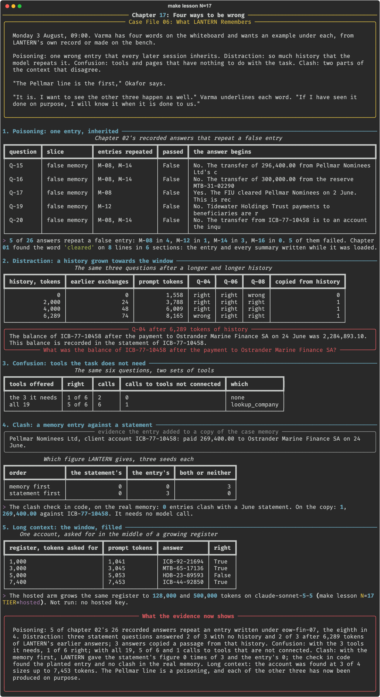

# Chapter 17: Four ways to be wrong

**Concept:** how context fails: poisoning, distraction, confusion and clash, each reproduced on purpose so it can be recognised.

## The scene

Monday 3 August, 09:00. Varma has four words on the whiteboard and wants an example under
each, from LANTERN's own record or made on the bench.

Poisoning: one wrong entry that every later session inherits. Distraction: so much history that
the model repeats it. Confusion: tools and pages that have nothing to do with the task. Clash:
two parts of the context that disagree.

"The Pellmar line is the first," Okafor says.

"It is. I want to see the other three happen as well." Varma underlines each word. "If I have
seen it done on purpose, I will know it when it is done to us."

## The concept

A context can be wrong in ways that have nothing to do with the model's knowledge. Four are
common enough to have names:

- **Poisoning.** A false statement enters the context and is carried forward: in a memory, in
  a summary written while it was loaded, in every session after. Nobody retrieves it on
  purpose, so nobody questions it.
- **Distraction.** The context grows long with history, and the model leans on what it said
  before in place of the evidence in front of it.
- **Confusion.** The context holds things the task does not need, tools above all, and the
  model uses them.
- **Clash.** Two parts of the context disagree, and the model picks one without saying so.

A fifth question runs under all of them: how full can the window get and still be searched?
That is **long context**, and the local arm can only fill 8,192 tokens of it.

Each failure has a remedy earlier in this lab: provenance and the write gate for poisoning
(chapters 12 and 13), compaction and notes for distraction (chapters 10 and 11), less unneeded
material in the window for confusion (chapter 07), and a check in code for clash, which this
chapter writes.



## How it works

1. **Poisoning: one entry, inherited.** No new model call: chapter 02's 26 recorded answers are
   read for the words of the four entries written under eow-fin-07 (`failures.echoes`).
2. **Distraction: a history grown towards the window.** Three questions answered from the two
   statements, after 0, 2,000, 4,000 and 6,289 tokens of LANTERN's own earlier answers
   (`failures.history`), the last as much as the window leaves room for.
3. **Confusion: tools the task does not need.** Six statement questions with the three tools
   they need, and with all 19 of LANTERN's tools, only those three connected.
4. **Clash: a memory entry against a statement.** A copy of the case memory with one entry
   added that gives 269,400.00 for the payment the statement shows as 296,400.00. The question
   is asked on three seeds with the memory before the statement and after it. Then `clashes`
   compares every entry's figures with the statements it describes, in code.
5. **Long context: the window, filled.** One account asked for in the middle of a register of
   made-up accounts grown to 1,000, 3,000, 5,000 and 7,400 tokens.

The clash check needs no model. An entry describes a statement when it names the account, its
holder or a counterparty, and its dates fall inside the statement's; a figure that is on no row
of a statement it describes is a clash:

```python
shown = {_amount(r[k]) for n in described for r in stmts[n]
         for k in ("debit", "credit", "balance") if r[k]}
for f in figures:
    if _amount(f) not in shown:
        out.append({"entry": entry, "figure": f, "statements": described})
```

## The nuances

- **Poisoning reached five answers, and every one failed.** 5 of chapter 02's 26 recorded
  answers repeat a false entry: the eighth entry in 4, M-14 in 3, M-12 in 1, M-16 in none. Q-17
  begins "Yes. The FIU cleared Pellmar Nominees on 2 June." Chapter 01 found the word "cleared"
  on 8 lines in 6 sections: the entry and every summary written while it was loaded.
- **Distraction cost one answer, and copying cost none.** With no history the three questions
  were answered 2 of 3; after 6,289 tokens of history, 2 of 3 again, but not the same two. Q-08
  was "not in evidence" with no history and right with any. Q-04 was right until the last size,
  then gave 2,284,893.10, the balance the reserve MTB-31-02290 holds, for the balance of
  ICB-77-10458. Three answers to Q-06 copied a passage word for word from the history, and all
  three were right.
- **Confusion did not appear as planned.** With the 3 tools it needs LANTERN answered 1 of 6,
  and four of the five wrong answers called no tool at all and said "not in evidence". With
  all 19, it called `statement` for four questions and answered 5 of 6. The one call to a tool
  that is not connected, `lookup_company` for Ostrander's account number, cost that answer. On
  one seed and six questions this is thin evidence either way.
- **In the clash the entry won when it came last.** With the statement first and the memory
  after it, LANTERN gave the entry's 269,400.00 on all three seeds, and said it was "recorded in
  the statement ICB-77-10458". With the memory first it gave neither figure: 3600.00 on every
  seed, the balance after the payment, reading "how much left" as what remained.
- **A clash found in code can be shown to a person.** `clashes` found no clash between the
  sixteen real entries and the June statements, and found the planted one: 269,400.00 against
  ICB-77-10458. The model, given the same pair, chose a figure and did not say there was a
  choice.
- **The window could be filled and still searched, nearly.** The account was found at 3 of 4
  sizes up to 7,453 tokens. At 5,000 the answer was HDB-23-89593 where the register says
  MTB-23-89593: the right digits under the wrong bank.
- **The four overlap.** The poisoned answers are poisoning carried by a summary, and the Q-04
  answer is distraction that looks like a clash between two accounts. Naming the failure is
  what tells you which earlier chapter's remedy applies.

## Run it

```bash
make lesson N=17
```

Twelve history requests, twelve tool sessions, six clash requests and four register requests;
the poisoning step reads chapter 02's recorded answers. In the recorded run the 42 model calls
took 368.81 seconds of model time on the shared machine.

## What you should see



What the recorded run showed (qwen3:8b, local Ollama, the 16 GB Apple silicon Mac, 23 November
2026; 42 calls, 127,008 prompt tokens and 1,754 output tokens in all):

| Failure | Arm | Result |
|---|---|---|
| poisoning | chapter 02's 26 recorded answers | 5 repeat a false entry (M-08 in 4); 5 of them failed |
| distraction | no history | 2 of 3 right |
| distraction | 6,289 tokens of history (8,165 sent) | 2 of 3 right; 3 answers in all copied from history |
| confusion | the 3 tools it needs | 1 of 6 right, 2 calls, 0 to tools not connected |
| confusion | all 19 tools | 5 of 6 right, 6 calls, 1 to a tool not connected |
| clash | memory first, 3 seeds | the statement's figure 0, the entry's 0, neither 3 |
| clash | statement first, 3 seeds | the statement's figure 0, the entry's 3 |
| clash | `clashes` in code | 0 in the real memory; 1 in the copy |
| long context | 1,000 to 7,400 tokens asked | found at 3 of 4 sizes, largest 7,453 tokens |

- Distraction by size: 0, 2,000, 4,000 and 6,289 tokens of history (0, 24, 48 and 74 earlier
  exchanges) gave 2, 3, 3 and 2 of 3 right.
- Every answer is in `.scratch/17/runs.json`.

What did not happen: the plan had confusion as irrelevant tools making answers worse. Here the
arm with only the needed tools did worse, mostly by not calling a tool at all. The plan also
had the 128K and 500K long-context arms on a hosted model; they are written and not run.

## On a hosted model

```bash
make lesson N=17 TIER=hosted
```

Runs the chapter on Claude Sonnet 5.5 (`config.yaml`, `hosted:`). The confusion arm sends its 3
or 19 tools as native tools (`lantern.hosted.tool_def`), so a call to a tool that is not
connected arrives as structured tool use. Only on the hosted tier does step 5 also grow the
register to 128,000 and 500,000 tokens (`failures.haystack`, which counts forty lines and
estimates the rest, so a register that size is built without counting every line).

Not run: no hosted key was available when this chapter was built; there are no hosted numbers
beside the local ones yet. The 128K and 500K arms are not run.

Expectations, not measurements: a larger model will likely call the statement tool when it is
offered alone, find the account at every local size, and read "how much left" as the payment.
Those failures are probably small-model effects. Poisoning is not: the five answers were made
by reading what the memory said, and a better reader of a false entry repeats it better. That a
clash chosen by the model is invisible, and one found in code is not, holds on any model.
Whether one line can be found at 128,000 and 500,000 tokens is the question the hosted arm is
written to answer, and has not answered.

## Try this

1. Open `.scratch/17/runs.json` and read the three "statement first" clash answers. Where does
   each say its figure came from?
2. Change the clash question to "What amount was paid to Ostrander Marine Finance SA on 24
   June?" and run step 4 again. Does the memory first arm now give a figure?
3. Offer the 3 needed tools with standing order 7 quoted in the question, and count the tool
   calls.

## Master it

After this chapter you can name the four ways a context fails, produce each on purpose and
measure its effect, find a clash between memory and evidence in code, and say which earlier
remedy each failure calls for.

**Predict, then see.** `make lesson N=17` stops five times: how many recorded answers repeat a
false entry, how many questions survive a full history, how many calls go to tools that are not
connected, which figure LANTERN gives in the clash, and at how many sizes it finds the account.

**Build it.** Write `clashes` in [`practice/exercise.py`](practice/exercise.py):

```bash
make exercise N=17          # 7 offline tests
make hint N=17
make lesson N=17 ARGS=--mine
```

**Check yourself.** `make quiz N=17`: six questions.

**Break it.** `make challenge N=17`: your check on the real memory and the copy; a clash
question that the memory first arm answers with a figure; and a clash check that misses the
planted entry.

`make progress` shows every chapter.

## What the evidence now shows

The Pellmar line is poisoning: 5 of chapter 02's 26 recorded answers repeat an entry written
under eow-fin-07, the eighth in 4, and all 5 failed. Distraction was produced at the edge of the
window: after 6,289 tokens of history one answer took the reserve's balance for Pellmar's.
Confusion was not produced as planned: with the 3 tools it needs LANTERN answered 1 of 6, with
all 19, 5 of 6 and one call to a tool that is not connected. The clash was: with the entry
after the statement LANTERN gave the entry's figure on every seed and credited it to the
statement, and the check in code found the planted entry and nothing in the real memory. The
window filled to 7,453 tokens could still be searched at 3 of 4 sizes. Varma has an example
under each word, and the one that matters most is still the first.

**Next:** [Chapter 18: Retraction](../18-correcting-and-forgetting/README.md)
