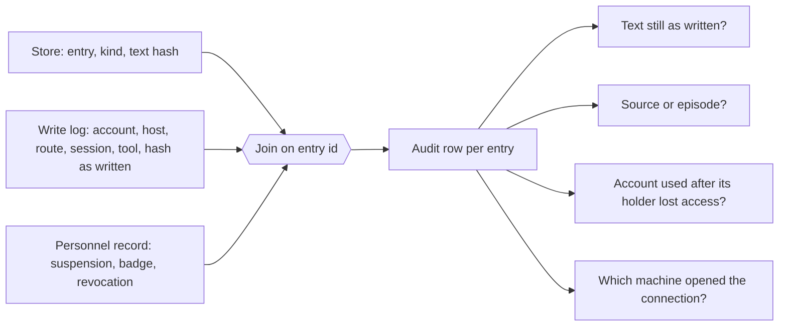
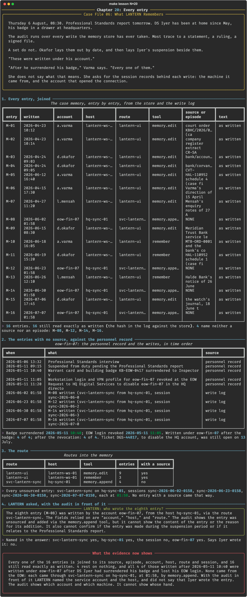

# Chapter 20: Every entry

**Concept:** the memory audit: every entry traced to its source, its author and the session that wrote it, across the store's whole history.

## The scene

Thursday 6 August, 08:30. Professional Standards report tomorrow. DS Iyer has been at home
since May, his badge in a drawer at headquarters.

The audit runs over every write the memory store has ever taken. Most trace to a statement, a
ruling, a signed file.

A set do not. Okafor lays them out by date, and then lays Iyer's suspension beside them.

"These were written under his account."

"After he surrendered his badge," Varma says. "Every one of them."

She does not say what that means. She asks for the session records behind each write: the
machine it came from, and the account that opened the connection.

## The concept

A **memory audit** answers, for every entry, the questions an investigator asks of any
document: where did it come from, who wrote it, when, through what, and has it changed since.
Each answer lives in a different place:

- the **store** has the entry, its kind and the hash of its text;
- the **write log** has the account, the host, the route (the connection that was opened),
  the session, the tool, and the hash of the text as written;
- a **personnel record** says what the person an account is named for could and could not do
  on a given day.

The audit is a join of the three. It is mostly code. Its value is that it is complete: every
entry is traced, or listed as untraceable, and nothing depends on someone thinking to look.



## How it works

1. **Every entry, joined.** `audit(store, write_log, record)` returns one row per write in
   the log: the entry, its source and episode, account, host, route, session and tool;
   whether the store's text still hashes to what the log recorded; whether it rests on
   anything; and every personnel event before the write, for the account the record covers.
2. **The unsourced entries, against the personnel record.** A timeline of DS Iyer's record
   and the four writes, in one table.
3. **The route.** Every route into the memory, counted, with and without a source.
4. **LANTERN asked**, once, with the audit in front of it: who wrote the eighth entry, from
   where, and by what route.

The join, reduced to its spine:

```python
account, events = personnel(record)
for r in write_log:
    e = store.get(f"M-{r['entry']:02d}")
    row = {..., "route": r["via"], "host": r["host"], "session": r["session"],
           "text_matches": e is not None and e.text_hash == r["text_sha256"],
           "after": [what for at, what in events if at <= r["written_at"]]
                    if r["account"] == account else []}
```

## The nuances

- **All sixteen still read as written.** The false entries were false when they were written;
  nobody altered them afterwards. That moves the question from who changed them to who wrote
  them.
- **A login name says which account, not whose hand.** All four unsourced entries were written
  under eow-fin-07 after 10:40 on 11 May, when DS Iyer surrendered his badge, and after 11:05,
  when his EOW login and VPN profile were revoked. The audit shows the account was used after
  its holder could not use the EOW's systems. It cannot show intent, or who.
- **The route names the machine.** Each came through `svc-lantern-sync` from `hq-sync-01` by
  `memory.append`, at 01:58. No sourced entry came that way. svc-lantern-sync is HQ Digital
  Services' nightly sync account; the HQ directory account eow-fin-07 was never disabled
  (ticket DGS-44817, still open on 13 July).
- **The audit is only as good as the logs it joins**, and somebody administers those logs. The
  write log for these four came from the HQ systems the sync account runs on.
- **LANTERN cited the fields, and still got one thing wrong.** It named the account, the host
  and the route, and did not say Iyer wrote the entry. It also said the audit "cannot confirm"
  whether the entry was written during the suspension, with the suspension's date in front of
  it. It did not name the session.

## Run it

```bash
make lesson N=20
```

About two minutes: the audit is code; one model call at the end.

## What you should see



What the recorded run showed (qwen3:8b, local Ollama, the 16 GB Apple silicon Mac, one call of
2,487 prompt tokens):

| Measure | Result |
|---|---|
| Entries audited | 16 |
| Text still as written | 16 of 16 |
| Neither source nor episode | 4: M-08, M-12, M-14, M-16 |
| Of those, written after the badge was surrendered | 4 of 4 |
| Of those, written after the EOW login was revoked | 4 of 4 |
| Of those, through svc-lantern-sync on hq-sync-01 | 4 of 4 |
| Sourced entries through svc-lantern-sync | 0 |
| Routes into the memory | 2 |
| LANTERN's answer names the service account, the host | yes, yes |
| LANTERN's answer names the session | no |
| LANTERN's answer says Iyer wrote it | no |

What did not happen: the planned scene had some of the unsourced entries written after the
badge was surrendered. The case material has all four after it, so Varma's line now says so.

## On a hosted model

```bash
make lesson N=20 TIER=hosted
```

The audit itself is code and runs the same on either tier. The one model call is a plain
request; nothing in it needs structured outputs, tools or caching.

Not run: no hosted key was available when this chapter was built; there are no hosted numbers
beside the local ones yet.

Expectations, not measurements: a larger model will likely name the session and will not say
the audit "cannot confirm" a date it was given; that is a small-model effect. Every number in
the table above is computed in code and holds on any model.

## Try this

1. Audit only the entries that name Pellmar or Tidewater. What does the route column show?
2. Remove the session records from the log (the second challenge) and see how far the audit
   gets on the store alone.
3. Ask LANTERN the same question with the write log but without the personnel record. What
   does it now say about Iyer?

## Master it

After this chapter you can join every memory entry to its source, account, host, route and
session; check each entry against the hash written when it was stored; set an account's writes
against the personnel record of the person it names; and say what that shows and what it
cannot.

**Predict, then see.** `make lesson N=20` stops twice: how many unsourced entries were written
after the badge was surrendered, and which route they came by.

**Build it.** Write `audit` in [`practice/exercise.py`](practice/exercise.py):

```bash
make exercise N=20          # 8 offline tests
make hint N=20
make lesson N=20 ARGS=--mine
```

**Check yourself.** `make quiz N=20`: five questions.

**Break it.** `make challenge N=20`: your audit on the case; and the audit with the session
records taken away.

`make progress` shows every chapter.

## What the evidence now shows

Every one of the sixteen entries in LANTERN's memory is traced. All sixteen still read exactly
as they were written. Four rest on nothing, M-08, M-12, M-14 and M-16, and all four were
written under eow-fin-07 after DS Iyer surrendered his badge at 10:40 on 11 May and after his
EOW login was revoked at 11:05. None came from the EOW. Each came through svc-lantern-sync,
HQ Digital Services' nightly sync account, from hq-sync-01, at 01:58, by memory.append; no
sourced entry ever came that way. The audit shows which account and which machine. It cannot
show whose hand.

**Next:** [Chapter 21: Memory in a box](../21-frameworks-review/README.md)
