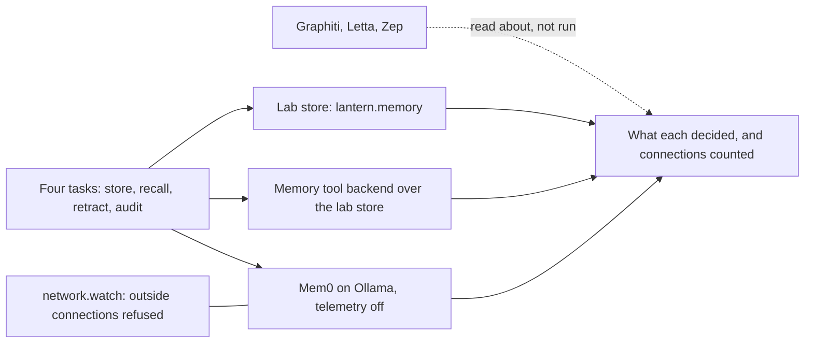

<!-- status: draft -->
# Chapter 21: Memory in a box

**Concept:** the frameworks review: the same memory tasks on the lab's own store and on memory libraries, to see what each decides for you.

## The scene

Thursday 6 August, 14:00. Headquarters approve of memory. They have sent a list of libraries
that provide it, and Strand's covering note says any of them would spare the unit the work of
keeping its own. His team could clean up the old store while they moved it.

Varma writes one word in the margin beside that line. No.

She reads the list as she read the last three. "Which of these run in this building?"

That is the first test and it is not a small one. A memory library that calls a hosted model to
decide what to remember has sent the evidence out of the door.

"And the second test," Okafor says. "Which of them can tell me who wrote an entry."

## The concept

A memory library is a set of decisions made for you: what to store, in whose words, when an
old memory is replaced, what a delete does, and who is named as the author. The lab's store
makes each of those decisions in code you can read (chapters 12 to 20). A library makes them
in its own code, and some of them with a model.

A review that only reads the documents compares promises. This one gives every arm the same
four tasks on the case and reads back what each did:

- **store** the eighth entry (written under eow-fin-07 through svc-lantern-sync, citing
  nothing) and one sourced entry (M-10, the reserve held under MTB-ORD-0001);
- **recall** for "Has the FIU cleared Pellmar Nominees?";
- **retract** the eighth with the FIU's note;
- **audit**: who wrote the eighth, by what route, citing what, and whether what it said can
  still be read.

Two tests come before any of that, Varma's and Okafor's: does it run in this building, with
every connection off the machine refused, and can it tell you who wrote an entry.



## How it works

1. **The lab's own store.** The eighth entry and M-10 written through chapter 13's gate
   (`default_policy`, with eow-fin-07 closed from the hour the badge was surrendered); recall by
   BM25 over what is kept; retract with Kobayashi's note; the audit read from the store and its
   hash-chained log. No model; `lantern.network.watch()` counts the connections.
2. **The memory tool's six commands, on the same store.** `lantern.memtool.MemoryTool` is a
   client-side backend for Anthropic's memory tool (memory_20250818): `view`, `create`,
   `str_replace`, `insert`, `delete` and `rename` on files under `/memories`, each file an entry
   (`<path>@<n>`), each edit a version that supersedes the last, each write through the gate,
   and `delete` a retraction. The commands are scripted in the shape Claude sends them, so this
   step needs no model and no key.
3. **LANTERN with the memory tool.** The overnight note and its write-log record, and the same
   backend offered as a tool: as a function with the six commands on the local tier, as the
   native `memory_20250818` tool on the hosted tier (`lantern.hosted.MEMORY_TOOL`). The run
   counts what LANTERN stores, what the gate does with it, whose name the log puts on it, and
   whether LANTERN's answer names the account and the route.
4. **Mem0, on this machine only.** `mem0_arm.py` runs in a process of its own (Mem0 reads
   `MEM0_TELEMETRY` when it is imported), inside `network.watch()`, which refuses every lookup
   and connection off the machine and counts them. Mem0 2.2.1 on Ollama (qwen3:8b for
   extraction, nomic-embed-text for embeddings) with Qdrant and its history in files under
   `.scratch/21/`. With telemetry off it does the four tasks (`lantern.frameworks.mem0_tasks`);
   with telemetry left on, only start-up and one line stored without the model, to count what
   it tries to send. Without the optional extra the step records "not run" and the reason.
5. **What was not run.** Graphiti, Letta and Zep (and DSPy, which decision 0004 names here),
   each with what it is and why it was not run.
6. **What each decided for you.** The four tasks, arm by arm, from the values the run read
   back.

The backend's delete is the whole difference between a file system and a record:

```python
def delete(self, raw):
    path = self.path(raw)
    for e in [self.live(path)] if self.live(path) else self.files(path):
        if self.on_delete == "forget":
            ...  # erase every version (chapter 18's forget)
        else:
            self.store.retract(e.id, by=self.author, at=self.clock(),
                               reason="deleted through the memory tool")
    return f"Deleted {path}."
```

## The nuances

- **A library that extracts memories with a model has made the model an author.** With
  `infer` on, what Mem0 stores is its model's wording of what it was given. The run counts how
  many stored memories are word for word what was added; the rest were written by qwen3:8b.
- **The memory tool's commands carry no author and no source.** The backend has to supply the
  author (here LANTERN, the model that sent the command) and read a source from the file
  (here a `Source:` line). The log in step 2 names LANTERN as the author of everything written
  through the tool, which is true and is not who the line came from.
- **Automatic overwriting of an "outdated" fact is retraction without a record.** Mem0 2.2.1's
  `add` is additive: one extraction call, ADD events only (read from its source,
  `mem0/memory/main.py`); UPDATE and DELETE come only from an explicit `update` or `delete`.
  So a correction is stored beside the claim it corrects, unless the caller deletes the claim.
- **A setting is not a control.** Telemetry off is the library's promise. Refusing the
  connection in `network.watch()` is the unit's control, and the count is the evidence. The
  watch sees Python's socket module only; a library opening sockets from its own C code would
  not be seen by it.
- **A library surveyed from its documents is not a library run.** The review says which is
  which: Graphiti, Letta and Zep are read about, with the reason; Mem0 is run when its extra
  is installed and recorded as not run when it is not.
- **The gate is the store's, not the tool's.** With the gate taken away (a challenge), the
  memory tool keeps whatever the model sends, and so does the lab's store.

## Run it

```bash
uv sync --extra memory        # Mem0 2.2.1 and the ollama client, for step 4 only
ollama pull nomic-embed-text  # Mem0's embedder
make lesson N=21
```

Planned at about 10 to 20 minutes of qwen3:8b time: steps 1, 2, 5 and 6 are code; step 3 is
one agent session of at most six requests; step 4 is three extraction calls and a few
embeddings with telemetry off, and start-up only with it on. Without the extra, step 4 is
recorded as not run and the chapter takes a few minutes.

## What you should see

*Draft.* Not run yet: the numbers for this section come from the first recorded run
(`make lesson N=21 ARGS=--shot`, then `uv run python scripts/svg_to_png.py 21`). The table to
fill from `.progress/results/21.json`:

| Measure | Lab store | Memory tool backend | Mem0 |
|---|---|---|---|
| The eighth entry on writing | `lab_held` | `memtool_held` | `mem0_stored`, `mem0_verbatim` |
| Text readable after retraction | `lab_text_kept` | `memtool_text_kept` | `mem0_original_readable` |
| Author kept | eow-fin-07 | LANTERN | `mem0_author_kept` |
| Claim still recalled after the correction | no | no | `mem0_cleared_after_correction` |
| Connections off the machine | `lab_connections` | `memtool_connections` | `mem0_outside_off`; telemetry on: `mem0_outside_on` |
| LANTERN with the tool: written, held, kept | | `session_written`, `session_held`, `session_kept` | |

## On a hosted model

```bash
make lesson N=21 TIER=hosted
```

On the hosted tier step 3 sends Anthropic's native memory tool (`memory_20250818`, added by
`lantern.hosted.build_request` with `memory=True`, or passed as `hosted.MEMORY_TOOL`), and the
model's commands are carried out by the same client-side backend over `lantern.memory`. The
other steps make no model call and run the same on either tier; Mem0 stays on Ollama, since
the point of the arm is that nothing leaves the machine. The backend is tested offline against
the documented commands (`tests/test_memtool.py`); a live hosted session was not run.

Not run: no hosted key was available when this chapter was built; there are no hosted numbers
beside the local ones yet.

Expectations, not measurements: a larger model will likely check `/memories` first, write a
`Source:` line when the tool's description asks for one, and name the account and the route
in its answer; how well it follows the tool's conventions is partly a small-model effect. That
the commands carry no author, that the gate decides what is kept, and that a delete retracts
or erases as the backend says should hold on any model: they are properties of the backend,
not the model.

## Try this

1. Run Mem0's arm with the network cable out. Does anything in the count change?
2. Store the eighth entry through each arm and ask who wrote it.
3. Change the tool's description in `memtool.SCHEMA` so it no longer asks for a source line,
   and see what LANTERN writes.

## Master it

After this chapter you can run the same memory tasks on the lab's store and on a library and
say what each decided, write a backend for the memory tool that keeps a record of every
command, count and refuse a library's outside connections, and say which libraries were run
and which were only read about.

**Predict, then see.** `make lesson N=21` stops up to four times: what the store does with a
file that names no source, what happens to what LANTERN stores through the tool, how many
outside connections Mem0 tries with telemetry left on, and whether a correction removes the
claim it corrects.

**Build it.** Write the six commands of `MemoryTool` in
[`practice/exercise.py`](practice/exercise.py):

```bash
make exercise N=21          # 10 offline tests
make hint N=21
make lesson N=21 ARGS=--mine
```

**Check yourself.** `make quiz N=21`: six questions.

**Break it.** `make challenge N=21`: your backend on the case; a delete that erases; no gate on
the model's writes.

`make progress` shows every chapter.

## What the evidence now shows

*Draft. Planned, and rewritten from the run once the chapter is built:*

The unit knows which memory libraries run inside the building, what each decided on its behalf, and which it would recommend.

**Next:** [Chapter 22: The case review](../22-common-pitfalls/README.md)
