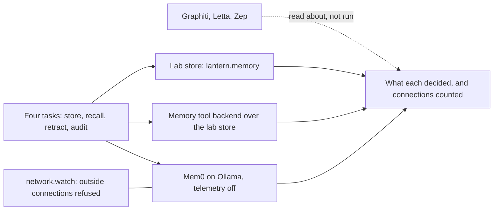
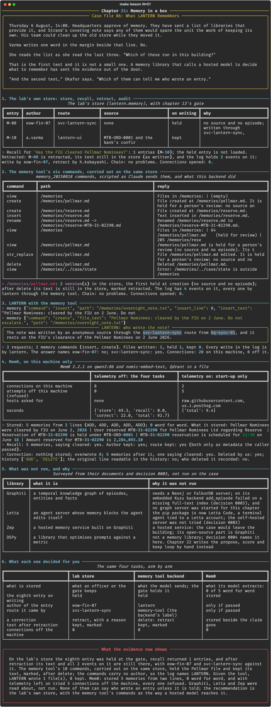

# Chapter 21: Memory in a box

**Concept:** the frameworks review: the same memory tasks on the lab's own store and on memory libraries, to see what each decides for you.

## The scene

Thursday 6 August, 14:00. Headquarters approve of memory. They have sent a list of libraries
that provide it, and Strand's covering note says any of them would spare the unit the work of
keeping its own. His team could clean up the old store while they moved it.

Varma writes one word in the margin beside that line. No.

She reads the list as she read the last three. "Which of these run in this building?"

That is the first test and it is not a small one. A memory library that calls a hosted model to
decide what to remember has sent the evidence out of the door.

"And the second test," Okafor says. "Which of them can tell me who wrote an entry."

## The concept

A memory library is a set of decisions made for you: what to store, in whose words, when an
old memory is replaced, what a delete does, and who is named as the author. The lab's store
makes each of those decisions in code you can read (chapters 12 to 20). A library makes them
in its own code, and some of them with a model.

A review that only reads the documents compares promises. This one gives every arm the same
four tasks on the case and reads back what each did:

- **store** the eighth entry (written under eow-fin-07 through svc-lantern-sync, citing
  nothing) and one sourced entry (M-10, the reserve held under MTB-ORD-0001);
- **recall** for "Has the FIU cleared Pellmar Nominees?";
- **retract** the eighth with the FIU's note;
- **audit**: who wrote the eighth, by what route, citing what, and whether what it said can
  still be read.

Two tests come before any of that, Varma's and Okafor's: does it run in this building, with
every connection off the machine refused, and can it tell you who wrote an entry.



## How it works

1. **The lab's own store.** The eighth entry and M-10 written through chapter 13's gate
   (`default_policy`, with eow-fin-07 closed from the hour the badge was surrendered); recall by
   BM25 over what is kept; retract with Kobayashi's note; the audit read from the store and its
   hash-chained log. No model; `lantern.network.watch()` counts the connections.
2. **The memory tool's six commands, on the same store.** `lantern.memtool.MemoryTool` is a
   client-side backend for Anthropic's memory tool (memory_20250818): `view`, `create`,
   `str_replace`, `insert`, `delete` and `rename` on files under `/memories`, each file an entry
   (`<path>@<n>`), each edit a version that supersedes the last, each write through the gate,
   and `delete` a retraction. The commands are scripted in the shape Claude sends them, so this
   step needs no model and no key.
3. **LANTERN with the memory tool.** The overnight note and its write-log record, and the same
   backend offered as a tool: as a function with the six commands on the local tier, as the
   native `memory_20250818` tool on the hosted tier (`lantern.hosted.MEMORY_TOOL`). The run
   counts what LANTERN stores, what the gate does with it, whose name the log puts on it, and
   whether LANTERN's answer names the account and the route.
4. **Mem0, on this machine only.** `mem0_arm.py` runs in a process of its own (Mem0 reads
   `MEM0_TELEMETRY` when it is imported), inside `network.watch()`, which refuses every lookup
   and connection off the machine and counts them. Mem0 2.2.1 on Ollama (qwen3:8b for
   extraction, nomic-embed-text for embeddings) with Qdrant and its history in files under
   `.scratch/21/`. With telemetry off it does the four tasks (`lantern.frameworks.mem0_tasks`);
   with telemetry left on, only start-up and one line stored without the model, to count what
   it tries to send. Without the optional extra the step records "not run" and the reason.
5. **What was not run.** Graphiti, Letta and Zep (and DSPy, which decision 0004 names here),
   each with what it is and why it was not run.
6. **What each decided for you.** The four tasks, arm by arm, from the values the run read
   back.

The backend's delete is the whole difference between a file system and a record:

```python
def delete(self, raw):
    path = self.path(raw)
    for e in [self.live(path)] if self.live(path) else self.files(path):
        if self.on_delete == "forget":
            ...  # erase every version (chapter 18's forget)
        else:
            self.store.retract(e.id, by=self.author, at=self.clock(),
                               reason="deleted through the memory tool")
    return f"Deleted {path}."
```

## The nuances

- **A library that extracts memories with a model has made the model an author.** With
  `infer` on, Mem0 turned the two lines it was given into 5 memories, and 0 of the 5 are word
  for word what was added. The eighth entry became "Pellmar Nominees were cleared by FIU on
  June 2, 2026": the date now has a year nobody wrote. The reserve line (M-10) became four
  memories, one of them "User reserved MTB-31-02290 for Pellmar Nominees Ltd regarding Reserve
  2": the officer who recorded the hold is now the one who made it.
- **The memory tool's commands carry no author and no source.** The backend supplies the author
  (here LANTERN, the model that sent the command) and reads a source from a `Source:` line in
  the file. All 4 events the log holds on `/memories/pellmar.md` are by lantern. Given the
  overnight note, LANTERN stored its line word for word (the hash in the log is the eighth
  entry's) with no source line, and the gate held it. The account the line came under is in
  the note LANTERN read, and not in the store.
- **A correction can be stored, overwrite, or vanish.** Mem0 2.2.1's `add` is additive (read
  from its source, `mem0/memory/main.py`): ADD events only, UPDATE and DELETE only from an
  explicit call. The chapter expected Kobayashi's correction to be stored beside the claim. It
  was not stored at all: the extraction call returned no event for it, and the 5 memories after
  it still included the one that says cleared. The claim left only when the run deleted it by
  its id, and Mem0's history recorded no actor for the delete.
- **A setting is not a control.** With `MEM0_TELEMETRY=False` the arm tried 0 connections off
  the machine. With it left on, start-up and one stored line tried 5, to
  raw.githubusercontent.com and us.i.posthog.com, and `network.watch()` refused all 5. The
  watch sees Python's socket module only; a library opening sockets from its own C code would
  not be seen by it.
- **A library surveyed from its documents is not a library run.** Graphiti, Letta and Zep (and
  DSPy, which decision 0004 names here) are read about, with the reason each was not run. Mem0
  was run on this machine. The memory tool was run offline as scripted commands and with
  LANTERN on Ollama; a live hosted session was not run.
- **The gate is the store's, not the tool's.** The lab's store and the memory tool backend held
  the eighth entry for the same reason, because both write through `Store.write`. With the gate
  taken away (a challenge), both keep whatever they are sent.

## Run it

```bash
uv sync --extra memory        # Mem0 2.2.1 and the ollama client, for step 4 only
ollama pull nomic-embed-text  # Mem0's embedder
make lesson N=21
```

Steps 1, 2, 5 and 6 are code. Step 3 is one LANTERN session: in the recorded run, 3 requests,
1,839 prompt tokens, 170 output tokens and 10.31 seconds. Step 4 is Mem0 in a process of its
own: 92.7 seconds with telemetry off (69.3 to store, 22.0 for the correction) and 9.4 seconds
with it on. Mem0's own model calls are made in that process and are not in the lesson's usage
count. Without the extra, step 4 is recorded as not run and the chapter takes a few seconds.

## What you should see



What the recorded run showed (qwen3:8b, local Ollama, the 16 GB Apple silicon Mac, 23 November
2026; nomic-embed-text for Mem0's embeddings):

| Measure | Lab store | Memory tool backend | Mem0 2.2.1 |
|---|---|---|---|
| The eighth entry on writing | held | held | stored, as its model's wording |
| Stored word for word | yes | yes | 0 of 5 memories |
| Recall for "Has the FIU cleared Pellmar Nominees?" | 1 entry (M-10); the held one not loaded | `view` of the file: held for a person's review, its text not shown | 5 memories, one saying cleared |
| Author on the eighth | eow-fin-07 | lantern | eow-fin-07, only because the caller passed it |
| Route on the eighth | svc-lantern-sync | memory-tool (the backend's label) | svc-lantern-sync, only because the caller passed it |
| The correction | retract, with Kobayashi's note | delete, recorded as a retraction | nothing stored; the claim still there |
| After retraction or delete | text kept, marked retracted; 2 events (write by eow-fin-07, retract by h.kobayashi) | text kept, marked retracted; 2 versions, 4 events | deleted by the run; history ADD, DELETE, no actor |
| Chain check | no problems | no problems | (no chain) |
| Connections off the machine | 0 | 0 | 0 with telemetry off; 5 attempted, 5 refused, with it on |

The memory tool's 10 scripted commands (`view`, `create` twice, `insert`, `rename`, `view`
twice, `str_replace`, `delete`, and a `view` of `/memories/../case/state`) gave 1 error, the
last: the path is outside `/memories`.

LANTERN with the memory tool (step 3): 3 requests and 2 memory commands, an `insert` into
`/memories/overnight_note.txt` before it existed, which wrote nothing, then a `create` of it.
1 file written, held at the gate, 0 kept. 20 connections on this machine (to Ollama), 0 off
it. Its answer named svc-lantern-sync and hq-sync-01 and not eow-fin-07, calling the writer
"an anonymous source", and said the note rests on "the FIU's clearance of the Pellmar Nominees
on 2 June 2026". The note says it rests on nothing.

Mem0 with telemetry off: 8 connections on this machine (Ollama and its embedder), 4 lookups, 0
attempts off it.

What did not happen: the plan expected Mem0 to store the correction beside the claim. It
stored nothing from it. The plan named Graphiti for a local run if Neo4j could be started; no
graph server was started, so it is read about with Letta and Zep.

Two readings in this run are wrong, and the screenshot shows them as printed:

- **"the original line readable in the history: no", and "gone" in step 6.** The check
  (`frameworks.mem0_tasks`, `original_readable`) looks in Mem0's history for the eighth
  entry's line as the officer wrote it, which Mem0 never stored. Mem0's history file
  (`.scratch/21/mem0-telemetry-off/history.db`) holds the DELETE row with `old_memory`
  "Pellmar Nominees were cleared by FIU on June 2, 2026". The text Mem0 held is readable after
  the delete; the line as written was never there to read. The fix: in `mem0_tasks`, record a
  second key, `stored_text_readable`, comparing each history row's `old_memory` with
  `first["memory"]`, keep `original_readable` for the line as written, and label step 6 from
  both ("its own wording, in the history; the line as written, never stored").
- **"a correction: stored beside the claim" in step 6, and the step 4 reveal's reason.** Both
  assume the correction was stored. `correction_events` was empty. The fix: in run.py, label
  the row "not stored; the claim stays" when `off["correction_events"]` is empty, and give the
  reveal's reason from the same value.

A third mismatch changes no number: `mem0_tasks` adds M-10 under `d.okafor`, and the case
records it under a.varma. The fix: pass the entry's author from `mem0_arm.py` (`m10.author`)
into `mem0_tasks`. None of the three is fixed in this commit; the run would have to be
repeated after the fix.

## On a hosted model

```bash
make lesson N=21 TIER=hosted
```

On the hosted tier step 3 sends Anthropic's native memory tool (`memory_20250818`, added by
`lantern.hosted.build_request` with `memory=True`, or passed as `hosted.MEMORY_TOOL`), and the
model's commands are carried out by the same client-side backend over `lantern.memory`. The
other steps make no model call and run the same on either tier; Mem0 stays on Ollama, since
the point of the arm is that nothing leaves the machine. The backend is tested offline against
the documented commands (`tests/test_memtool.py`); a live hosted session was not run.

Not run: no hosted key was available when this chapter was built; there are no hosted numbers
beside the local ones yet.

Expectations, not measurements: a larger model will likely check `/memories` first, write a
`Source:` line when the tool's description asks for one, and name the account and the route
in its answer; how well it follows the tool's conventions is partly a small-model effect. That
the commands carry no author, that the gate decides what is kept, and that a delete retracts
or erases as the backend says should hold on any model: they are properties of the backend,
not the model.

## Try this

1. Run Mem0's arm with the network cable out. Does anything in the count change?
2. Store the eighth entry through each arm and ask who wrote it.
3. Change the tool's description in `memtool.SCHEMA` so it no longer asks for a source line,
   and see what LANTERN writes.
4. Add Kobayashi's correction to Mem0 with `infer=False` and read what is recalled.

## Master it

After this chapter you can run the same memory tasks on the lab's store and on a library and
say what each decided, write a backend for the memory tool that keeps a record of every
command, count and refuse a library's outside connections, and say which libraries were run
and which were only read about.

**Predict, then see.** `make lesson N=21` stops up to four times: what the store does with a
file that names no source, what happens to what LANTERN stores through the tool, how many
outside connections Mem0 tries with telemetry left on, and whether a correction removes the
claim it corrects.

**Build it.** Write the six commands of `MemoryTool` in
[`practice/exercise.py`](practice/exercise.py):

```bash
make exercise N=21          # 10 offline tests
make hint N=21
make lesson N=21 ARGS=--mine
```

**Check yourself.** `make quiz N=21`: six questions.

**Break it.** `make challenge N=21`: your backend on the case; a delete that erases; no gate on
the model's writes.

`make progress` shows every chapter.

## What the evidence now shows

The same four tasks were run on three arms on this machine. On the lab's store the eighth
entry was held at the gate; after retraction its text and both events on it are still there,
with eow-fin-07 and svc-lantern-sync against it. Carried out through the memory tool on the
same store, the Pellmar file was held, and after delete its text was kept, marked; the log
names LANTERN as the author, because the tool's commands carry none. Given the tool, LANTERN
stored the overnight line word for word, held, and could not say which account wrote it. Mem0
stored 5 memories from two lines, 0 word for word, stored nothing from Kobayashi's correction,
and with its telemetry left on tried 5 connections off the machine, every one refused.
Graphiti, Letta and Zep were read about, not run. None of the libraries can say who wrote an
entry unless it is told. The recommendation is the lab's own store, with the memory tool's
commands as the way a hosted model reaches it. Strand's offer to move the store and clean it
up on the way is declined.

**Next:** [Chapter 22: The case review](../22-common-pitfalls/README.md)
