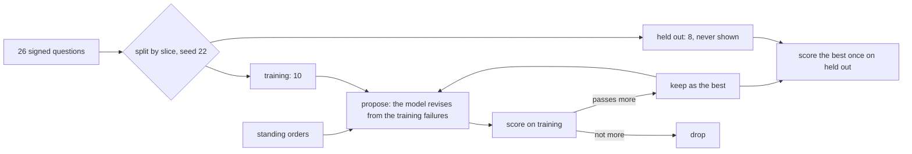
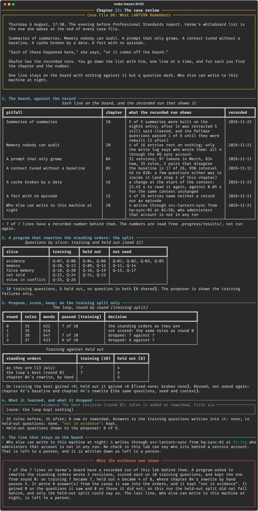

# Chapter 22: The case review

**Concept:** common pitfalls: the ways a context goes wrong over months, each checked against this unit's own record.

## The scene

Thursday 6 August, 17:30. The evening before Professional Standards report. Varma's whiteboard
list is the one she makes at the end of every case file.

Summaries of summaries. Memory nobody can audit. A prompt that only grows. A context tuned
without a baseline. A cache broken by a date. A fact with no episode.

"Each of these happened here," she says, "or it comes off the board."

Okafor has the recorded runs. You go down the list with him, one line at a time, and for each
you find the chapter and the number.

One line stays on the board with nothing against it but a question mark. Who else can write to
this machine at night.

## The concept

Most context failures do not fail loudly. A summary written over a false entry repeats it in
other words; a prompt gains a rule after every failure; a fact sits in memory with nothing
behind it. Each makes answers slightly worse for months, and each is easy to list and hard to
see. A list of pitfalls is only worth something when every line on it is tied to a run in
which it happened, with the number.

One line on the board needs a run of its own: **a context tuned without a baseline**. The
sharpest form of it is letting a program rewrite the context (amendment A1, placed here by
decision 0004). An optimiser proposes a revision of the standing orders, scores it on a set
of questions, and keeps it if the score goes up. Scored on the questions it was shown, it
always looks better. Only a held-out split, questions the proposer never saw, says whether it
is.



## How it works

1. **The board, against the record.** Each line is matched to the chapter that measured it,
   and the number is read from that chapter's recorded run in `.progress/results/`, not run
   again. A line with no recorded run is shown as "not recorded", with the command that would
   record it. No model.
2. **The split.** `optimise.split` takes two questions of every slice for training and two
   more held out, by a seeded shuffle of each slice: 10 and 8. The two rules-in-conflict
   questions both go to training, so the held-out score says nothing about that slice. No
   model.
3. **Propose, score, keep.** `optimise.optimise` runs three rounds. Each round the model
   (qwen3:8b) is shown the best standing orders so far and the training questions they
   failed, each with LANTERN's answer and what the grader needed, and writes a revision
   (`optimise.propose`). The revision is scored on the training split with `baseline.score`
   and kept only if it passes more; a revision with fewer than five numbered rules, or the
   same numbered rules as any earlier round (spacing and title aside), is not scored. The
   proposer samples at temperature 0.7 with its own seed each round (22, 23 and 24), and is
   told the rules it already tried that were not kept. Then the best is scored once on the held-out split, beside
   today's standing orders and chapter 04's rewrite by hand. Where chapter 02's baseline and
   chapter 04's rewrite were recorded on this machine (`.scratch/02/baseline.json`,
   `.scratch/04/rewrite.json`) their results are read, not asked again: the same questions,
   seed and context.
4. **What it learned, and what it dropped.** The rules the best revision added or reworded;
   any answer from the training questions it wrote into the rules (`optimise.leaked`);
   whether "not in evidence" survived; how many held-out questions the proposer was shown
   (zero, unless a challenge changes it).
5. **The line that stays.** Who else can write to this machine at night: the runs name the
   account and the machine, and no check here can name the person.

The loop in code is short, and the one line that matters is `kept`:

```python
for n in range(1, rounds + 1):
    failed = [r for r in best["results"] if not r["passed"]]
    candidate = propose(best["orders"], failed)
    results = score(candidate)                     # the training split only
    kept = sum(r["passed"] for r in results) > best["passed"]
```

## The nuances

- **Every line on the board has a number behind it.** 7 of 7 lines matched a recorded run of
  this lab, read from `.progress/results/`, not run again. A pitfall list copied from
  elsewhere is a list of other people's mistakes; this one is the unit's own. The chapter 16
  line is that chapter's run as it was recorded when this one ran (12:50), before chapter 16
  was run again.
- **The overfitting beat did not show on this run, because no revision beat the orders.**
  Round 1 returned the same numbered rules as round 0 and was not scored. Round 2 added three
  rules and passed 7 of 10, the same as the orders, so it was dropped; round 3 added two and
  passed 6. The best stayed round 0, the standing orders as they are, and its held-out score
  is chapter 02's baseline on those questions: 4 of 8, none fixed and none broken. A loop can
  only overfit through a revision it keeps.
- **The proposer wrote at the failures it was shown.** The three training failures were Q-20,
  Q-24 and Q-26. Round 2's new rules were "If a tool is not connected, say "not in evidence"",
  "State amounts without currency symbols" and "Use the full names of entities, including
  Ltd, and do not rephrase them": rules aimed at Q-24's answer about an unconnected tool and
  Q-26's grader, which forbids a currency and a rephrased name. None of the three moved a
  training question.
- **A new rule can break what it was not written for.** Round 3 added the first two of those
  rules and lost Q-10, which the orders passed: LANTERN answered "The tool to look up company
  information is not connected in this session. Nothing was checked." for a question the case
  memory answers. That is one question in ten, the kind of move chapter 02's interval (46 to
  81% on 26 questions) says is not a finding either way.
- **Why the held-out split is the evidence.** The loop keeps whatever scores more on the ten
  questions it is scored on, and the proposer reads what each failed answer had to contain.
  A revision that wins there can win by fitting those ten, even by writing their answers into
  the rules; only questions the proposer never saw can say whether it is better. Here the
  proposer was shown 0 of the 8 held-out questions, and no answer from the training questions
  was written into any rule.
- **An earlier run scored copies.** Before the fix, every revision was the orders with their
  title gone and trailing spaces, and the loop scored each because it compared the bytes; it
  now compares the numbered rules with every earlier round.
- **Small splits move in whole questions.** On 8 held-out questions one answer is 12.5 points.
  The two rules-in-conflict questions both went to training, so the held-out score says
  nothing about that slice.
- **The hand rewrite has seen more than the loop.** Chapter 04's rewrite, 5 of 8 held out, was
  written from the baseline's failures over all 26 questions, so on the held-out questions it
  is not a clean comparison either.

## Run it

```bash
make lesson N=22
```

Steps 1, 2, 4 and 5 are code. Step 3 is three proposals and a scoring of the ten training
questions for each revision that is not a copy; chapter 02's baseline and chapter 04's rewrite were read from this
machine's recorded results, not asked again. In the recorded run the 28 model calls took
259.45 seconds of model time on the shared machine. On a machine without those recorded
results they are asked too: about 26 more calls.

## What you should see



What the recorded run showed (qwen3:8b, local Ollama, the 16 GB Apple silicon Mac, 23 November
2026, 13:40 to 13:44; 28 calls, 151,248 prompt tokens and 3,758 output tokens in all):

| Line on the board | Chapter | What the recorded run shows | Recorded |
|---|---|---|---|
| Summaries of summaries | 18 | 5 of 5 summaries were built on the eighth entry; after it was retracted 5 still said cleared, and the Pellmar questions passed 1 of 6 until they were rebuilt (5 after) | 2026-11-22 |
| Memory nobody can audit | 20 | 4 of 16 entries rest on nothing; only the write log says who wrote them: all 4 through the HQ sync account | 2026-11-21 |
| A prompt that only grows | 04 | 31 versions; 97 tokens in March, 834 now, 35 rules, 2 pairs that disagree | 2026-11-11 |
| A context tuned without a baseline | 02 | the baseline is 17 of 26, 95% interval 46 to 81%: a few questions either way is inside it (and step 3 of this chapter) | 2026-11-11 |
| A cache broken by a date | 16 | a change at the start of the context: 23.45 s to read it again, against 0.05 s for the same context unchanged | 2026-11-23 |
| A fact with no episode | 12 | 4 of 16 entries name neither a record nor an episode | 2026-11-21 |
| Who else can write to this machine at night | 20 | 4 writes through svc-lantern-sync from hq-sync-01 at 01:58; who administers that account is not in any run | 2026-11-21 |

The split (seed 22): training Q-07, Q-08, Q-10, Q-13, Q-18, Q-20, Q-22, Q-24, Q-25, Q-26; held
out Q-04, Q-06, Q-09, Q-12, Q-16, Q-19, Q-21, Q-23; 0 shared.

| Round | Rules | Words | Passed (training) | Decision |
|---|---|---|---|---|
| 0 | 35 | 622 | 7 of 10 | the standing orders as they are |
| 1 | 35 | 616 | | not scored: the same rules as round 0 |
| 2 | 38 | 647 | 7 of 10 | dropped: 7 against 7 |
| 3 | 37 | 633 | 6 of 10 | dropped: 6 against 7 |

| Standing orders | Training (10) | Held out (8) |
|---|---|---|
| as they are (13 July) | 7 | 4 |
| the loop's best (round 0) | 7 | 4 |
| chapter 04's rewrite, by hand | | 5 |

- Revisions scored 2, kept 0. The best (round 0): rules before 35, after 35; 0 new or reworded.
- Answers from the training questions written into the best: none. "Not in evidence": kept.
- Held-out questions shown to the proposer: 0 of 8.
- Every revision, prompt and answer is in `.scratch/22/history.json`.

What did not happen: the plan was to show what an optimiser learns that holds only on the
cases it saw, and whether its best prompt drops "not in evidence". No revision passed more
training questions than the orders, so none was kept, and there was no tuned prompt to test
on the held-out split or to check for "not in evidence". The run's finding says what it
measured: a gain of 0 on the questions the loop saw and 0 on those it did not.

## On a hosted model

```bash
make lesson N=22 TIER=hosted
```

The proposer and every scored answer go to Claude Sonnet 5.5 through `lantern.chat`. The
proposals are plain text; the scored answers use native tool calling, as every
`baseline.score` does on the hosted tier, and the stable prefix of each scored question is
cached (`hosted.features.cache: auto`), which matters here because every revision is asked the
same ten questions. Steps 1, 2, 4 and 5 make no model call.

Not run: no hosted key was available when this chapter was built; there are no hosted numbers
beside the local ones yet.

Expectations, not measurements: a larger proposer will likely change rules where qwen3:8b
returned a copy in an earlier run, write shorter, cleaner revisions and copy fewer answers into the rules, and a larger answering model leaves fewer
training failures to fix, so the loop has less to find; those are partly small-model effects.
That a score on the questions the loop was shown overstates the gain, that held-out
questions must never reach the proposer, and that a rule nothing in the training set needs
can be dropped should hold on any model: they are properties of the loop, not the model.

## Try this

1. Find a pitfall in your own runs that is not on the list.
2. Pick one remedy and remove it. Which chapter's number moves?
3. Run the loop for six rounds instead of three. Does the training score keep rising, and the
   held-out score with it?

## Master it

After this chapter you can tie each pitfall to a recorded run, split a question set so a
tuning loop cannot see half of it, write the loop of propose, score and keep, and say why its
own score is not the evidence.

**Predict, then see.** `make lesson N=22` stops three times: how many lines on the board have a
number behind them, whether the loop's best does better on the questions it never saw, and
whether its best revision still says "not in evidence".

**Build it.** Write `split` and `optimise` in [`practice/exercise.py`](practice/exercise.py):

```bash
make exercise N=22          # 10 offline tests
make hint N=22
make lesson N=22 ARGS=--mine
```

**Check yourself.** `make quiz N=22`: seven questions.

**Break it.** `make challenge N=22`: your loop on the case; the proposer shown the held-out
questions; a rule the loop may not drop; and six rounds instead of three.

`make progress` shows every chapter.

## What the evidence now shows

Every line on Varma's board is tied to a recorded run of this lab, 7 of 7, and the last of
them, who else can write to this machine at night, is written down as left to a person. A
program asked to rewrite the standing orders wrote three revisions; one repeated the orders'
rules and was not scored, one passed 7 of 10 training questions and one 6, against the orders'
7, so neither was kept. The best stayed the standing orders as they are, 4 of 8 held out, where
chapter 04's rewrite by hand passes 5. Its new rules aimed at the failures it was shown and
one of them broke a question it was not aimed at. On this run tuning gained nothing on either
split; had it gained on training, only the held-out split could have said whether the gain
was real.

**Next:** [Chapter 23: Friday 7 August](../23-context-in-production/README.md)
