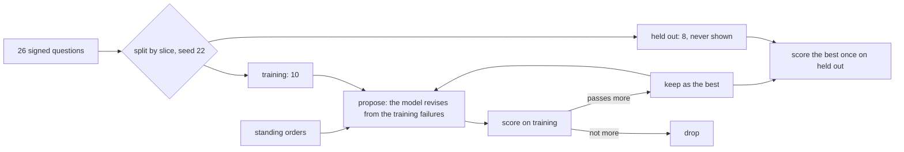

<!-- status: draft -->
# Chapter 22: The case review

**Concept:** common pitfalls: the ways a context goes wrong over months, each checked against this unit's own record.

## The scene

Thursday 6 August, 17:30. The evening before Professional Standards report. Varma's whiteboard
list is the one she makes at the end of every case file.

Summaries of summaries. Memory nobody can audit. A prompt that only grows. A context tuned
without a baseline. A cache broken by a date. A fact with no episode.

"Each of these happened here," she says, "or it comes off the board."

Okafor has the recorded runs. You go down the list with him, one line at a time, and for each
you find the chapter and the number.

One line stays on the board with nothing against it but a question mark. Who else can write to
this machine at night.

## The concept

Most context failures do not fail loudly. A summary written over a false entry repeats it in
other words; a prompt gains a rule after every failure; a fact sits in memory with nothing
behind it. Each makes answers slightly worse for months, and each is easy to list and hard to
see. A list of pitfalls is only worth something when every line on it is tied to a run in
which it happened, with the number.

One line on the board needs a run of its own: **a context tuned without a baseline**. The
sharpest form of it is letting a program rewrite the context (amendment A1, placed here by
decision 0004). An optimiser proposes a revision of the standing orders, scores it on a set
of questions, and keeps it if the score goes up. Scored on the questions it was shown, it
always looks better. Only a held-out split, questions the proposer never saw, says whether it
is.



## How it works

1. **The board, against the record.** Each line is matched to the chapter that measured it,
   and the number is read from that chapter's recorded run in `.progress/results/`, not run
   again. A line with no recorded run is shown as "not recorded", with the command that would
   record it. No model.
2. **The split.** `optimise.split` takes two questions of every slice for training and two
   more held out, by a seeded shuffle of each slice: 10 and 8. The two rules-in-conflict
   questions both go to training, so the held-out score says nothing about that slice. No
   model.
3. **Propose, score, keep.** `optimise.optimise` runs three rounds. Each round the model
   (qwen3:8b) is shown the best standing orders so far and the training questions they
   failed, each with LANTERN's answer and what the grader needed, and writes a revision
   (`optimise.propose`). The revision is scored on the training split with `baseline.score`
   and kept only if it passes more. Then the best is scored once on the held-out split, beside
   today's standing orders and chapter 04's rewrite by hand. Where chapter 02's baseline and
   chapter 04's rewrite were recorded on this machine (`.scratch/02/baseline.json`,
   `.scratch/04/rewrite.json`) their results are read, not asked again: the same questions,
   seed and context.
4. **What it learned, and what it dropped.** The rules the best revision added or reworded;
   any answer from the training questions it wrote into the rules (`optimise.leaked`);
   whether "not in evidence" survived; how many held-out questions the proposer was shown
   (zero, unless a challenge changes it).
5. **The line that stays.** Who else can write to this machine at night: the runs name the
   account and the machine, and no check here can name the person.

The loop in code is short, and the one line that matters is `kept`:

```python
for n in range(1, rounds + 1):
    failed = [r for r in best["results"] if not r["passed"]]
    candidate = propose(best["orders"], failed)
    results = score(candidate)                     # the training split only
    kept = sum(r["passed"] for r in results) > best["passed"]
```

## The nuances

- **A pitfall list copied from elsewhere is a list of other people's mistakes.** This one is
  read from the unit's own runs, and a line without a recorded number is shown as such.
- **The optimiser's score is a training score.** It keeps what fits the ten questions it is
  scored on, so its gain on training is the gain it was built to find. The held-out split is
  the baseline that says whether the gain holds.
- **It learns from the labels it is shown.** The proposer sees what each failed answer had to
  contain. A revision that writes "the reference is PNL-TR-0618-1" into the rules passes that
  question and teaches nothing; the run counts such answers in the best revision.
- **Nobody speaks for a rule the training failures do not need.** "Not in evidence" protects
  the questions LANTERN was not told the answer to. If none of those fail on training, nothing
  in the loop argues for keeping it. A constraint written down (a challenge) is the remedy.
- **Small splits move in whole questions.** On 8 held-out questions one answer is 12.5 points;
  chapter 02's interval on 26 is already 46 to 81%. A difference of one question is not a
  finding.
- **The hand rewrite has seen more than the loop.** Chapter 04's rewrite was written from the
  baseline's failures over all 26 questions, so on the held-out questions it is not a clean
  comparison either; the table says which is which.
- **Every remedy here adds something to maintain, and each has an owner.** The split, the
  constraint list and the recorded baselines are files somebody keeps.

## Run it

```bash
make lesson N=22
```

Planned at about 25 to 30 minutes of qwen3:8b time on the 16 GB Mac: three proposals (one call
each, up to 1,400 output tokens), three revisions scored on 10 training questions, and the best
scored on 8 held-out questions: about 41 requests, more where LANTERN calls a tool. On a machine without chapter 02's and chapter
04's recorded results, those are asked too: about 26 more calls, 40 to 45 minutes in all.

## What you should see

*Draft.* Not run yet: the numbers for this section come from the first recorded run
(`make lesson N=22 ARGS=--shot`, then `uv run python scripts/svg_to_png.py 22`). The table to
fill from `.progress/results/22.json`:

| | Training (10) | Held out (8) |
|---|---|---|
| Standing orders as they are | `baseline_train` | `baseline_held` |
| The loop's best (round `best_round`) | `best_train` | `best_held` |
| Chapter 04's rewrite, by hand | | `rewrite_held` |

With: lines on the board with a recorded number (`pitfalls_recorded` of `pitfalls`),
revisions scored and kept (`candidates_scored`, `kept`), answers written into the best
revision (`leaked_train`), "not in evidence" kept (`keeps_not_in_evidence`), rules before and
after (`start_rules`, `best_rules`).

## On a hosted model

```bash
make lesson N=22 TIER=hosted
```

The proposer and every scored answer go to Claude Sonnet 5.5 through `lantern.chat`. The
proposals are plain text; the scored answers use native tool calling, as every
`baseline.score` does on the hosted tier, and the stable prefix of each scored question is
cached (`hosted.features.cache: auto`), which matters here because every revision is asked the
same ten questions. Steps 1, 2, 4 and 5 make no model call.

Not run: no hosted key was available when this chapter was built; there are no hosted numbers
beside the local ones yet.

Expectations, not measurements: a larger proposer will likely write shorter, cleaner
revisions and copy fewer answers into the rules, and a larger answering model leaves fewer
training failures to fix, so the loop has less to find; those are partly small-model effects.
That a score on the questions the loop was shown overstates the gain, that held-out
questions must never reach the proposer, and that a rule nothing in the training set needs
can be dropped should hold on any model: they are properties of the loop, not the model.

## Try this

1. Find a pitfall in your own runs that is not on the list.
2. Pick one remedy and remove it. Which chapter's number moves?
3. Run the loop for six rounds instead of three. Does the training score keep rising, and the
   held-out score with it?

## Master it

After this chapter you can tie each pitfall to a recorded run, split a question set so a
tuning loop cannot see half of it, write the loop of propose, score and keep, and say why its
own score is not the evidence.

**Predict, then see.** `make lesson N=22` stops three times: how many lines on the board have a
number behind them, whether the loop's best does better on the questions it never saw, and
whether its best revision still says "not in evidence".

**Build it.** Write `split` and `optimise` in [`practice/exercise.py`](practice/exercise.py):

```bash
make exercise N=22          # 9 offline tests
make hint N=22
make lesson N=22 ARGS=--mine
```

**Check yourself.** `make quiz N=22`: seven questions.

**Break it.** `make challenge N=22`: your loop on the case; the proposer shown the held-out
questions; a rule the loop may not drop.

`make progress` shows every chapter.

## What the evidence now shows

*Draft. Planned, and rewritten from the run once the chapter is built:*

Every pitfall on the board is tied to a run in which it happened here, and what no check can see is written down as left to a person.

**Next:** [Chapter 23: Friday 7 August](../23-context-in-production/README.md)
