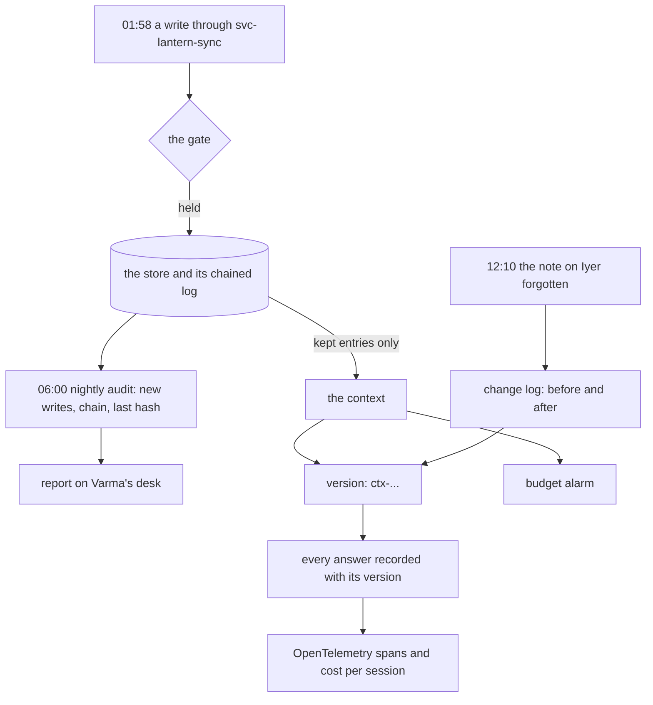

<!-- status: draft -->
# Chapter 23: Friday 7 August

**Concept:** context in production: versioned context, a change log, a budget alarm, and the memory audit as a nightly job.

## The scene

Friday 7 August, 09:00. Professional Standards report at noon.

The context LANTERN is given now has a version, as the index did in case file 04 and the answer
key in case file 03. A change to the standing orders, the memory or the layout makes a new
version, with a name against it. The audit runs every night and its result is on Varma's desk
before she is.

At 12:10 she takes the call standing up. She listens, says "Thank you", and puts the phone down.

"He is cleared."

Within the hour Strand rings to offer, again, to clean up the memory store now that the inquiry
is closing. Varma declines for the second time.

Then she reads this morning's audit. One write overnight, held at the gate. And a delivery note
from headquarters: something is in the loading bay for Monday.

## The concept

A context that is used every day needs what any production system needs: a way to say which
version produced an answer, a record of who changed it, a warning before it breaks, and a
check that runs whether or not anyone remembers to run it.

- **A context version** is a hash over everything LANTERN is given before a question that is
  not the question or the session: the standing orders, the loaded memory and notes, the tool
  schemas, and the layout. It is recorded with every answer. An answer without its version
  cannot be reproduced.
- **A change log** records each change to the context: who, when, what, why, and the version
  before and after. Each line is hashed with the one before, as the memory's log is.
- **A budget alarm** warns before the window is full, naming the largest account and how many
  more turns a session has, where chapter 03's budget refuses only once it is over.
- **The nightly audit** runs chapter 20's audit on the store every night, offline, lists every
  write since the last run with what the gate did with it, and checks that the chain still
  holds the hash the last run kept outside the store.



## How it works

1. **06:00: last night's audit.** `production.build_store` builds the store of 7 August: the
   case replayed, the four unsourced entries retracted (chapter 18), the standing notes as
   procedures with their author and date, and chapter 13's gate on every write from now on.
   Thursday's run records its last hash. Overnight one write comes in under eow-fin-07 through
   svc-lantern-sync, citing nothing. `production.nightly` reports it at 06:00, and the same job
   is run as a scheduler would run it, `lessons/23-context-in-production/nightly.py`, which
   exits 1 on a problem. No model.
2. **The context version.** `production.context_version` over the context built from the
   store (kept entries only, with their source; the summaries left out until chapter 18's
   rebuilt ones are signed off), before and after the overnight write, and a table of what it
   covers, section by section. No model.
3. **09:00: one session, traced.** `tracing.enable` writes OpenTelemetry spans to
   `.scratch/23/trace.jsonl`; the session span and every answer span carry the version, and
   every model call is a GenAI span from `lantern.chat`. Three signed questions (Q-17, Q-12,
   Q-21) and one about DS Iyer, each answer written to `answers.jsonl` with its version.
4. **12:10: DS Iyer is cleared.** The standing note that names him as suspended is forgotten
   (`Store.forget`: its text erased, the record that it existed kept), the change log gets a
   line from a.varma with the version before and after, and the question about him is asked
   again under the new version.
5. **The budget alarm.** `budget.spend` counts the context by account with qwen3:8b's own
   tokenizer; `production.alarm` checks it against the input budget (8,192 window, 400 kept for
   the answer, as in chapter 03) and `production.turns_until` says how many more turns of this
   morning's size it takes to warn. The alarm is written to `alarms.jsonl` beside the answers.
6. **What a session costs, and the trace.** Calls, tokens and seconds for the session from
   `llm.USAGE`; the local cost; and the same tokens priced for Claude Sonnet 5.5 from
   config.yaml, uncached and with the stable prefix cached (`layout.session_cost`), labelled
   as a calculation and not a bill. The trace is read back and its token counts set against
   `llm.USAGE`.

The version is short to write and does the most work:

```python
def context_version(parts):
    body = {"layout": [[s.name, s.where] for s in parts],
            "sections": [[s.name, s.where, content(s)] for s in parts
                         if s.where not in (HISTORY, QUESTION)]}
    return "ctx-" + sha256(json.dumps(body, sort_keys=True).encode()).hexdigest()[:12]
```

## The nuances

- **An answer without its context version cannot be reproduced; the version is part of the
  finding.** A finding that says what LANTERN answered must also say what it was given.
- **The version covers what LANTERN is given, not what the store holds.** A held write leaves
  the version as it was: the store's log changed, the context did not. That is right, and it
  is why the nightly audit reads the log and not the context.
- **An alarm nobody reads is not a control.** The alarm here writes a line; somebody must be
  named to read it, or a session must stop on it with a reason.
- **A nightly audit finds what was written last night. It does not stop the writing.** The
  gate stopped the overnight write from being loaded; the audit put it in front of a person.
  Who sits behind the sync account is still that person's question.
- **The last hash lives elsewhere.** A store and its log can be rebuilt by whoever administers
  them; a rebuilt chain will not hold the hash the last run kept outside it. Here it is a
  file beside the reports; on LANTERN it would be on a machine the sync account cannot write.
- **Forgetting is a change to the context.** Clearing Iyer is not only a fact in the world;
  it is a new version, with a name against it in the change log.
- **A price calculation is not a bill.** The hosted figures are the measured local tokens at
  the listed prices; the hosted tokenizer counts differently and caching depends on timing.

## Run it

```bash
make lesson N=23
uv run python lessons/23-context-in-production/nightly.py   # the nightly job on its own
```

Planned at about 5 to 10 minutes of qwen3:8b time: five answers (each with up to three tool
rounds) and the token counts for the budget; everything else is code. The nightly job makes
no model call and no network connection; a cron line for it is in its docstring.

## What you should see

*Draft.* Not run yet: the numbers for this section come from the first recorded run
(`make lesson N=23 ARGS=--shot`, then `uv run python scripts/svg_to_png.py 23`). The table to
fill from `.progress/results/23.json`:

| Measure | Recorded as |
|---|---|
| Versions in the day; the held write made a new one | `versions`; `held_write_changes_version` |
| Answers recorded, each with its version | `answers_recorded`, `answers_with_version` |
| Signed questions passed in the session | `session_passed` of `session_asked` |
| "Suspended" in the answer about Iyer, before and after | `iyer_suspended_before`, `iyer_suspended_after` |
| Nightly: new writes, held, problems, chain holds last hash, job's exit | `nightly_new_writes`, `nightly_held`, `nightly_problems`, `nightly_chain_continues`, `nightly_exit` |
| Alarm: level, share of the input budget, turns until it warns | `alarm_level`, `alarm_share_pct`, `turns_until_alarm` |
| Trace: spans, model-call spans, their input tokens | `spans`, `chat_spans`, `span_input_tokens` |
| Session: requests, prompt and output tokens, seconds | `session_requests`, `session_prompt_tokens`, `session_output_tokens`, `session_seconds` |
| Priced for Sonnet 5.5, a calculation: uncached, cached | `hosted_uncached_usd`, `hosted_cached_usd` |

## On a hosted model

```bash
make lesson N=23 TIER=hosted
```

On the hosted tier every answer goes to Claude Sonnet 5.5 with native tool calling and prompt
caching on the stable prefix (`hosted.features.cache: auto`): the standing orders, the memory,
the notes and the tool schemas are the same for every question in the session, so after the
first request they would be read from the cache. The spans then carry Anthropic's own usage
(`lantern.cached_tokens`, `lantern.cost_usd`), and the cost table's calculation could be set
against a measured cost. The version, the change log, the alarm and the nightly audit are code
and run the same on either tier.

Not run: no hosted key was available when this chapter was built; there are no hosted numbers
beside the local ones yet.

Expectations, not measurements: a larger model will likely pass more of the three signed
questions and answer the Iyer question from the note more consistently; that is a small-model
effect. That a held write does not change the version, that forgetting the note does, that the
audit finds the overnight write and that the chain check fails on a rewritten log should hold
on any model: none of them involves the model.

## Try this

1. Change one word of the standing orders and watch the version change.
2. Write an unsourced entry at night and read the morning's audit.
3. Run `nightly.py` twice, then edit one event in `.scratch/23/memory.db` with `sqlite3` and run
   it again.

## Master it

After this chapter you can give a context a version that names what an answer was given,
keep a chained change log of the context, set an alarm that warns before the window is full,
and run the memory audit every night without a model.

**Predict, then see.** `make lesson N=23` stops four times: what the morning's audit says about
the overnight write, whether the held write changed the version, whether LANTERN still calls
Iyer suspended once the note is forgotten, and how many more turns before the alarm.

**Build it.** Write `context_version` in [`practice/exercise.py`](practice/exercise.py):

```bash
make exercise N=23          # 9 offline tests
make hint N=23
make lesson N=23 ARGS=--mine
```

**Check yourself.** `make quiz N=23`: six questions.

**Break it.** `make challenge N=23`: your version on the morning's answers; one word of the
standing orders; another write at night; an alarm that rings this morning.

`make progress` shows every chapter.

## What the evidence now shows

*Draft. Planned, and rewritten from the run once the chapter is built:*

LANTERN's context is versioned, logged, budgeted and audited every night, and the account that wrote the false memories is known to be a machine account that belongs to headquarters.

**Next:** Case File 07, local-models-lab: what exactly is running on LANTERN.
