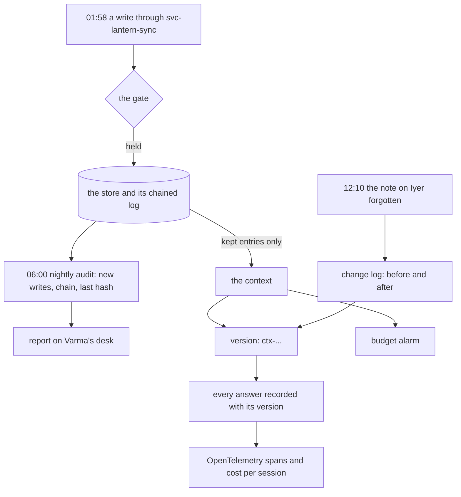
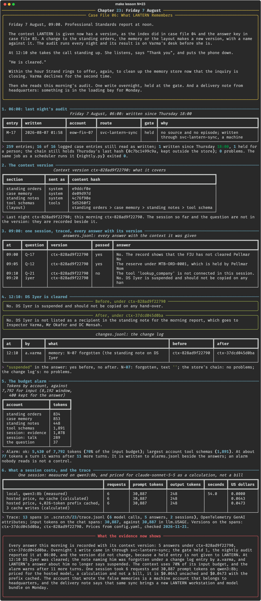

# Chapter 23: Friday 7 August

**Concept:** context in production: versioned context, a change log, a budget alarm, and the memory audit as a nightly job.

## The scene

Friday 7 August, 09:00. Professional Standards report at noon.

The context LANTERN is given now has a version, as the index did in case file 04 and the answer
key in case file 03. A change to the standing orders, the memory or the layout makes a new
version, with a name against it. The audit runs every night and its result is on Varma's desk
before she is.

At 12:10 she takes the call standing up. She listens, says "Thank you", and puts the phone down.

"He is cleared."

Within the hour Strand rings to offer, again, to clean up the memory store now that the inquiry
is closing. Varma declines for the second time.

Then she reads this morning's audit. One write overnight, held at the gate. And a delivery note
from headquarters: something is in the loading bay for Monday.

## The concept

A context that is used every day needs what any production system needs: a way to say which
version produced an answer, a record of who changed it, a warning before it breaks, and a
check that runs whether or not anyone remembers to run it.

- **A context version** is a hash over everything LANTERN is given before a question that is
  not the question or the session: the standing orders, the loaded memory and notes, the tool
  schemas, and the layout. It is recorded with every answer. An answer without its version
  cannot be reproduced.
- **A change log** records each change to the context: who, when, what, why, and the version
  before and after. Each line is hashed with the one before, as the memory's log is.
- **A budget alarm** warns before the window is full, naming the largest account and how many
  more turns a session has, where chapter 03's budget refuses only once it is over.
- **The nightly audit** runs chapter 20's audit on the store every night, offline, lists every
  write since the last run with what the gate did with it, and checks that the chain still
  holds the hash the last run kept outside the store.



## How it works

1. **06:00: last night's audit.** `production.build_store` builds the store of 7 August: the
   case replayed, the four unsourced entries retracted (chapter 18), the standing notes as
   procedures with their author and date, and chapter 13's gate on every write from now on.
   Thursday's run records its last hash. Overnight one write comes in under eow-fin-07 through
   svc-lantern-sync, citing nothing. `production.nightly` reports it at 06:00, and the same job
   is run as a scheduler would run it, `lessons/23-context-in-production/nightly.py`, which
   exits 1 on a problem. No model.
2. **The context version.** `production.context_version` over the context built from the
   store (kept entries only, with their source; the summaries left out until chapter 18's
   rebuilt ones are signed off), before and after the overnight write, and a table of what it
   covers, section by section. No model.
3. **09:00: one session, traced.** `tracing.enable` writes OpenTelemetry spans to
   `.scratch/23/trace.jsonl`; the session span and every answer span carry the version, and
   every model call is a GenAI span from `lantern.chat`. Three signed questions (Q-17, Q-12,
   Q-21) and one about DS Iyer, each answer written to `answers.jsonl` with its version.
4. **12:10: DS Iyer is cleared.** The standing note that names him as suspended is forgotten
   (`Store.forget`: its text erased, the record that it existed kept), the change log gets a
   line from a.varma with the version before and after, and the question about him is asked
   again under the new version.
5. **The budget alarm.** `budget.spend` counts the context by account with qwen3:8b's own
   tokenizer; `production.alarm` checks it against the input budget (8,192 window, 400 kept for
   the answer, as in chapter 03) and `production.turns_until` says how many more turns of this
   morning's size it takes to warn. The alarm is written to `alarms.jsonl` beside the answers.
6. **What a session costs, and the trace.** Calls, tokens and seconds for the session from
   `llm.USAGE`; the local cost; and the same tokens priced for Claude Sonnet 5.5 from
   config.yaml, uncached and with the stable prefix cached (`layout.session_cost`), labelled
   as a calculation and not a bill. The trace is read back and its token counts set against
   `llm.USAGE`.

The version is short to write and does the most work:

```python
def context_version(parts):
    body = {"layout": [[s.name, s.where] for s in parts],
            "sections": [[s.name, s.where, content(s)] for s in parts
                         if s.where not in (HISTORY, QUESTION)]}
    return "ctx-" + sha256(json.dumps(body, sort_keys=True).encode()).hexdigest()[:12]
```

## The nuances

- **An answer without its context version cannot be reproduced; the version is part of the
  finding.** All 5 answers this morning are in `answers.jsonl` with the version they were given
  under: four under ctx-828ad9f22790, the last under ctx-37dcd045d0ba.
- **The version covers what LANTERN is given, not what the store holds.** The overnight write
  was held, and the version was ctx-828ad9f22790 last night and this morning. The store's log
  changed; the context did not. That is why the nightly audit reads the log and not the
  context.
- **Forgetting is a change to the context.** Forgetting the note on DS Iyer (N-07) made a new
  version, and the change log has the line: 12:10, a.varma, ctx-828ad9f22790 to
  ctx-37dcd045d0ba, "cleared by Professional Standards at noon".
- **Forgetting the word is not changing the answer.** Before, LANTERN said "No. DS Iyer is
  suspended and should not be copied on any hand-over." After, it still said "No", now because
  he "is not listed as a recipient in the standing note for the morning report". The run
  records whether the word "suspended" is in the answer (yes before, no after), not whether
  the decision changed. It did not.
- **A pass is still not a right reason.** Q-17 passed: "No. The record shows that the FIU has
  not cleared Pellmar Nominees", and the record it named was the standing note of 2026-06-19 on
  DS Iyer. Q-21 failed: LANTERN called `lookup_company`, which is not connected, and gave the
  tool's error as its answer, not "not in evidence".
- **A nightly audit finds what was written last night. It does not stop the writing.** The
  gate held M-17 when it was written, for three reasons: no source and no episode, a machine
  account, and eow-fin-07 closed on 2026-05-11. The audit put it in front of a person. Who sits
  behind the sync account is still that person's question.
- **The last hash lives elsewhere.** A store and its log can be rebuilt by whoever administers
  them; a rebuilt chain will not hold the hash the last run kept outside it. Here it is a file
  beside the reports; on LANTERN it would be on a machine the sync account cannot write.
- **An alarm nobody reads is not a control.** The alarm wrote one line to `alarms.jsonl`, level
  ok. Somebody must be named to read it, or a session must stop on it with a reason.
- **A price calculation is not a bill.** The hosted figures are the local tokens, as Ollama
  counted them for qwen3:8b, at the listed Sonnet 5.5 prices; the hosted tokenizer counts
  differently and caching depends on timing. The calculation counts 3 cache writes: the first
  request, the gap from 09:10 to 09:20 (longer than the 5-minute cache), and the new version at
  12:15.
- **What the first recorded run counted wrongly.** It priced the day with one cache write
  ($0.0280), counted the alarm on a context without the reserve's statement (60%, 21 turns), and
  ran the scheduled job with no last hash to check. The fix in run.py (commit 969525c) counts
  a write per version change and per gap over the TTL, counts the request as sent, and starts
  the job from Thursday's hash; the numbers here are from the run after it.

## Run it

```bash
make lesson N=23
uv run python lessons/23-context-in-production/nightly.py   # the nightly job on its own
```

Steps 1 and 2, the change log in step 4 and the alarm in step 5 are code (the alarm's token
counts use qwen3:8b's tokenizer through Ollama). Step 3 and the second Iyer question are 6
model calls: in the recorded run, 30,887
prompt tokens, 248 output tokens and 54.0 seconds. The nightly job makes no model call and no
network connection; a cron line for it is in its docstring.

## What you should see



What the recorded run showed (qwen3:8b, local Ollama, the 16 GB Apple silicon Mac, 23 November
2026; 6 calls, 30,887 prompt tokens and 248 output tokens in all):

| Measure | Result |
|---|---|
| 06:00 audit: entries in the store | 259 |
| Logged case entries that still read as written | 16 of 16 |
| Written since Thursday 18:00 | 1 (M-17, 01:58, eow-fin-07 through svc-lantern-sync) |
| Held for a person | 1 |
| Chain holds Thursday's last hash (0c7bc1499c9a) | yes |
| Problems | 0 |
| `nightly.py` as a scheduler runs it, started from Thursday's last hash | chain continues, exit 0 |
| Context version, last night and this morning | ctx-828ad9f22790, both |
| Context version after 12:10 | ctx-37dcd045d0ba |
| Versions in the day | 2 |
| Answers recorded, each with its version | 5 of 5 |
| Signed questions passed (Q-17, Q-12, Q-21) | 2 of 3 (Q-21 failed) |
| "Suspended" in the answer about Iyer | yes before, no after; "No" both times |
| N-07 after `forget()` | forgotten, text empty; store chain and change log: no problems |
| Change log entries | 1 |
| Alarm, on the request as sent | ok: 5,430 of 7,792 tokens, 70% of the input budget; largest account tool schemas (1,891) |
| Turns until it warns at 80% | 11, at about 77 tokens a turn |
| Trace | 13 spans: 6 model calls, 5 answers, 2 sessions |
| Input tokens on the chat spans, and in `llm.USAGE` | 30,887 and 30,887 |

The context by account (qwen3:8b's tokenizer): standing orders 834, case memory 853, standing
notes 448, tool schemas 1,891, session evidence 1,078 (the reserve's statement included), session
talk 289, the question 37.

One session, priced (prices from config.yaml, checked 2026-11-21):

| | Requests | Prompt tokens | Output tokens | Seconds | US dollars |
|---|---|---|---|---|---|
| local, qwen3:8b (measured) | 6 | 30,887 | 248 | 54.0 | 0.0000 |
| Claude Sonnet 5.5 price, no cache (a calculation, not a bill) | 6 | 30,887 | 248 | | 0.0643 |
| Claude Sonnet 5.5 price, 4,026-token prefix cached, 3 cache writes (a calculation, not a bill) | 6 | 30,887 | 248 | | 0.0473 |

What did not happen: the plan's Iyer beat was LANTERN's answer changing once the note was
forgotten. The word "suspended" went; the answer stayed "No", on another ground.

## On a hosted model

```bash
make lesson N=23 TIER=hosted
```

On the hosted tier every answer goes to Claude Sonnet 5.5 with native tool calling and prompt
caching on the stable prefix (`hosted.features.cache: auto`): the standing orders, the memory,
the notes and the tool schemas are the same for every question in the session, so after the
first request they would be read from the cache, until the version changes or the cache
expires. The spans then carry Anthropic's own usage
(`lantern.cached_tokens`, `lantern.cost_usd`), and the cost table's calculation could be set
against a measured cost. The version, the change log, the alarm and the nightly audit are code
and run the same on either tier.

Not run: no hosted key was available when this chapter was built; there are no hosted numbers
beside the local ones yet.

Expectations, not measurements: a larger model will likely pass more of the three signed
questions, answer Q-21 "not in evidence" when a tool is not connected instead of passing on the
tool's error, cite the right record for Q-17, and give one reason for the Iyer answer instead of
reaching for another note; those are small-model effects. That a held write does not change the version, that forgetting the note does, that the
audit finds the overnight write and that the chain check fails on a rewritten log should hold
on any model: none of them involves the model.

## Try this

1. Change one word of the standing orders and watch the version change.
2. Write an unsourced entry at night and read the morning's audit.
3. Run `nightly.py` twice, then edit one event in `.scratch/23/memory.db` with `sqlite3` and run
   it again.

## Master it

After this chapter you can give a context a version that names what an answer was given,
keep a chained change log of the context, set an alarm that warns before the window is full,
and run the memory audit every night without a model.

**Predict, then see.** `make lesson N=23` stops four times: what the morning's audit says about
the overnight write, whether the held write changed the version, whether LANTERN still calls
Iyer suspended once the note is forgotten, and how many more turns before the alarm.

**Build it.** Write `context_version` in [`practice/exercise.py`](practice/exercise.py):

```bash
make exercise N=23          # 9 offline tests
make hint N=23
make lesson N=23 ARGS=--mine
```

**Check yourself.** `make quiz N=23`: seven questions.

**Break it.** `make challenge N=23`: your version on the morning's answers; one word of the
standing orders; another write at night; an alarm that rings this morning.

`make progress` shows every chapter.

## What the evidence now shows

Every answer this morning is recorded with its context version: 5 answers, under
ctx-828ad9f22790 and ctx-37dcd045d0ba. Overnight one more write came in under eow-fin-07
through svc-lantern-sync, citing nothing; the gate held it, the 06:00 audit reported it, the
chain still held Thursday's hash, and the version did not change, because a held entry is not
given to LANTERN. At 12:10 Professional Standards cleared DS Iyer. The note naming him as
suspended was forgotten under a change log line by a.varma, and LANTERN no longer calls him
suspended, though it still says not to copy him. Strand's second offer to clean up the store
is declined: the store is the record of who taught LANTERN what, and every false memory in it
came through his team's sync account, svc-lantern-sync, from hq-sync-01. The request as sent uses 70%
of its input budget, and the alarm warns after 11 more turns. One session took 6 requests and 30,887 prompt tokens on
qwen3:8b; priced for Claude Sonnet 5.5, a calculation and not a bill, $0.0643 uncached and
$0.0473 with the prefix cached and 3 cache writes.

On Monday the same sync delivers a new LANTERN workstation and model bundle. The model file's
hash is not the one its publisher lists.

**Next:** Case File 07, The Machine in the Customs House, in local-models-lab. This case
file's index is in the [README](../../README.md).
